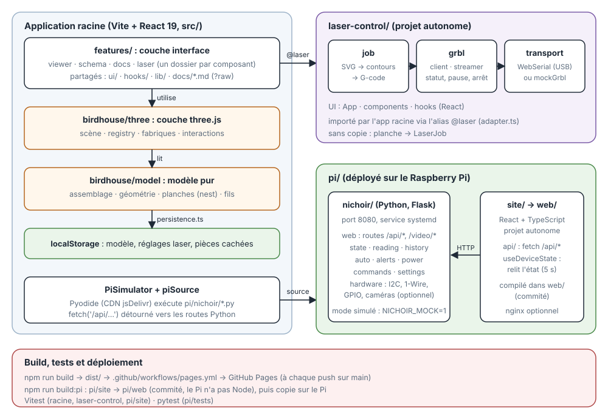

# Nichoir high tech

Un nichoir à mésanges isolé, dessiné en 3D dans le navigateur et découpé au laser dans du contreplaqué de 3 mm, avec son électronique : deux caméras, LED infrarouges, ventilateur silencieux sur cassette amovible (été / hiver), prise d'air basse, capteurs, le tout alimenté par un câble Ethernet PoE+ (splitter USB-C 5 V), piloté par un Raspberry Pi 5 et visible sur une page web.

[Application en ligne](https://mathieujullien77190.github.io/birds/)

## Ce que fait l'application

**Concevoir le nichoir**
- Un nichoir complet généré en 3D (Three.js) à partir de quelques curseurs : taille intérieure, hauteur et diamètre du trou d'envol. Option : 2ᵉ caméra.
- Montage sans soudure : cordons Dupont, borniers à vis, Wago 221 et prises d'origine ; voir la section « Montage sans soudure » du document « Dossier du nichoir ».
- Chaque pièce est une plaque de contreplaqué de 3 mm à crans qui s'emboîtent, avec isolant, habillage en lambris, toit, ventilateur amovible avec son conduit de sortie, prise d'air basse et fixation à l'arbre. L'électronique est modélisée aussi (Raspberry Pi, caméras, splitter PoE+, fils et nappes à leur vraie taille ; le switch PoE+ et le Pi serveur sont dessinés hors du nichoir).
- Vue 3D interactive : survol et sélection des pièces, liste « Pièces » (groupes, œil pour cacher, renommer, dupliquer), plan de coupe, tirer une face, trou par clic droit, historique avec « Retour ».
- Mode **jour / nuit** de la scène, et **schéma électronique** à côté de la 3D : survoler un fil ou un composant le met en surbrillance des deux côtés, clic sur un module pour sa fiche.

**Fabriquer**
- **Découpe laser** : toutes les plaques rangées automatiquement sur des planches de 400 × 400 mm (réglable), exportées en SVG.
- **Pilotage de la laser** (Sculpfun E1 Pro 21 W) depuis le navigateur : connexion USB, déplacements, cadre à vide, génération du G-code, planche d'essai, envoi avec pause et arrêt, et une machine simulée pour essayer sans rien brancher.

**Surveiller et commander le nichoir** (programme sur le Raspberry Pi, site React + TypeScript)
- Température et humidité du nid, température de l'extérieur (sonde DS18B20 étanche sous le débord du toit).
- Ventilateur de 60 mm manuel ou **automatique** (démarre quand le nid dépasse un seuil et qu'il fait plus chaud que dehors, réglable), mode hiver, alerte au-dessus de 35 °C, sécurités (capteur muet, ventilateur en panne).
- Consommation estimée selon ce qui est allumé (alimentation par câble PoE+).
- Deux caméras en direct avec LED infrarouges, chacune allumable et éteignable.
- **Simulateur** de ce site dans l'app (bouton « 🐍 Pi ») : le vrai programme Python tourne dans le navigateur, avec un terminal, des flux vidéo pris depuis les caméras de la 3D (noir et blanc infrarouge la nuit) et des essais de pannes.

**Comprendre**
- Documents intégrés (schéma électronique avec poids et prix par groupe, logiciel, laser) et explorateur du code du Pi : voir **Documentation** ci-dessous.

## Documentation

Cinq documents Markdown dans [`docs/`](docs/), lisibles aussi dans l'application (bouton « Dossier » de la barre du haut, collé au bouton « Schéma ») :

| Document | Contenu |
| --- | --- |
| [`docs/schema-electronique.md`](docs/schema-electronique.md) | **Dossier du nichoir** : schéma électronique général (branchements fil par fil, broches du Raspberry Pi), paramètres à respecter pour chaque composant, vérification des branchements, poids, prix par groupe (cases à cocher dans l'app), stratégie d'énergie. |
| [`docs/logiciel.md`](docs/logiciel.md) | **Logiciel** : programme Python sur le Pi (capteurs, ventilateur, LED, caméras), sécurités (alerte à 35 °C, capteur muet, ventilateur en panne), sonde de température extérieure, consommation estimée, page web React, simulateur et essais, service systemd, accès à distance. |
| [`docs/architecture-3d.md`](docs/architecture-3d.md) | **Architecture 3D** : modèle pur et couche Three.js, comment ajouter une pièce, libération des ressources, tests. |
| [`docs/checklist-changements.md`](docs/checklist-changements.md) | **Checklist** : quand je change X, quels fichiers mettre à jour et quelle commande vérifie. |
| [`docs/laser.md`](docs/laser.md) | **Pilotage de la laser** (Sculpfun E1 Pro 21 W, GRBL) : branchement USB, mise en place pas à pas, cadre à vide, réglages de coupe à calibrer, sécurité, convention d'axes. |

## Architecture



Trois projets : l'application racine (modèle pur → couche three.js → interface React), `laser-control/` (autonome, importé par l'app via l'alias `@laser`) et `pi/` (service Python Flask + site React compilé dans `pi/web`). Le simulateur fait tourner `pi/nichoir/` dans le navigateur avec Pyodide ; l'app est publiée sur GitHub Pages par le workflow `pages.yml`.

## Lancer en local

```sh
npm install
npm run dev        # http://localhost:5174
npm run typecheck
npm run build      # dist/
```

## Publier sur GitHub Pages

Le dépôt contient le workflow `.github/workflows/pages.yml` : à chaque push sur `main`, il construit l'application et la publie. Une seule fois, dans les réglages du dépôt sur GitHub : **Settings → Pages → Source : GitHub Actions**. L'adresse est alors `https://<utilisateur>.github.io/<dépôt>/` (les chemins de l'application sont relatifs, `base: './'` dans `vite.config.ts`).

## Dossiers

| Dossier | Rôle |
| --- | --- |
| `src/app/`, `src/features/` | L'application : `features/viewer` (vue 3D, interface, historique), `features/schema` (schéma à côté de la 3D), `features/docs` (documents, code), `features/laser` (découpe laser) ; `src/birdhouse/` garde le modèle du nichoir (`model.ts`), la géométrie Three (`three/`) et le simulateur du Pi.
| `src/ui/`, `src/hooks/`, `src/lib/` | Briques d'interface partagées (un dossier par brique), hooks et utilitaires communs. |
| `docs/` | Les documents Markdown affichés dans l'application. |
| `pi/` | Ce qui tourne sur le Raspberry Pi : programme Python (dossier `nichoir/`), site React + TypeScript (`pi/site/`, projet autonome, compilé dans `pi/web/`) et installation. |
| `public/models/` | Le modèle 3D du Raspberry Pi. |
| `laser-control/` | Logiciel autonome de pilotage de la laser (GRBL), exportable seul. |
| `archives/` | Anciens projets et outils, gardés pour mémoire. |

Le fichier `CLAUDE.md` décrit le modèle en détail (conventions, décisions, historique des choix).
