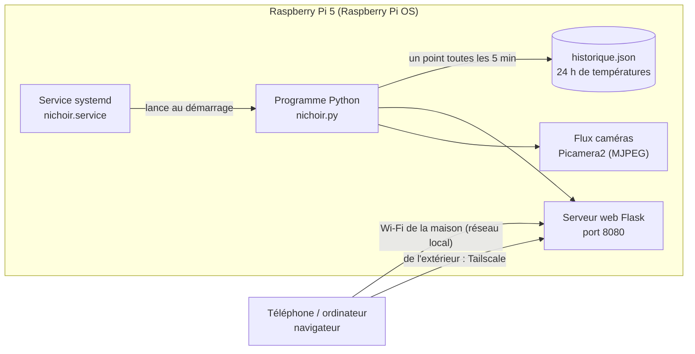

# Logiciel du nichoir

**Le programme de test est prêt dans le dossier `pi/` du dépôt** : `pi/nichoir.py` (capteurs, caméras, ventilateur, LED, page web), `pi/web/` (la page compilée) et `pi/site/` (ses sources : site React + TypeScript autonome, avec `ui/` pour les briques et `components/` pour les cartes : Nid (avec l'écart avec dehors), Dehors, Ventilateur (+ ventilation automatique), Batterie, Consommation, graphique des températures sur 24 h, Caméras ; `npm run build:pi` régénère `pi/web/`, sortie committée car le Pi n'a pas Node ; `pi/` = ce qui tourne sur le Raspberry, `src/` = l'app de conception et de simulation), `pi/nichoir.service`, `pi/requirements.txt` et un `pi/README.md` qui explique l'installation. Il lit les capteurs, montre les caméras, pilote le ventilateur et les LED, et **enregistre les températures** : juste de quoi vérifier que tout marche et mesurer.

Tout tourne sur le Raspberry Pi 5, dans le grenier du nichoir : un programme Python lit les capteurs, pilote le ventilateur et les LED et sert une page web. Rien n'est hébergé ailleurs : la page web est servie par le Pi lui-même, sur le Wi-Fi de la maison.

> **Le Peltier a été retiré (2026-10-11)** : trop faible en refroidissement. Il est remplacé par **un ventilateur silencieux de 60 mm** (Noctua NF-A6x25 PWM, 12 V, 4 fils) qui aspire l'air chaud du nid à travers le toit ; l'air frais entre par le trou d'envol Ø 28. Disparus avec lui : le pont en H, le filtre LC, la sonde du dissipateur et toute la régulation chaud / froid.

## Vue d'ensemble



## En quoi c'est programmé

- **Python 3**, déjà installé sur Raspberry Pi OS. C'est le langage le mieux outillé pour le Pi : chaque capteur a sa bibliothèque.
- Bibliothèques :
  - `gpiozero` + `lgpio` : PWM du ventilateur (GPIO18, 25 kHz visé, repli à 10 kHz), tachymètre (GPIO17), MOSFET des LED (GPIO23, GPIO24).
  - `smbus2` + `bme280` : capteur de température et d'humidité du nid (I2C) ; `pi-ina219` : batterie (facultatif).
  - `picamera2` : les deux caméras, flux MJPEG.
  - `flask` : la page web et son API.
  - Rien d'autre : l'historique est un simple fichier JSON, la météo vient d'`urllib`.

## Où il est et comment il se lance

- Le code vit dans `/home/pi/nichoir/` sur la carte microSD du Pi : `nichoir.py`, `web/` (la page), et deux fichiers créés tout seuls : `reglages.json` (réglages de la ventilation automatique) et `historique.json` (les températures).
- Il démarre tout seul à l'allumage grâce à un **service systemd** (`pi/nichoir.service`) : si le Pi redémarre après une panne de batterie, tout repart sans rien toucher.

```sh
sudo raspi-config          # Interface Options : activer I2C et les caméras
sudo apt install python3-picamera2 git
cd /home/pi/nichoir
python3 -m venv --system-site-packages venv
venv/bin/pip install -r requirements.txt
sudo cp nichoir.service /etc/systemd/system/
sudo systemctl enable --now nichoir
journalctl -u nichoir -f  # voir ce qu'il raconte
```

## Ce que fait le programme (boucle toutes les 5 secondes)

1. Lit le capteur du nid (température, humidité) et la vitesse réelle du ventilateur (tachymètre).
2. Lit la tension de la batterie (INA219, facultatif) et, toutes les 10 minutes, la météo extérieure.
3. Applique les **sécurités** (alerte de chaleur, panne du ventilateur, délestage de la batterie) et la **ventilation automatique** si elle est activée.
4. Ajoute un point à l'historique des températures (toutes les 5 minutes).
5. Sert la page web et les deux flux vidéo.

Les LED infrarouges et les caméras se commandent à la main depuis la page (pas d'horaire automatique pour l'instant).

## Le ventilateur
Un **Noctua NF-A6x25 PWM** (60 mm, 12 V, 4 fils) : Le **12 V positif passe par un interrupteur (MOSFET) commandé par GPIO27** (broche 13) ; **PWM sur GPIO18** (gpiozero / lgpio, 25 kHz visé, repli à 10 kHz) (broche 12) ; **tachymètre sur GPIO17** (broche 11, résistance de rappel interne, 2 impulsions par tour) ; masse commune broche 14. Débit visé ≈ 4 à 5 m³/h à bas régime. Il ne tourne que quand il fait chaud.

- **Arrêt = 12 V coupé.** Un Noctua PWM tourne encore à ~20 % à 0 % de rapport cyclique, donc « Arrêt » met le PWM à 0 puis coupe GPIO27. Pour démarrer : GPIO27 à haut d'abord, ~0,5 s d'attente (démarrage), puis le PWM. Le 12 V n'est jamais coupé quand une vitesse est demandée. GPIO27 est bas au démarrage et à l'arrêt du programme ; PWM à 0 quand le 12 V est coupé (le fil de commande n'alimente pas le ventilateur). `etat.ventilo.alimente` dit si le 12 V est présent ; la carte affiche « coupé (12 V) » sinon.
- **Vitesse minimale réelle : 30 %.** En dessous le ventilateur tourne mal : toute commande sous 30 % est un arrêt.
- Consommation : ≈ 0,6 W à 100 %, proportionnelle au **cube** de la vitesse (à 50 % : 0,08 W).
- Carte « Ventilateur » du site : vitesse en %, tr/min mesurés, qui commande (arrêt / à la main / automatique), boutons Arrêt et Marche, curseur de 30 à 100 %.
- **À valider sur le vrai matériel** : sur Pi 5, `gpiozero` passe par `lgpio`, dont le PWM serait limité à 10 kHz. Si 25 kHz est refusé le programme retombe sur 10 kHz et l'écrit sur la page (`ventilo_pwm`) ; piste de repli : le PWM matériel du noyau (`dtoverlay=pwm-2chan`).

## Ventilation automatique
Bouton « Ventilation automatique » dans la carte Ventilateur (désactivée au départ ; réglages et interrupteur gardés dans `reglages.json`). Les seuils portent sur la **température intérieure du nid** (le BME280). Tout est modifiable dans « Réglages ».

| Cas | Règle (valeur par défaut) |
| --- | --- |
| Démarrage | le nid dépasse **28 °C** ET (dehors inconnu OU le nid dépasse dehors d'au moins **2 °C**) |
| Vitesse | proportionnelle : de **30 %** (minimum) à **100 %** (maximum) sur **5 °C** au-dessus du seuil |
| Arrêt | le nid repasse sous **26 °C** (seuil − marge de 2 °C) OU le nid n'est plus plus chaud que dehors (nid ≤ dehors + 0,5 °C) |
| Alerte | si le nid dépasse **35 °C** (même automatique éteint) : message sur la page et notification [ntfy.sh](https://ntfy.sh) si `NICHOIR_NTFY_TOPIC` est réglé |

**Mode hiver.** Case à cocher dans la carte (clé `hiver`, gardée dans `reglages.json` ; l'ancienne clé `bouche` est encore lue) : en hiver on **retire à la main la cassette du ventilateur** (connecteur 4 broches), on pose à sa place **un bloc isolant** et on met **la sous-boîte isolante de la prise d'air du dessous**. Cochée, la ventilation automatique ne démarre jamais le ventilateur (raison « mode hiver : ventilateur retiré ») ; la commande manuelle reste possible, mais la carte avertit « mode hiver actif : le ventilateur est censé être retiré » si on le met en marche. La page rappelle de **remettre la cassette et d'ôter le bouchon au printemps**, puis de décocher.

**Sécurités.** Capteur du nid absent, muet ou valeur aberrante (hors −40 à 60 °C) : le ventilateur ne démarre pas (on ne sait pas s'il fait chaud) et l'état passe à « Arrêtée par sécurité » avec la raison. **Panne du ventilateur** : commandé à 30 % ou plus depuis plus de 10 s alors qu'il est alimenté (12 V présent) et que le tachymètre lit 0 tr/min (jamais quand il est coupé volontairement) : erreur affichée et notification (seulement si le tachymètre a déjà donné des impulsions, c'est-à-dire s'il est branché). **Le délestage de la batterie ne coupe jamais le ventilateur** : c'est la sécurité du nid. Une commande manuelle (Arrêt / Marche / curseur) désactive l'automatique ; désactiver l'automatique arrête le ventilateur qu'il pilotait.

**Adapté à notre montage.** Une seule sonde de température, dans le nid ; la température de dehors vient de la **météo en ligne** (Open-Meteo) : sans internet la condition « plus chaud que dehors » est ignorée et la page le signale. L'**INA219** (batterie) et le **tachymètre** sont facultatifs (sans tachymètre : pas de tr/min ni de détection de panne, avertissement affiché).

## Mesurer d'abord
Le programme **enregistre les températures avant de décider d'autre chose** : une saison de mesures (nid, dehors, humidité, vitesse du ventilateur) dira si le ventilateur suffit, s'il faut le régler autrement ou si une autre solution est nécessaire. Un point `{t, nid, ext, hum, ventilo}` est ajouté **toutes les 5 minutes** (5 secondes en mode simulé, pour que le graphique se remplisse), **288 points au plus (24 h)**. L'historique est écrit dans `historique.json` à côté du programme (au plus une fois par minute ; échec silencieux sans disque) et relu au démarrage : un redémarrage ne perd pas la courbe. Route `GET /api/historique` ; carte « Températures (24 h) » du site : graphique SVG (nid, dehors, vitesse du ventilateur en fond, échelle automatique). Pour garder plus de 24 h, copier `historique.json` de temps en temps.

## La page web : voir les capteurs

- Accès en **local** : depuis le Wi-Fi de la maison, avec l'adresse IP du Pi et le port 8080 (aucun nom à configurer).
- Ce qu'elle montre : température et humidité du nid avec l'écart avec dehors, la météo extérieure, le ventilateur et son automatique, la batterie, la consommation, le graphique des 24 h, les deux caméras en direct (flux MJPEG `/video/1` et `/video/2`) avec leur bouton marche / arrêt et celui de leurs LED infrarouges.
- La page se rafraîchit toute seule toutes les 5 secondes en lisant `/api/etat` et `/api/historique`.

Contenu de `/api/etat` : `t_nid`, `hum_nid`, `ventilo` (`pourcent`, `rpm`, `mode` arret / manuel / auto, `raison`), `led_nid`, `led_ext`, `cam1`, `cam2`, `batterie`, `conso`, `meteo`, `auto` (réglages + `etat` inactif / veille / ventile / securite, `raison`, `avertissements`), `erreurs`, `derniere_lecture`. Commandes : `POST /api/ventilo` (`{pourcent}` ou `{mode:"arret"}`), `/api/auto`, `/api/led`, `/api/camera`.

## Essayer sans matériel (mode simulé)
`NICHOIR_MOCK=1 python nichoir.py` sur un ordinateur : le programme invente des mesures plausibles (le nid suit dehors + un excès de ≈ 4 °C le jour et 2 °C la nuit, **réduit par le ventilateur jusqu'à −3 °C à 100 %**, avec de l'inertie ; humidité 60–80 %), accepte les commandes sans toucher de GPIO, simule le tachymètre (≈ 300 + 27 × vitesse tr/min) et sert deux flux vidéo animés. Un bandeau « MODE SIMULÉ » prévient sur la page.

Chaque caméra a son bouton marche / arrêt (route `/api/camera` : le flux est arrêté pour économiser l'énergie) et, juste à côté, le bouton de sa carte de LED infrarouges (nid pour la caméra 1, extérieures pour la 2).

## Météo extérieure
Le Pi lit la météo : `maj_meteo()` interroge l'API gratuite **Open-Meteo** (sans clé) toutes les 10 minutes avec `urllib` et ajoute `meteo` à `/api/etat` : température et humidité dehors, nuages (%), vent (km/h), jour / nuit, rayonnement solaire (W/m²). Sans réseau la page affiche l'erreur et tout le reste continue. **À régler : les coordonnées du nichoir** (`NICHOIR_LAT` / `NICHOIR_LON`, par défaut Dammarie-les-Lys : 48,51 N, 2,64 E). **La carte « Dehors » est la seule « sonde » extérieure** : elle sert de comparaison à la ventilation (n'aspirer que si l'air de dehors est plus frais) ; l'écart avec le nid s'affiche sur la carte « Nid ». En mode simulé la météo est inventée ; `NICHOIR_MOCK_METEO_REEL=1` interroge la vraie API depuis un PC.

## Niveau de la batterie et consommation
`/api/etat` donne `batterie` (pourcentage, tension, source) et `conso` (watts par élément et total). La **consommation est estimée** selon ce qui est allumé : Raspberry Pi 5,5 W (Pi 5 : ≈ 3 W au repos, ≈ 5 à 6 W avec deux flux caméra), 0,7 W par caméra allumée, 1,2 W par carte de LED infrarouges, ventilateur 0,6 W × (vitesse / 100)³. **Moyenne typique ≈ 6,9 W de jour (Pi + deux caméras) et ≈ 9,3 W la nuit avec les deux cartes de LED, + 0,6 W de ventilateur** à pleine vitesse (≈ 6,9 W avec les caméras seules, ventilateur arrêté) ; le bilan d'énergie chiffré est dans la « Stratégie d'énergie » du schéma électronique. Le **niveau** vient d'un module **INA219** (I2C 0x41, shunt 10 mΩ, `pi-ina219`) qui mesure la tension de la batterie, convertie en pourcentage par la courbe LiFePO4 (grossière sous charge) ; sans lui le niveau reste « — ». En mode simulé la batterie part à 80 %, se décharge de la consommation et se recharge de jour par le panneau solaire (jusqu'à ≈ 60 W) ; le simulateur de l'app propose ×1, ×10 et ×60 pour voir le niveau bouger plus vite.

**Délestage** : sous **20 %** un message d'économie d'énergie s'affiche (il n'y a plus rien de gourmand à couper) ; sous **10 %** les **caméras** et les LED infrarouges sont coupées (et refusées tant que la batterie reste sous 10 %). **Le ventilateur n'est jamais coupé.**

## Essais automatiques
Le menu « 🧪 Tests » du simulateur provoque chaque cas dans le Python simulé et vérifie la réaction (✔ TEST OK / ✘ TEST ÉCHEC dans le terminal) :

| Essai | Ce qu'on provoque | Réaction attendue |
| --- | --- | --- |
| Nid chaud | nid 33 °C, dehors 26 °C, automatique activé | le ventilateur démarre (> 30 %) |
| Nid frais | nid 20 °C, dehors 18 °C | ventilateur arrêté (veille) |
| Plus chaud dehors | nid 34 °C, dehors 36 °C | ventilateur arrêté, raison « dehors plus chaud » |
| Arrêt = 12 V coupé | « Arrêt » avec une panne de tachymètre simulée | `alimente` faux, 0 tr/min, aucune fausse panne |
| Mode hiver | nid chaud, automatique activé, case cochée | le ventilateur ne démarre pas |
| Ventilateur en panne | commandé à 60 %, tachymètre à 0 tr/min | erreur `ventilo` après 10 s |
| Capteur du nid en panne (automatique) | nid chaud mais BME280 muet | sécurité, ventilateur arrêté |
| Capteur du nid en panne | BME280 muet | la page affiche « — » et l'erreur |
| Alerte | nid 37 °C | alerte au-dessus de 35 °C |
| Batterie 8 % | batterie presque vide, LED allumées, nid chaud | caméras et LED coupées, **ventilateur toujours actif** |

« Tout remettre à zéro » retire les pannes, éteint ventilateur et LED, désactive l'automatique et remet la batterie à 80 %.

## Mode nuit
Le bouton « Jour / Nuit » de la vue 3D assombrit la scène (fond sombre, lumière de lune). Les caméras du simulateur voient cette scène : la nuit elles sont presque noires ; quand les LED infrarouges d'une caméra sont allumées, l'image devient **noir et blanc**, éclairée par ces LED et granuleuse. Caméra éteinte : écran noir « éteinte ». Le même bouton est dans l'en-tête du simulateur, à côté de « 🧪 Tests ».

## Simulateur dans l'app (bouton « 🐍 Pi »)
Le bouton « 🐍 Pi » en haut à droite de la vue 3D ouvre un écran qui simule le Pi **sans rien installer** : le vrai `nichoir.py` (mode simulé) est exécuté dans le navigateur par Pyodide (Python en WebAssembly, ≈ 10 Mo téléchargés à la première ouverture), la vraie page compilée `web/index.html` (+ `app.css`, `app.js`) s'affiche à gauche et un **terminal** à droite montre la sortie du programme comme `journalctl -u nichoir -f` (situation toutes les 10 lectures, démarrages et arrêts du ventilateur, sécurités, requêtes façon Flask). Les **flux vidéo sont la scène 3D vue depuis l'objectif des caméras** : caméra 1 dans le nid (niveaux de gris, comme la NoIR sous infrarouge), caméra 2 dehors (horizon redressé). Seul Flask est remplacé par une doublure : les routes (`/api/etat`, `/api/ventilo`, `/api/auto`, `/api/historique`, `/api/led`, `/api/camera`) sont appelées directement. Le graphique des 24 h se remplit toutes les 5 s.

## Hébergé où ?

- **Sur le Pi, et nulle part ailleurs.** Pas d'abonnement, pas de serveur extérieur, les données restent chez toi.
- **Depuis la maison** : n'importe quel navigateur sur le même Wi-Fi.
- **Depuis l'extérieur** : installer **Tailscale** sur le Pi et sur le téléphone (gratuit pour un usage perso), sans ouvrir de port sur la box.
- À éviter : ouvrir le port 8080 sur la box vers Internet (page sans mot de passe).

## Ce qu'il faut encore faire

- Brancher le ventilateur (et son interrupteur 12 V GPIO27) et **valider le PWM 25 kHz** sur le Pi 5 (voir plus haut), vérifier le tachymètre (2 impulsions par tour).
- Mesurer une saison de températures, puis décider des réglages (seuil, vitesses) ou d'autre chose.
- Prévoir une sauvegarde de la carte microSD une fois que tout marche.
- **Heure sans réseau** : le graphique des 24 h et le jour / nuit lisent l'horloge du Pi, qui n'en a pas de matérielle sans pile. Le Pi 5 a un connecteur de pile RTC : une pile rechargeable dédiée garde l'heure après une coupure (option, non comptée dans les prix).
- **Mesurer la consommation réelle** (INA219) : le programme compte 5,5 W pour le Pi 5 avec deux flux caméra (≈ 3 W au repos), une estimation.
