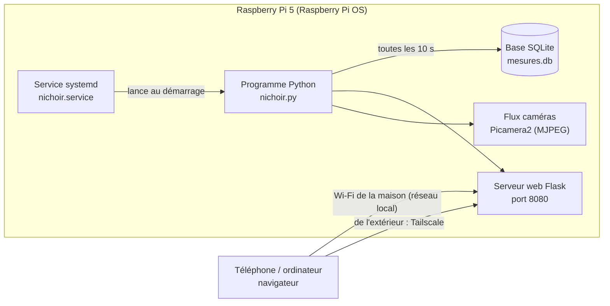

# Logiciel du nichoir

**Le programme de test est prêt dans le dossier `pi/` du dépôt** : `pi/nichoir.py` (capteurs, caméras, Peltier, LED, page web), `pi/web/` (la page compilée) et `pi/site/` (ses sources : site React + TypeScript autonome, avec `ui/` pour les briques et `components/` pour les cartes ; cartes Batterie (niveau, tension, Wh restants, solaire) et Consommation (watts par élément, autonomie estimée) lues dans `batterie` et `conso` de `/api/etat` ; `npm run build:pi` régénère `pi/web/`, sortie committée car le Pi n'a pas Node ; `pi/` = ce qui tourne sur le Raspberry, `src/` = l'app de conception et de simulation), `pi/nichoir.service`, `pi/requirements.txt` et un `pi/README.md` qui explique l'installation. Il lit les capteurs, montre les caméras et allume / éteint le Peltier et les LED : juste de quoi vérifier que tout marche. Ce qui suit décrit la version complète (régulation, historique).

Tout tourne sur le Raspberry Pi 5, dans le grenier du nichoir : un programme Python lit les capteurs, pilote le Peltier et les LED, enregistre les mesures et sert une page web. Rien n'est hébergé ailleurs : la page web est servie par le Pi lui-même, sur le Wi-Fi de la maison.

## Vue d'ensemble



## En quoi c'est programmé

- **Python 3**, déjà installé sur Raspberry Pi OS. C'est le langage le mieux outillé pour le Pi : chaque capteur a sa bibliothèque.
- Bibliothèques :
  - `gpiozero` + `lgpio` : PWM du pont en H (GPIO18), sens INA / INB (GPIO13, GPIO19), MOSFET des LED (GPIO23, GPIO24).
  - `smbus2` + `bme280` : capteur de température et d'humidité du nid (I2C).
  - `w1thermsensor` : sonde DS18B20 du dissipateur (1-Wire sur GPIO4).
  - `picamera2` : les deux caméras, flux MJPEG et photos.
  - `flask` : la page web et son API.
  - `sqlite3` (inclus) : l'historique des mesures.

## Où il est et comment il se lance

- Le code vit dans `/home/pi/nichoir/` sur la carte microSD du Pi : `nichoir.py` (le programme), `templates/index.html` (la page), `mesures.db` (créé tout seul).
- Il démarre tout seul à l'allumage grâce à un **service systemd** : si le Pi redémarre après une panne de batterie, tout repart sans rien toucher.

Fichier `/etc/systemd/system/nichoir.service` :

```ini
[Unit]
Description=Nichoir mésange (capteurs, Peltier, LED, page web)
After=network-online.target

[Service]
User=pi
WorkingDirectory=/home/pi/nichoir
ExecStart=/home/pi/nichoir/venv/bin/python nichoir.py
Restart=always
RestartSec=5

[Install]
WantedBy=multi-user.target
```

Mise en place, une seule fois, depuis un terminal sur le Pi (ou en SSH) :

```sh
sudo raspi-config          # Interface Options : activer I2C, 1-Wire, les caméras
sudo apt install python3-picamera2 python3-flask python3-smbus
cd /home/pi/nichoir
python3 -m venv --system-site-packages venv
venv/bin/pip install gpiozero lgpio smbus2 RPi.bme280 w1thermsensor
sudo cp nichoir.service /etc/systemd/system/
sudo systemctl enable --now nichoir
journalctl -u nichoir -f  # voir ce qu'il raconte
```

## Ce que fait le programme (boucle toutes les 10 secondes)

1. Lit le capteur du nid (température, humidité) et la sonde du dissipateur.
2. Lit la tension de la batterie (via le pont en H ou un petit diviseur sur un ADC).
3. Décide pour le Peltier :
   - cible : garder le nid à environ 5 °C de moins que dehors le jour, 5 °C de plus la nuit ;
   - sens du courant : INA / INB (froid ou chaud) ;
   - puissance : PWM faible, ajustée petit à petit (régulation proportionnelle, pas de tout-ou-rien) ;
   - **sécurités** : coupure si le dissipateur dépasse 55 °C (relance sous 40 °C), coupure si la batterie passe sous 12 V (relance au-dessus de 12,6 V).
4. Allume les LED infrarouges seulement la nuit (heure ou luminosité de la caméra).
5. Enregistre tout dans `mesures.db` (une ligne par passage).
6. Prend une photo de chaque caméra toutes les 10 minutes, garde 7 jours.

Squelette de `nichoir.py` :

```python
import time, sqlite3, threading
from gpiozero import PWMOutputDevice, DigitalOutputDevice
from w1thermsensor import W1ThermSensor
import smbus2, bme280
from flask import Flask, jsonify, render_template, Response
from picamera2 import Picamera2

pwm = PWMOutputDevice(18, frequency=20000)   # puissance du Peltier
ina, inb = DigitalOutputDevice(13), DigitalOutputDevice(19)  # sens
led_nid, led_ext = DigitalOutputDevice(23), DigitalOutputDevice(24)
sonde = W1ThermSensor()                       # DS18B20 sur le dissipateur
bus = smbus2.SMBus(1); cal = bme280.load_calibration_params(bus, 0x76)
etat = {"t_nid": None, "hum": None, "t_dissip": None, "v_bat": None, "peltier": 0.0, "mode": "arrêt"}

def peltier(sens, puissance):                 # sens : "froid", "chaud" ou "arrêt"
    ina.value, inb.value = (1, 0) if sens == "froid" else (0, 1) if sens == "chaud" else (0, 0)
    pwm.value = max(0.0, min(0.6, puissance))  # jamais plus de 60 % : batterie de 6 Ah

def boucle():
    db = sqlite3.connect("mesures.db")
    db.execute("create table if not exists mesures(t real, t_nid real, hum real, t_dissip real, v_bat real, peltier real, mode text)")
    while True:
        d = bme280.sample(bus, 0x76, cal)
        etat.update(t_nid=d.temperature, hum=d.humidity, t_dissip=sonde.get_temperature())
        # ... lecture de la tension batterie, calcul du mode et de la puissance, sécurités ...
        db.execute("insert into mesures values(?,?,?,?,?,?,?)", (time.time(), etat["t_nid"], etat["hum"], etat["t_dissip"], etat["v_bat"], etat["peltier"], etat["mode"]))
        db.commit()
        time.sleep(10)

app = Flask(__name__)
@app.route("/")
def index(): return render_template("index.html")
@app.route("/api/etat")
def api_etat(): return jsonify(etat)
@app.route("/api/historique")
def api_hist():
    rows = sqlite3.connect("mesures.db").execute("select * from mesures where t > ? order by t", (time.time() - 86400,)).fetchall()
    return jsonify(rows)

threading.Thread(target=boucle, daemon=True).start()
app.run(host="0.0.0.0", port=8080)
```

## La page web : voir les capteurs

- Accès en **local** : depuis le Wi-Fi de la maison, avec l'adresse IP du Pi et le port 8080 (aucun nom à configurer).
- Ce qu'elle montre :
  - les valeurs du moment : température et humidité du nid, température du dissipateur, tension de la batterie, état du Peltier (froid / chaud / arrêt, puissance), LED ;
  - un graphique des dernières 24 h (courbes tracées dans le navigateur depuis `/api/historique`) ;
  - les deux caméras en direct (flux MJPEG `/video/1` et `/video/2`) et les dernières photos ;
  - quelques boutons : forcer froid / chaud / arrêt, allumer les LED, prendre une photo.
- La page se rafraîchit toute seule toutes les 10 secondes en lisant `/api/etat`.

## Essayer sans matériel (mode simulé)
`NICHOIR_MOCK=1 python nichoir.py` sur un ordinateur : le programme invente des mesures plausibles (nid autour de 15 °C, dissipateur qui chauffe avec le Peltier, humidité 60–80 %), accepte les commandes sans toucher de GPIO et sert deux flux vidéo animés. `NICHOIR_MOCK_SURCHAUFFE=60` force le dissipateur à 60 °C pour voir la coupure de sécurité à 55 °C. Un bandeau « MODE SIMULÉ » prévient sur la page. Testé : lecture de l'état, commande du Peltier, coupure à 55,2 °C, LED, flux PNG.

Chaque caméra a son bouton marche / arrêt (route `/api/camera`, `camera(num, on)` : le flux est arrêté pour économiser l'énergie) et, juste à côté, le bouton de sa carte de LED infrarouges (nid pour la caméra 1, extérieures pour la 2).

## Météo extérieure
Oui, le Pi peut lire la météo : `maj_meteo()` interroge l'API gratuite **Open-Meteo** (sans clé, `api.open-meteo.com`) toutes les 10 minutes avec `urllib` (rien à installer) et ajoute `meteo` à `/api/etat` : température et humidité dehors, nuages (%), vent (km/h), jour / nuit, rayonnement solaire (W/m²). Il faut que le Pi ait internet (Wi-Fi) ; sans réseau la page affiche l'erreur et tout le reste continue. **À régler : les coordonnées du nichoir** (`NICHOIR_LAT` / `NICHOIR_LON` dans le service systemd, par défaut Dammarie-les-Lys : 48,51 N, 2,64 E). La carte « Dehors » du site montre ces valeurs et l'écart avec la température du nid. Utile plus tard : décider d'allumer le Peltier selon l'écart avec l'extérieur, ou prévoir la recharge solaire d'après les nuages. En mode simulé la météo est inventée (cohérente avec le jour, la nuit et les nuages de la simulation) ; `NICHOIR_MOCK_METEO_REEL=1` interroge la vraie API depuis un PC.

## Niveau de la batterie et consommation
`/api/etat` donne aussi `batterie` (pourcentage, tension, source) et `conso` (watts par élément et total). La **consommation est estimée** selon ce qui est allumé : Raspberry Pi 3,5 W, 0,7 W par caméra allumée, 1,2 W par carte de LED infrarouges, Peltier 72 W × (rapport cyclique)² (TEC1-12706 d'environ 2 Ω sous 12 V : ≈ 26 W à 60 %). Le **niveau** vient d'un module **INA219** (I2C 0x41, shunt 10 mΩ, bibliothèque `pi-ina219`) qui mesure la tension de la batterie, convertie en pourcentage par la courbe LiFePO4 (`COURBE_LIFEPO4`, grossière sous charge) ; sans ce module le niveau reste « — » (le module n'est pas encore dans le modèle 3D). En mode simulé la batterie part à 80 %, se décharge de la consommation et se recharge de jour par le panneau solaire (jusqu'à ≈ 60 W, le bouton Jour / Nuit de l'app impose le jour ou la nuit à la simulation ; sans lui c'est l'horloge), en **temps réel par défaut** : le simulateur de l'app propose ×1, ×10 et ×60 (`NICHOIR_MOCK_ACCEL`) pour voir le niveau bouger plus vite. Le panneau donne jusqu'à ≈ 60 W et varie avec des nuages (0,2 à 1 de la puissance) ; au-dessus de 90 % la charge ralentit comme avec un vrai régulateur.

## Sécurités et essais automatiques
Le programme coupe le Peltier dans quatre cas : dissipateur au-dessus de 55 °C, sonde du dissipateur qui ne répond plus (sans mesure, pas de Peltier), batterie sous 20 % (délestage : le Peltier est coupé et refusé ; sous 10 % les **caméras** et les LED infrarouges le sont aussi, et refusées tant que la batterie reste sous 10 %). Le capteur du nid en panne n'arrête rien : la page affiche « — » et l'erreur. Le menu « 🧪 Tests » du simulateur provoque chacun de ces cas dans le Python simulé et vérifie la réaction (✔ TEST OK / ✘ TEST ÉCHEC dans le terminal) ; « Tout remettre à zéro » retire les pannes.

## Mode nuit
Le bouton « Jour / Nuit » de la vue 3D assombrit la scène (fond sombre, lumière de lune). Les caméras du simulateur voient cette scène : la nuit elles sont presque noires ; quand les LED infrarouges d'une caméra sont allumées, l'image devient **noir et blanc**, éclairée par ces LED (lampe posée à l'objectif) et granuleuse. Caméra éteinte : écran noir « éteinte ». Le même bouton Jour / Nuit est dans l'en-tête du simulateur, à côté de « 🧪 Tests ».

## Simulateur dans l'app (bouton « 🐍 Pi »)
Le bouton « 🐍 Pi » en haut à droite de la vue 3D ouvre un écran qui simule le Pi **sans rien installer** : le vrai `nichoir.py` (mode simulé) est exécuté dans le navigateur par Pyodide (Python en WebAssembly, ≈ 10 Mo téléchargés à la première ouverture), la vraie page compilée `web/index.html` (+ `app.css`, `app.js`) s'affiche à gauche et un **terminal** à droite montre la sortie du programme comme `journalctl -u nichoir -f` sur le Pi (une ligne par lecture, commandes du Peltier et des LED, coupures de sécurité, requêtes façon Flask). Les **flux vidéo sont la scène 3D vue depuis l'objectif des caméras** : caméra 1 dans le nid (en niveaux de gris, comme la NoIR sous infrarouge), caméra 2 dehors (horizon redressé). Le bouton « 🔥 Surchauffe 60 °C » essaie la coupure à 55 °C. Seul Flask est remplacé par une doublure : les routes sont appelées directement.

## Hébergé où ?

- **Sur le Pi, et nulle part ailleurs.** Pas d'abonnement, pas de serveur extérieur, les données restent chez toi. Le Pi est allumé en permanence de toute façon.
- **Depuis la maison** : n'importe quel navigateur sur le même Wi-Fi.
- **Depuis l'extérieur** (au travail, en vacances) : installer **Tailscale** sur le Pi et sur le téléphone (gratuit pour un usage perso). Le nichoir apparaît alors comme s'il était sur le réseau local, sans ouvrir de port sur la box et sans exposer la page à Internet. L'alternative est un VPN WireGuard sur la box.
- À éviter : ouvrir le port 8080 sur la box vers Internet (page sans mot de passe, visible par tout le monde).

## Ce qu'il faut encore faire

- Écrire le vrai `nichoir.py` et la page `index.html` (les squelettes ci-dessus donnent la structure).
- Choisir comment lire la tension de la batterie : le VNH5019 ne la donne pas ; un petit ADC I2C (ADS1115, 5 €) avec un diviseur de tension suffit.
- Mesurer le rapport cyclique du Peltier nécessaire pour tenir 5 °C d'écart, avec le vrai matériel.
- Prévoir une sauvegarde de la carte microSD une fois que tout marche.
