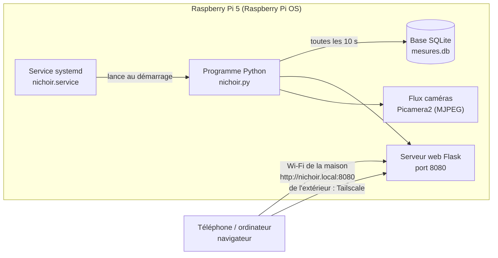

# Logiciel du nichoir

**Le programme de test est prêt dans le dossier `pi/` du dépôt** : `pi/nichoir.py` (capteurs, caméras, Peltier, LED, page web), `pi/web/` (la page), `pi/nichoir.service`, `pi/requirements.txt` et un `pi/README.md` qui explique l'installation. Il lit les capteurs, montre les caméras et allume / éteint le Peltier et les LED : juste de quoi vérifier que tout marche. Ce qui suit décrit la version complète (régulation, historique).

Tout tourne sur le Raspberry Pi 5, dans le grenier du nichoir : un programme Python lit les capteurs, pilote le Peltier et les LED, enregistre les mesures et sert une page web. Rien n'est hébergé ailleurs : la page web est servie par le Pi lui-même, sur le Wi-Fi de la maison.

## Vue d'ensemble



## En quoi c'est programmé

- **Python 3**, déjà installé sur Raspberry Pi OS. C'est le langage le mieux outillé pour le Pi : chaque capteur a sa bibliothèque.
- Bibliothèques :
  - `gpiozero` + `lgpio` : PWM du pont en H (GPIO18), sens INA / INB (GPIO13, GPIO19), MOSFET des LED (GPIO23, GPIO24).
  - `smbus2` + `bme280` : capteur de température et d'humidité du nid (I2C).
  - `w1thermsensor` : sonde DS18B20 du dissipateur (1-Wire sur GPIO4).
  - `picamera2` : les deux caméras, flux MJPEG et photos.
  - `flask` : la page web et son API.
  - `sqlite3` (inclus) : l'historique des mesures.

## Où il est et comment il se lance

- Le code vit dans `/home/pi/nichoir/` sur la carte microSD du Pi : `nichoir.py` (le programme), `templates/index.html` (la page), `mesures.db` (créé tout seul).
- Il démarre tout seul à l'allumage grâce à un **service systemd** : si le Pi redémarre après une panne de batterie, tout repart sans rien toucher.

Fichier `/etc/systemd/system/nichoir.service` :

```ini
[Unit]
Description=Nichoir mésange (capteurs, Peltier, LED, page web)
After=network-online.target

[Service]
User=pi
WorkingDirectory=/home/pi/nichoir
ExecStart=/home/pi/nichoir/venv/bin/python nichoir.py
Restart=always
RestartSec=5

[Install]
WantedBy=multi-user.target
```

Mise en place, une seule fois, depuis un terminal sur le Pi (ou en SSH) :

```sh
sudo raspi-config          # Interface Options : activer I2C, 1-Wire, les caméras
sudo apt install python3-picamera2 python3-flask python3-smbus
cd /home/pi/nichoir
python3 -m venv --system-site-packages venv
venv/bin/pip install gpiozero lgpio smbus2 RPi.bme280 w1thermsensor
sudo cp nichoir.service /etc/systemd/system/
sudo systemctl enable --now nichoir
journalctl -u nichoir -f  # voir ce qu'il raconte
```

## Ce que fait le programme (boucle toutes les 10 secondes)

1. Lit le capteur du nid (température, humidité) et la sonde du dissipateur.
2. Lit la tension de la batterie (via le pont en H ou un petit diviseur sur un ADC).
3. Décide pour le Peltier :
   - cible : garder le nid à environ 5 °C de moins que dehors le jour, 5 °C de plus la nuit ;
   - sens du courant : INA / INB (froid ou chaud) ;
   - puissance : PWM faible, ajustée petit à petit (régulation proportionnelle, pas de tout-ou-rien) ;
   - **sécurités** : coupure si le dissipateur dépasse 55 °C (relance sous 40 °C), coupure si la batterie passe sous 12 V (relance au-dessus de 12,6 V).
4. Allume les LED infrarouges seulement la nuit (heure ou luminosité de la caméra).
5. Enregistre tout dans `mesures.db` (une ligne par passage).
6. Prend une photo de chaque caméra toutes les 10 minutes, garde 7 jours.

Squelette de `nichoir.py` :

```python
import time, sqlite3, threading
from gpiozero import PWMOutputDevice, DigitalOutputDevice
from w1thermsensor import W1ThermSensor
import smbus2, bme280
from flask import Flask, jsonify, render_template, Response
from picamera2 import Picamera2

pwm = PWMOutputDevice(18, frequency=20000)   # puissance du Peltier
ina, inb = DigitalOutputDevice(13), DigitalOutputDevice(19)  # sens
led_nid, led_ext = DigitalOutputDevice(23), DigitalOutputDevice(24)
sonde = W1ThermSensor()                       # DS18B20 sur le dissipateur
bus = smbus2.SMBus(1); cal = bme280.load_calibration_params(bus, 0x76)
etat = {"t_nid": None, "hum": None, "t_dissip": None, "v_bat": None, "peltier": 0.0, "mode": "arrêt"}

def peltier(sens, puissance):                 # sens : "froid", "chaud" ou "arrêt"
    ina.value, inb.value = (1, 0) if sens == "froid" else (0, 1) if sens == "chaud" else (0, 0)
    pwm.value = max(0.0, min(0.6, puissance))  # jamais plus de 60 % : batterie de 6 Ah

def boucle():
    db = sqlite3.connect("mesures.db")
    db.execute("create table if not exists mesures(t real, t_nid real, hum real, t_dissip real, v_bat real, peltier real, mode text)")
    while True:
        d = bme280.sample(bus, 0x76, cal)
        etat.update(t_nid=d.temperature, hum=d.humidity, t_dissip=sonde.get_temperature())
        # ... lecture de la tension batterie, calcul du mode et de la puissance, sécurités ...
        db.execute("insert into mesures values(?,?,?,?,?,?,?)", (time.time(), etat["t_nid"], etat["hum"], etat["t_dissip"], etat["v_bat"], etat["peltier"], etat["mode"]))
        db.commit()
        time.sleep(10)

app = Flask(__name__)
@app.route("/")
def index(): return render_template("index.html")
@app.route("/api/etat")
def api_etat(): return jsonify(etat)
@app.route("/api/historique")
def api_hist():
    rows = sqlite3.connect("mesures.db").execute("select * from mesures where t > ? order by t", (time.time() - 86400,)).fetchall()
    return jsonify(rows)

threading.Thread(target=boucle, daemon=True).start()
app.run(host="0.0.0.0", port=8080)
```

## La page web : voir les capteurs

- Adresse sur le Wi-Fi de la maison : **http://nichoir.local:8080** (le Pi s'appelle `nichoir` dans `raspi-config`), ou son adresse IP.
- Ce qu'elle montre :
  - les valeurs du moment : température et humidité du nid, température du dissipateur, tension de la batterie, état du Peltier (froid / chaud / arrêt, puissance), LED ;
  - un graphique des dernières 24 h (courbes tracées dans le navigateur depuis `/api/historique`) ;
  - les deux caméras en direct (flux MJPEG `/video/1` et `/video/2`) et les dernières photos ;
  - quelques boutons : forcer froid / chaud / arrêt, allumer les LED, prendre une photo.
- La page se rafraîchit toute seule toutes les 10 secondes en lisant `/api/etat`.

## Hébergé où ?

- **Sur le Pi, et nulle part ailleurs.** Pas d'abonnement, pas de serveur extérieur, les données restent chez toi. Le Pi est allumé en permanence de toute façon.
- **Depuis la maison** : n'importe quel navigateur sur le même Wi-Fi.
- **Depuis l'extérieur** (au travail, en vacances) : installer **Tailscale** sur le Pi et sur le téléphone (gratuit pour un usage perso). Le nichoir apparaît alors comme s'il était sur le réseau local, sans ouvrir de port sur la box et sans exposer la page à Internet. L'alternative est un VPN WireGuard sur la box.
- À éviter : ouvrir le port 8080 sur la box vers Internet (page sans mot de passe, visible par tout le monde).

## Ce qu'il faut encore faire

- Écrire le vrai `nichoir.py` et la page `index.html` (les squelettes ci-dessus donnent la structure).
- Choisir comment lire la tension de la batterie : le VNH5019 ne la donne pas ; un petit ADC I2C (ADS1115, 5 €) avec un diviseur de tension suffit.
- Mesurer le rapport cyclique du Peltier nécessaire pour tenir 5 °C d'écart, avec le vrai matériel.
- Prévoir une sauvegarde de la carte microSD une fois que tout marche.
