# Dossier du nichoir isolé

Un panneau solaire de 100 W charge une batterie LiFePO4 12,8 V ; la batterie alimente un Raspberry Pi 5 (via un convertisseur 12 V → 5 V) et un ventilateur silencieux de 60 mm qui aspire l'air chaud du nid à travers le toit (l'entrée d'air est le trou d'envol et une prise d'air basse dans l'isolant). Le ventilateur ne tourne que quand il fait chaud : le Pi le pilote en PWM et peut couper son 12 V par un petit interrupteur. Une sonde de température étanche, sous le débord du toit, donne la température de dehors. Ce document décrit le montage tel qu'il est modélisé dans l'outil « Plaques » (groupe « Électronique »), puis donne, composant par composant, les paramètres à respecter.

## Schéma général

```mermaid
flowchart TB
  subgraph DEHORS["Dehors"]
    PV["Panneau solaire 100 W<br/>12 V nominal"]
    CAM2["Caméra 2 (dehors)<br/>Camera Module 3"]
    IR2["Carte 4 LED infrarouges<br/>extérieures"]
    SONDE["Sonde de température extérieure<br/>DS18B20 étanche, sous le débord du toit<br/>(module 3 broches dans le grenier)"]
  end
  subgraph SOUS["Sous le nichoir, protégé par le lambris"]
    MPPT["Régulateur de charge solaire<br/>compatible LiFePO4"]
    FUSE["Fusible"]
    BAT["Batterie LiFePO4 12,8 V 6 Ah<br/>4 cellules 32700 en série + BMS"]
  end
  subgraph TOIT["Électronique dans le grenier"]
    subgraph V12["Côté 12 V"]
      RAIL(("Rail 12 V<br/>Wago 221-413 (+) et 221-415 (−)"))
      BUCK["Convertisseur 12 V → 5 V 5 A<br/>sortie USB-C"]
      SWF["Interrupteur 12 V du ventilateur<br/>MOSFET côté +"]
      FAN["Ventilateur Noctua NF-A6x25 PWM<br/>60 mm, 12 V, cassette amovible"]
    end
    subgraph V33["Côté 5 V et 3,3 V (logique)"]
      PI["Raspberry Pi 5"]
      SW["Module 2 MOSFET<br/>LED on / off"]
    end
  end
  subgraph NID["Dans le nid (sous le plafond)"]
    CAM1["Caméra 1 (NoIR)"]
    IR["Carte 4 LED infrarouges"]
    SENS["Capteur température / humidité"]
  end
  PV -->|"câble 12 V"| MPPT
  MPPT -->|"2 fils courts sous le fond"| FUSE
  FUSE <-->|"charge le jour, alimente la nuit"| BAT
  FUSE -->|"2 fils (+ du fusible, − de la batterie)<br/>par la gaine Ø 16"| RAIL
  RAIL --> BUCK
  BUCK -->|"5 V USB-C"| PI
  RAIL -->|"12 V + / −"| SWF
  SWF -->|"12 V commuté (rallonge 4 broches)"| FAN
  RAIL -->|"12 V − (masse)"| FAN
  PI -->|"GPIO27 (broche 13) commande<br/>3,3 V"| SWF
  PI -->|"GPIO18 (broche 12) PWM 25 kHz visé (10 kHz si refusé)<br/>GPIO17 (broche 11) tachymètre<br/>masse broche 14"| FAN
  PI -->|"nappe CSI → CAM0"| CAM1
  PI -->|"longue nappe CSI → CAM1<br/>par le canal du toit en okoumé"| CAM2
  PI -->|"GPIO23 (broche 16) IN1<br/>GPIO24 (broche 18) IN2<br/>masse broche 6"| SW
  PI -->|"5 V broche 4"| IR
  PI -->|"5 V broche 2<br/>par le canal du toit"| IR2
  SW -->|"masse commutée OUT1"| IR
  SW -->|"masse commutée OUT2"| IR2
  PI -->|"I2C : 3,3 V broche 1, SDA 3, SCL 5, masse 9"| SENS
  PI -->|"1-Wire GPIO4 (broche 7)<br/>3,3 V broche 17, masse broche 20"| SONDE
  linkStyle 0 stroke:#111827,stroke-width:2.5px
  linkStyle 1 stroke:#dc2626,stroke-width:2.5px
  linkStyle 2 stroke:#dc2626,stroke-width:2.5px
  linkStyle 3 stroke:#dc2626,stroke-width:2.5px
  linkStyle 4 stroke:#dc2626,stroke-width:2.5px
  linkStyle 5 stroke:#dc2626,stroke-width:2.5px
  linkStyle 6 stroke:#dc2626,stroke-width:2.5px
  linkStyle 7 stroke:#dc2626,stroke-width:2.5px
  linkStyle 8 stroke:#111827,stroke-width:2.5px
  linkStyle 9 stroke:#f97316,stroke-width:2.5px
  linkStyle 10 stroke:#2563eb,stroke-width:2.5px
  linkStyle 11 stroke:#d97706,stroke-width:2.5px
  linkStyle 12 stroke:#d97706,stroke-width:2.5px
  linkStyle 13 stroke:#6b7280,stroke-width:2.5px
  linkStyle 14 stroke:#dc2626,stroke-width:2.5px
  linkStyle 15 stroke:#dc2626,stroke-width:2.5px
  linkStyle 16 stroke:#111827,stroke-width:2.5px
  linkStyle 17 stroke:#111827,stroke-width:2.5px
  linkStyle 18 stroke:#eab308,stroke-width:2.5px
  linkStyle 19 stroke:#eab308,stroke-width:2.5px
  style V12 fill:#fef2f2,stroke:#dc2626,stroke-width:2px
  style V33 fill:#eff6ff,stroke:#2563eb,stroke-width:2px
  classDef pv fill:#1e3a8a,stroke:#1c1917,color:#fff
  classDef mppt fill:#1d4ed8,stroke:#1c1917,color:#fff
  classDef fuse fill:#dc2626,stroke:#1c1917,color:#fff
  classDef bat fill:#047857,stroke:#1c1917,color:#fff
  classDef buck fill:#0e7490,stroke:#1c1917,color:#fff
  classDef pi fill:#15803d,stroke:#1c1917,color:#fff
  classDef sw fill:#1f2937,stroke:#1c1917,color:#fff
  classDef swf fill:#7e22ce,stroke:#1c1917,color:#fff
  classDef fan fill:#8b5a2b,stroke:#1c1917,color:#fff
  classDef cam fill:#166534,stroke:#1c1917,color:#fff
  classDef ir fill:#7f1d1d,stroke:#1c1917,color:#fff
  classDef sens fill:#1d4ed8,stroke:#1c1917,color:#fff
  classDef sonde fill:#475569,stroke:#1c1917,color:#fff
  class PV pv
  class MPPT mppt
  class FUSE fuse
  class BAT bat
  class BUCK buck
  class PI pi
  class SW sw
  class SWF swf
  class FAN fan
  class CAM1,CAM2 cam
  class IR,IR2 ir
  class SENS sens
  class SONDE sonde
```

Couleur des blocs = couleur des composants dans la 3D (panneau bleu nuit, régulateur bleu, fusible rouge, batterie verte, convertisseur bleu-vert, Pi vert, interrupteur violet, ventilateur brun, LED brun-rouge…). Couleur des traits = couleur des fils dans la 3D : rouge pour le + (12 V, 5 V), noir pour la masse et le câble du panneau, orange (violet-orangé) pour la commande de l'interrupteur, bleu pour le PWM du ventilateur, jaune pour l'I2C et le 1-Wire de la sonde de dehors, gris pour la commande des LED, orange foncé pour les nappes caméra.

## Branchements, fil par fil

| Liaison | De | Vers | Remarque |
| --- | --- | --- | --- |
| Câble 12 V | Panneau solaire | Régulateur de charge, sous le nichoir | Longe le sol et arrive sous le nichoir, à l'abri du lambris |
| Charge | Régulateur | Batterie, via le fusible | Tout se passe sous le nichoir, dans la jupe de l'habillage : le régulateur Victron (à l'avant droit), la batterie (à l'arrière gauche, à plat, tournée de 90°, tenue par quatre étriers) et le fusible (collé sous le fond, entre la batterie et le mur droit). Deux fils de 2,5 mm² (≈ 8 cm pour le + et ≈ 13 cm pour le −) relient les bornes batterie du régulateur, sur sa face est, au fusible (lame A, avec le + de la batterie) et à la borne − de la batterie. La charge ne passe pas par la lame B du fusible |
| Montée vers le toit | Fusible (lame B) et borne − de la batterie | Wago + et Wago −, sur le dessus du toit | Deux fils de 2,5 mm² montent dans une gaine de Ø 16 mm, dans l'isolant du coin arrière droit (à 5 mm du mur arrière et à 5 mm du mur de droite) : ils traversent le fond et le plancher intérieur par des trous de 16 mm, pile le diamètre de la gaine, puis la pièce en C, les trois planches du cadre, le dessous du toit, le fourreau de petits carrés empilés dans le toit et son dessus par des trous de Ø 18 mm (la gaine y passe tranquillement), et arrivent sur le dessus du toit (≈ 37 cm de fil pour le + et ≈ 49 cm pour le −). Le fusible protège la batterie et le câblage du rail |
| Rail 12 V | Fusible / batterie (par la gaine) | Convertisseur 12 → 5 V et ventilateur (par son interrupteur) | Fils rouge (+) et noir (−), répartis par un **Wago 221-413 à 3 entrées pour le +** (fusible, interrupteur du ventilateur, convertisseur) et un **Wago 221-415 à 5 entrées pour le −** (batterie, convertisseur, ventilateur, masse de l'interrupteur, une entrée de réserve), posés à droite de la sortie de la gaine : chaque fil a sa propre entrée |
| Alimentation du Pi | Convertisseur 12 → 5 V | Prise USB-C du Pi 5 | 5 V, 5 A recommandés pour le Pi 5 |
| Interrupteur du ventilateur | Wago + (12 V) ; Pi GPIO27 (broche 13) ; masse sur le Wago − | Entrée, commande 3,3 V et masse du module interrupteur 12 V (côté +) | Le Noctua ne s'arrête pas à 0 % de PWM (il tourne à environ 20 %) : on coupe son 12 V. Côté **+**, pas côté masse : une masse coupée ferait remonter jusqu'à 12 V dans les fils PWM et tachymètre vers les GPIO |
| 12 V du ventilateur | Sortie de l'interrupteur (+, rouge) ; Wago − (−, noir) | Prise 4 broches d'origine du ventilateur (sur le bord avant du couvercle de la cassette) + rallonge 4 broches (prise mâle collée sur la face avant du siège) | Fils de 1,6 mm de diamètre ; on débranche la prise à la main, une seule fois, avant de sortir la cassette ; aucune soudure |
| Commande du ventilateur | Pi GPIO18 (broche 12, PWM par gpiozero / lgpio : 25 kHz visé, repli à 10 kHz si le Pi le refuse), GPIO17 (broche 11, tachymètre), masse commune broche 14 | Fils PWM (bleu) et tachymètre (jaune) du Noctua, par la prise 4 broches d'origine et la rallonge | Le PWM est référencé à la masse du ventilateur : d'où le fil de masse commune vers la broche 14. Le tachymètre est collecteur ouvert : tirage interne du GPIO17 (pull-up logiciel) |
| Caméra 1 | Pi, port CSI CAM0 | Camera Module 3 NoIR, dans le nid | Courte nappe, passe par l'ouverture du toit |
| Caméra 2 | Pi, port CSI CAM1 | Caméra 2, dehors, sur sa plaque au-dessus du trou d'envol, au centre, sous le débord du toit en okoumé | Longue nappe, passe DANS le toit : par le canal oblong du pan (28 mm de large), entre ses deux plaques collées |
| LED infrarouges | Pi broche 4 (5 V) | Carte 4 LED IR | Masse par le module MOSFET (OUT1) : le Pi les allume ou les éteint |
| LED infrarouges extérieures | Pi broche 2 (5 V) | Carte 4 LED IR devant la caméra 2, sur la même plaque | Masse par le module MOSFET (OUT2) ; les fils suivent la nappe dans le même canal |
| Module MOSFET | Pi GPIO23 (broche 16), GPIO24 (broche 18), masse broche 6 | Module 2 canaux (MOSFET logique 3,3 V) | Coupe la masse de chaque carte de LED ; 5 V direct, courant des LED hors du GPIO |
| Capteur température / humidité | Pi broches 1 (3,3 V), 3 (SDA), 5 (SCL), 9 (masse) | Capteur dans le compartiment de la caméra, à fleur du plafond | Liaison I2C, 4 fils |
| Sonde de température extérieure | Pi : broche 17 (3,3 V), GPIO4 (broche 7, donnée 1-Wire), broche 20 (masse) | Module 3 broches DS18B20 (résistance de rappel de 4,7 kΩ), puis la sonde étanche par son câble de 3 conducteurs | Trois cordons Dupont du Pi au module ; le câble de la sonde (rouge 3,3 V, noir masse, jaune donnée) entre dans le toit par un canal oblong de 8 mm de la plaque crénelée du pan (fermé par la plaque pleine) et ressort dans le caisson, derrière la baguette gauche du couvercle. Le 1-Wire est activé par `dtoverlay=w1-gpio` dans `/boot/firmware/config.txt` |
| Prise d'air basse | — (pas d'électronique) | Conduit de contreplaqué dans l'isolant du mur gauche avant, fente dans la paroi intérieure à mi-hauteur | Section libre 10,9 cm² ; grille de bois sur la fente (la prise d'air reste toujours ouverte, sans clapet), ouverture de 26 × 6 mm au ras du plancher pour l'eau, sous-boîte isolante amovible par le dessous (lèvre de 11 mm sous le fond) |

**Fiche d'un fil dans l'application.** Un clic sur un fil (ou sur sa carte dans « Pièces ») de la vue 3D ouvre sa fiche : couleur, diamètre dessiné et section, longueur du trajet, longueur de cordon à prévoir, de → vers (broche et GPIO du Pi, borne, Wago), rôle, tension, courant, raccord. Les broches de cette fiche sont celles de ce tableau ; la longueur est calculée sur le trajet dessiné.

## Explication, bloc par bloc

**Production.**

- Le panneau de 100 W est déporté à environ 70 cm du nichoir, incliné de 35° vers l'avant, son bord bas près du sol.
- Son câble 12 V longe le sol et arrive sous le nichoir, où est le régulateur de charge, posé à plat sous le plancher.
- Le lambris descend de 50 mm sous le nichoir pour protéger le régulateur de la pluie ; le câble du panneau passe sous l'habillage, sans le percer.
- Il charge la batterie par deux fils courts : tout cela est sous le nichoir, dans la jupe de l'habillage.

**Stockage.**

- La batterie est un pack LiFePO4 12,8 V de 6 Ah : 4 cellules 32700 en série, environ 77 Wh.
- Ce chimisme est plus sûr que le lithium-ion classique, mais le régulateur doit avoir un profil de charge LiFePO4 et le pack doit avoir un BMS.
- La batterie est sous le nichoir, à plat, à l'arrière gauche et tournée de 90° : 128 mm le long de x (de −97 à +31 mm), 70 mm en y (de 20 à 90 mm), 32 mm de haut. Elle est tenue par quatre étriers en U de contreplaqué (« Étrier batterie 1 à 4 », tenons de 5 mm dans des fentes du fond), plaques debout à x = −88, −63, −38 et −17 mm.
- Elle est à plus de 25 mm du conduit d'air basse (sa sous-boîte se retire par le dessous) et à 5 mm de l'étrier du régulateur le plus proche ; elle est protégée du soleil par la jupe de l'habillage, qui descend de 50 mm sous le nichoir.
- Ses deux bornes regardent l'est (le régulateur) : le fusible est collé contre le dessous du fond, dans le couloir entre la batterie et le mur droit, à environ 3 cm de fil du + de la batterie.
- Deux fils de 2,5 mm² (+ du fusible, − de la batterie) montent dans une gaine électrique ICTA de Ø 16 mm (≈ 12 mm utiles, soit 113 mm²) : deux fils de Ø 3,6 mm en occupent 20 mm², 18 % de la section ; quatre fils au plus (36 %) resteraient raisonnables.

**Régulation.** Le régulateur de charge reçoit le panneau, charge la batterie et empêche la surcharge. Un fusible collé tout près de la batterie protège tout le reste : le + de la batterie et le + du régulateur arrivent sur sa lame A, la lame B part vers le rail 12 V.

**Cerveau.** Le Raspberry Pi 5 pilote tout le montage.

- Il est posé sur des entretoises de 6 mm dans le coin arrière gauche du toit, calé au montage par des morceaux de baguette de contreplaqué collés sur tous les côtés (voir « Cales »).
- Il pilote le ventilateur (PWM, tachymètre, interrupteur 12 V), lit le capteur du nid et la sonde de dehors, commande les deux caméras et allume les LED infrarouges.
- Ses prises USB (2 × USB 3 et 2 × USB 2) et sa prise Ethernet regardent la plaque arrière, percée d'une fenêtre de 60 × 35,5 mm en face d'elles (la même hauteur que la sortie du ventilateur) : on branche sans ouvrir le nichoir, en retirant au besoin la plaque de ventilation arrière de l'habillage. Son USB-C d'alimentation et ses deux micro-HDMI sont sur l'autre grand bord, tourné vers le centre du toit, hors de cette fenêtre. Le Pi 5 n'a pas de prise jack audio.
- Il lui faut un convertisseur 12 V → 5 V capable de fournir 5 A (le Pi 5 demande 5 V / 5 A en USB-C ; avec 3 A seulement, il limite le courant de ses ports USB).
- Ses deux ports caméra sont des connecteurs de 22 broches côte à côte sur le bord tourné vers le centre du toit ; les caméras (nappes de 15 broches) s'y branchent par des nappes adaptatrices 22 → 15 broches.
- Il possède un connecteur de pile RTC : une pile rechargeable dédiée garde l'heure sans réseau (option, voir « Points à vérifier »).

**Température de dehors.** Une sonde DS18B20 étanche mesure l'air extérieur ; aucun service en ligne n'intervient.

- **Position** : sur le côté gauche, sous le débord de 30 mm du toit, collée contre le dessous du pan en okoumé, à y = +42 mm (vers l'arrière). Elle est à l'ombre, à 129 mm du ventilateur et de sa sortie (arrière droit), à 176 mm de la caméra 2 et de ses LED infrarouges (avant gauche) et à 191 mm du régulateur solaire (sous le nichoir, à droite).
- **Passage du câble** : il passe dans le toit, comme la nappe de la caméra 2. Un canal oblong de 8 mm de large et 37 mm de long (bouts ronds) est percé dans la plaque crénelée du pan en okoumé, de l'à-plomb du bout de la sonde (x = −121 mm) jusque dans le caisson (x = −84 mm), 15 mm derrière la baguette gauche du couvercle ; la plaque pleine le ferme. Le câble sort du bout de la sonde, monte dans le canal, circule entre les deux plaques à 2,5 mm du dessous du pan, passe au-dessus du chant de la baguette gauche et ressort dans le caisson ; il n'y a aucun trou dans la lame d'habillage gauche ni dans la plaque gauche du toit.
- **Baguette gauche** : elle n'a pas de dent dans le canal ni à 3 mm de chaque côté (une dent sur six omise) ; ligaments de bois autour du canal : 14 mm au moins, contre 3 mm exigés.
- **Module** : le câble de 3 conducteurs finit dans un module 3 broches (résistance de rappel de 4,7 kΩ) posé sur le dessus du toit, devant le Pi, contre le mur gauche. Trois cordons Dupont le relient au Pi : 3,3 V (broche 17), donnée sur GPIO4 (broche 7), masse (broche 20).
- **Lecture** : le noyau lit la sonde par le 1-Wire dans `/sys/bus/w1/devices/28-*/w1_slave`. Le programme refuse un CRC mauvais, la valeur d'erreur 85,0 °C du DS18B20 et toute valeur hors −40 à 60 °C.
- **Ventilation automatique** : la comparaison nid / dehors utilise cette mesure. Sans mesure valable de dehors (sonde absente, muette ou hors plage), l'automatique ne démarre pas, la page l'indique (état « sécurité », avertissement) ; l'alerte à 35 °C du nid ne dépend pas de la sonde.

**Cales.** Le Pi, le convertisseur et l'interrupteur du ventilateur se calent avec des morceaux de baguette (14 morceaux, 396 mm en tout).

- Le groupe « Baguettes de cale (à couper) » contient **4 baguettes** de contreplaqué de 3 mm : 384 mm de long (la plus grande longueur qui tient sur une planche de 410 × 400 mm comme sur une planche de 400 × 400 mm, avec 8 mm de marge) et 5 mm de large, soit le triple du besoin pour garder de la marge.
- Elles sont découpées au laser avec le reste du contreplaqué (elles se rangent dans les creux des planches) et posées dans la 3D au sol, à gauche des pièces d'hiver, hors du nichoir.
- Posée à plat, une baguette fait 3 mm de haut et 5 mm de large.
- **Mode d'emploi : au montage, on coupe un morceau de baguette à la longueur voulue et on le colle contre le composant, une fois celui-ci posé à sa place.**

**Baguettes du dessus du toit.** Le dessus du toit (« Dessus toit ») repose sur cinq **baguettes de contreplaqué de 3 mm découpées au laser** (« Baguette dessus toit gauche / droite / avant / arrière 1 et 2 », groupe « Toit »).

- Elles sont posées **à plat** juste sous le dessus, contre la face intérieure des quatre plaques du toit.
- Chaque baguette a un corps de 5 mm de large (la surface d'appui) plus des **dents de 3 mm** (en nombre impair, d'environ 16 mm ; aux deux bouts, un bout de corps sans dent).
- Les dents traversent des fentes de 3 mm percées dans la plaque du toit qui porte la baguette (« Face avant toit », « Face arrière toit », « Côté gauche toit », « Côté droit toit ») : elles s'emboîtent comme les autres crénelages.
- La baguette arrière est en deux morceaux : elle contourne le siège du ventilateur.
- Le dessus des baguettes affleure le dessous du dessus du toit ; chaque baguette fait 3 mm de haut (l'épaisseur du contreplaqué) sur 5 mm de large.
- Ligaments de bois autour des fentes : 4,5 mm ou plus.

**Corps, isolant et cadre.** Le corps est fait de huit parois de contreplaqué 3 mm : quatre extérieures (« Face avant ext », « Face arrière ext », « Côté gauche ext », « Côté droit ext ») hautes de 227 mm et quatre intérieures (« … int ») hautes de 185 mm, dont le haut est au niveau du dessous du toit.

- **Isolant** : de la fibre de bois de 39 mm remplit la couronne entre les murs extérieurs et intérieurs ; elle s'arrête 12 mm sous le haut des parois, sous la pièce en C.
- **Plaques qui cachent l'isolant autour du bloc d'entrée** : trois plaques de contreplaqué 3 mm (groupe « Corps ») bordent le puits du bloc d'entrée, côté gauche et côté droit (COR-16, deux plaques identiques, debout) et en dessous (COR-17, à plat). Elles sont crénelées aux deux bouts (dents impaires d'environ 16 mm) : leurs dents entrent dans des fentes de « Face avant ext » (COR-04) et de « Face avant int » (COR-10) du nid, le plat des bouts est collé contre ces deux parois, et le haut des plaques debout est collé à plat sous la pièce en C (COR-15), alignées sur les flancs de son ouverture, sans y entrer ; l'isolant avant gauche, avant droite et sous le bloc s'arrête contre elles.
- **Pièce en C crénelée** : plaque de contreplaqué 3 mm (« Pièce en C sous le cadre », groupe « Corps ») posée à plat dans la couronne d'isolant, sous le cadre ; elle n'a pas de tasseau : ses dents (≈ 16 mm, une sur deux, bouts pleins) s'encastrent directement dans des fentes des huit parois, les quatre extérieures par ses bords extérieurs et les quatre du nid par les bords de son trou. Elle revient vers l'entrée des deux côtés : devant, elle ne laisse que l'ouverture du bloc d'entrée (60 mm + 1 mm de jeu de chaque côté), qui reste enlevable par le haut. Elle enferme l'isolant ; la gaine la traverse (trou de Ø 18 mm).
- **Cadre** : trois planches de contreplaqué collées (« Cadre toit haut / milieu / bas », 9 mm, groupe « Toit »), posées pile sur la pièce en C, ferment la couronne par le haut, à fleur du chant des parois ; leur ouverture, en U, est ouverte vers l'avant sur toute la largeur du nid.
- **Plaque de ventilation arrière** : plaque d'okoumé de 5 mm (groupe « Habillage », peinte avec lui) qui remplit l'ouverture de l'habillage arrière, jeu 0 ; vue de derrière, à gauche la grille de la sortie du ventilateur (7 fentes de 4 mm, la même que celle de la plaque arrière du toit), à droite celle du Raspberry Pi (10 fentes de 4 mm devant sa fenêtre). Quatre trous de Ø 2,2 mm, un à chaque coin, la traversent et traversent la plaque arrière du toit : on y enfonce quatre cure-dents, avec un peu de colle, coupés à ras.
- **Lame d'entrée non collée** : la lame de l'habillage avant qui porte le trou d'envol (« Lambris avant 3 (percé) ») ne se colle pas : quatre trous de Ø 2,2 mm à ses coins, repris dans la paroi derrière elle (deux dans « Face avant ext », deux dans « Face avant toit »), reçoivent quatre cure-dents (« Cure-dent lame d'entrée 1 à 4 », 10 mm) ; on la retire en les tirant ou en les coupant.
- **Cure-dents de positionnement de l'habillage** : deux trous de cure-dent de Ø 2,2 mm par lame (hors la lame d'entrée, qui a les siens), à 6 mm au-dessus du bas du corps, à la hauteur des deux cure-dents du bas de la lame d'entrée, sur tout le tour du nichoir. Les mêmes trous sont percés dans « Face avant ext », « Face arrière ext », « Côté droit ext » et « Côté gauche ext » (cure-dents « Cure-dent habillage 1 à 38 », cylindres de Ø 2 × 10 mm : 5 mm de lame, 3 mm de paroi, 2 mm derrière). C'est le système qui positionne parfaitement chaque lame de l'habillage (même hauteur, bon écartement, rien à mesurer au collage). On les plante dans la paroi avant de coller : chaque lame s'enfile dessus et se place exactement. Pour les lames d'angle, qui dépassent la paroi, le cure-dent est ramené à 9 mm du bord de la paroi.
- **Toit** : le dessous du toit repose directement sur le chant des huit parois ; le haut du bloc d'entrée affleure ce chant (227 mm). **Fourreau de la gaine dans le toit** : 13 carrés de 26 mm (« Fourreau gaine toit 1 à 13 »), percés de Ø 18 mm, empilés et collés entre le dessous et le dessus du toit : l'isolant du toit est découpé autour. **Siège du ventilateur** : les trois parois de la goulotte sont dans le groupe « Toit » (la cassette et le reste de la ventilation gardent le groupe « Ventilation »).

**Pièces fines de rechange.** Chaque plaque de contreplaqué fine a 3 exemplaires de rechange.

- **Seuil** : plus petit côté ou largeur moyenne (2 × aire / périmètre du contour) d'au plus 12 mm. Cela couvre les baguettes du couvercle et du dessus du toit, les poignées en U, les étriers du régulateur et de la batterie, les clavettes de la fixation à l'arbre et les plaques du conduit de sortie.
- Le groupe « Pièces fines de rechange » contient **3 exemplaires identiques** (« … (rechange 1) » à « (rechange 3) »), posés à plat sur le sol, à gauche du nichoir et derrière les pièces d'hiver et les baguettes de cale.
- Ils sont découpés au laser avec le reste et portent **le même numéro que l'original**.
- Les baguettes de cale (déjà en triple) et les composants achetés n'ont pas de rechange.
- Ils ne demandent pas de planche de plus (ils se rangent dans les creux des planches).

**Ventilation.** Un ventilateur silencieux de 60 mm (Noctua NF-A6x25 PWM) aspire l'air chaud du nid à travers le plafond et le rejette à l'arrière, sous le débord du toit en okoumé ; l'air frais entre par le trou d'envol et par une prise d'air basse dans l'isolant (voir la fiche « Prise d'air basse »).

- **Cassette** : le ventilateur n'est pas dans la zone de l'électronique ; il tourne dans une cassette amovible à la main (quatre parois de contreplaqué, un cadre, un couvercle à poignée, le ventilateur posé sur quatre plots en caoutchouc).
- **Siège** : la cassette se pose par gravité dans un siège fixe collé sur le plancher du toit (la goulotte : trois parois, dont les deux latérales vont jusqu'à la plaque arrière du toit, qui fait la quatrième). La paroi avant (largeur extérieure du siège) et les deux côtés s'emboîtent par leurs arêtes verticales, comme les parois d'une boîte : 7 dents de 13 mm environ, paroi avant en phase 0 et côtés en phase 1, ce qui forme un U d'un seul bloc ; aucune dent à l'arrière, côté plaque arrière du toit, ni en haut. L'intérieur du siège est celui de la cassette, à jeu nul. Le siège est à 1 cm du bloc de la caméra.
- **Sortie** : la cassette a une fenêtre de sortie en face de celle de la plaque arrière. Un petit conduit de sortie de 10,6 mm de long (quatre plaques de contreplaqué), fixé à la cassette par crénelage (deux dents sur chacune de ses quatre plaques, dans la paroi arrière de la cassette), sort avec elle et la relie à la plaque ; il s'appuie sur la plaque, sans joint.
- **Grille** : la grille de sortie est percée dans la plaque arrière du toit (fentes verticales de 4 mm) ; rien ne dépasse derrière.
- **Ouverture du plafond** : elle reste ouverte quand le ventilateur est arrêté (sans clapet) ; par temps froid on pose le bloc isolant à la place de la cassette.
- **Branchement** : le câble d'origine du ventilateur finit par sa prise 4 broches femelle, sur le bord avant du couvercle. La prise mâle de la rallonge 4 broches (12 V commuté, masse, PWM, tachymètre) est collée sur la face avant du siège et la femelle s'y emboîte à la verticale : on la débranche à la main avant de sortir la cassette, sans soudure. Les fils de la rallonge contournent le siège.

**Brancher le ventilateur : quoi sur quoi.** Le câble vendu avec le Noctua est un seul câble noir gainé (quatre fils dedans) : la 3D le dessine en noir, sans couleur à suivre. On branche par le **numéro de broche de la prise 4 broches** (brochage standard des ventilateurs PWM : à confirmer sur la fiche Noctua avant de brancher) :

| Broche de la prise | Fonction | Fil du toit qui s'y branche | Arrivée |
| --- | --- | --- | --- |
| 1 | masse (GND) | « Fil ventilateur − » et « Fil masse commune ventilateur » (deux fils sur cette broche) | Wago −, et broche 14 du Pi (GND) |
| 2 | +12 V | « Fil interrupteur → ventilateur + » | sortie de l'interrupteur 12 V (jamais directement sur le rail) |
| 3 | tachymètre | « Fil tachymètre ventilateur » | broche 11 du Pi (GPIO17) |
| 4 | PWM | « Fil PWM ventilateur » | broche 12 du Pi (GPIO18) |

Les prises sont détrompées : la rallonge ne s'enfiche que dans le bon sens sur la prise du ventilateur. Le +12 V ne doit jamais toucher le tachymètre ni le PWM : ils vont sur des GPIO du Pi, qui ne tolèrent que 3,3 V.

- **Pilotage** : le Pi allume le ventilateur seulement quand il fait chaud, règle sa vitesse par PWM et peut couper son 12 V avec l'interrupteur (le Noctua tourne encore à environ 20 % à 0 % de PWM).
- **Toit** : il tient seul, posé sur le chant des parois du corps, calé par le cadre qui descend dans l'isolant et retenu par l'habillage collé au corps ; pour accéder au grenier, on soulève le toit en okoumé.

**Été / hiver, en 4 lignes**

1. Retirer le toit en okoumé (on accède au grenier).
2. Débrancher à la main la prise 4 broches (la femelle de la cassette, sur la prise mâle collée à l'avant du siège) et sortir la cassette par le haut.
3. Poser à sa place le bloc isolant d'hiver (même empreinte, mousse de 35 mm : il rend au plafond son isolation).
4. L'été, faire l'inverse et rebrancher la rallonge.

*Cassette qui passe mal* : elle est taillée pile (jeu 0) dans son siège. Si elle coince, la poncer légèrement (papier de verre grain 120 puis 180) sur les faces qui frottent, jusqu'à ce qu'elle coulisse sans forcer ; ne jamais la forcer au maillet.

**Couvercle.** Le groupe « Couvercle » réunit le toit en okoumé et quatre baguettes.

- **Toit** : deux plaques de contreplaqué okoumé de 5 mm collées l'une sur l'autre (**10 mm** en tout), non peintes, saturées au saturateur teck mat (voir « Finition du bois »).
- **Emprise** : 270 × 303 mm ; il déborde de 60 mm devant et de 30 mm sur les côtés et derrière ; pente de 8°. Il se découpe au laser sur « Planche okoumé 5 mm » avec les lames de l'habillage : les 22 lames et les 2 plaques (0,47 m² de pièces) tiennent sur 4 carreaux de 400 × 400 mm si la marge de bord de la découpe est réglée à 4 mm ; les lames les plus longues mesurent 386 mm, donc avec la marge de 8 mm par défaut un carreau de 400 mm ne suffit pas (la planche de 410 × 400 mm convient).
- **Plaque du dessous** (« Toit en okoumé (plaque crénelée) ») : elle reçoit les quatre baguettes de contreplaqué 3 mm (« Baguette couvercle avant / arrière / gauche / droite »), une par côté de l'ouverture du caisson, collées sous le pan. Elles entrent exactement dans le caisson (longueur = intérieur du caisson, mesurée dans le plan incliné, jeu 0) : le couvercle se centre tout seul.
- **Baguettes** : corps de 10 mm sous le pan et **dents de 5 mm**, d'environ 16 mm de large, qui s'enfoncent dans des fentes de la plaque crénelée (dent + 0 de jeu) et affleurent son dessus.
- **Plaque du dessus** (« Toit en okoumé (plaque pleine) », sans trou ni fente) : elle se colle à plat par-dessus, cache toutes les fentes et rend le toit étanche.
- **Montage** : enfiler les dents dans les fentes, coller les baguettes, puis coller la plaque pleine ; saturer l'ensemble assemblé (2 couches : faces visibles, chants, dessous ; les surfaces collées ne sont pas atteintes) avant la pose.
- **Canal de la caméra 2** : un seul grand trou oblong (28 mm de large, bouts arrondis) dans la plaque crénelée ; la plaque pleine le ferme, c'est un conduit DANS le toit. La baguette avant n'a pas de dents à cet endroit (3 mm de bois de chaque côté).
- **Découpe** : les baguettes sont découpées sur le contreplaqué 3 mm (déjà compté), le pan sur l'okoumé ; tout est caché par défaut dans « Pièces ».
- **Fils du ventilateur** : « commande interrupteur » et « masse commune » longent le mur arrière à 2 mm sous la pente ; celui de la commande est à 6,5 mm de la plaque arrière pour ne pas toucher la baguette arrière, qui descend de 10 mm sous le pan.

**Vision.** (Habillage : contreplaqué okoumé extérieur de 5 mm peint en blanc, découpé au laser sur ses propres planches, « Planche okoumé 5 mm ».)

- **Caméra 1** : elle regarde dans le nid, éclairée par 4 LED infrarouges.
- **Caméra 2** : dehors, pile au-dessus du trou d'envol, au centre de la façade, sous le débord du toit en okoumé, regardant droit vers le bas. Une seconde carte de 4 LED infrarouges, devant elle, éclaire la zone la nuit.
- **Plaque de la caméra extérieure (« Plaque caméra extérieure »)** : plaque de contreplaqué 3 mm, horizontale et perpendiculaire à la façade, au centre, à 18 mm au-dessus du haut du corps (au-dessus du trou d'envol). Elle fait la largeur de la lame d'entrée (44 mm) et dépasse de 42 mm devant l'habillage, sous le débord du toit. Elle est trouée : un trou de Ø 10 pour l'objectif de la caméra et une fenêtre de 20 × 10 pour les LED, la caméra et la carte de LED posées dessus avec l'objectif et les LED à fleur du dessous. Elle est crénelée à l'arrière (5 segments, deux dents) dans « Face avant toit » (T-04) et traverse l'habillage par une fenêtre pleine largeur de la lame d'entrée : la lame d'entrée est donc coupée en deux morceaux (le bas avec le trou d'envol, le haut), tenus chacun par deux cure-dents ; les deux du haut sont descendus de 10 mm.
- **Montage de la caméra 2** : sans boîte, sur sa plaque ; l'objectif et les LED regardent droit vers le bas ; la nappe et les fils passent par le canal du pan.
- **Nappe** : la longue nappe part du Pi, passe au-dessus de tout, monte dans le **canal du toit** (le grand trou oblong de la plaque crénelée, fermé par la plaque pleine) par son bout arrière, juste derrière la plaque avant, court dans le canal et en ressort par son bout avant, dans le débord, à l'aplomb de la caméra, puis pend jusqu'au connecteur de la caméra.
- **Fils des LED** : à gauche de la nappe, ils suivent le même chemin. La plaque avant du toit et le lambris n'ont ni fente ni fenêtre pour elle.
- **À fleur du bois** : la caméra 1, les LED infrarouges du nid et la puce du capteur ont leur carte contre la face intérieure ; l'objectif, les LED et la puce traversent leur trou et leur bout affleure la face extérieure (écart < 0,1 mm, jeu ≥ 0,4 mm autour de chaque corps).

## Paramètres à respecter, composant par composant

Les valeurs viennent de fiches de revendeurs et de constructeurs (liens en bas) ; la dernière ligne de chaque tableau donne le modèle exact à acheter, avec son lien. Les cases « à déterminer » dépendent du matériel exact que tu achèteras. Vérifie toujours la fiche du modèle choisi.

### Panneau solaire 100 W

| Paramètre | Valeur à viser | Dans le modèle |
| --- | --- | --- |
| Type | 12 V nominal, monocristallin, cadre alu | Oui |
| Puissance | 100 W | 100 W |
| Tension à puissance max (Vmp) | 17 V (fiche AST100-17M) | — |
| Courant à puissance max (Imp) | 5,8 A (fiche AST100-17M) | — |
| Tension à vide (Voc) | 20,5 V (fiche AST100-17M) : reste sous la limite d'entrée du régulateur | — |
| Courant de court-circuit (Isc) | 6,2 A (fiche AST100-17M) | — |
| Température nominale des cellules (NOCT) | 45 ± 2 °C | — |
| Dimensions et poids | 970 × 585 × 30 mm, 8 kg (fiche AST100-17M) | 970 × 585 × 30 mm |
| Connecteurs et câble | MC4, 2 fils de 4 mm² environ, boîte de jonction étanche | câble Ø 7 mm |
| Modèle exact / lien | [Panneau 100 Wc monocristallin AST100-17M, 970 × 585 × 30 mm (Wattuneed)](https://www.wattuneed.com/fr/panneaux-solaires/8120-panneau-solaire-12v-100wc-monocristallin-0712971138629.html) | — |

### Régulateur de charge solaire

| Paramètre | Valeur à viser | Dans le modèle |
| --- | --- | --- |
| Tension batterie | 12 V | 12 V |
| Profil de charge | LiFePO4 obligatoire (fin de charge 14,2 à 14,6 V pour 4 cellules) | — |
| Courant | au moins 10 A (le panneau donne environ 6 A) | 10 A (Victron SmartSolar 75/10) |
| Tension d'entrée maximale | au moins 25 V, mieux 30 V ou plus | 75 V |
| Type | MPPT (meilleur rendement) ou PWM (moins cher) | MPPT, Bluetooth intégré (appli VictronConnect) |
| Protections | surcharge, décharge profonde, inversion de polarité, court-circuit | — |
| Dimensions | Victron SmartSolar 75/10 : 100 × 113 × 40 mm, 0,5 kg | 100 × 113 × 40 mm (vraie taille), à plat sous le nichoir, bornes sur la face est |
| Modèle exact / lien | [Victron Energy SmartSolar MPPT 75/10 (Amazon, boutique Victron Energy)](https://www.amazon.fr/dp/B075NTT8GH) | — |

### Batterie LiFePO4 12,8 V

| Paramètre | Valeur à viser | Dans le modèle |
| --- | --- | --- |
| Montage | 4 cellules 32700 en série (4S) | 4 × 32700 |
| Tension nominale | 12,8 V | 12,8 V |
| Tension de charge max | 14,6 V (3,65 V par cellule) | — |
| Tension de coupure basse | environ 10 à 10,5 V (2,5 V par cellule ; certaines fiches annoncent 2 V) | — |
| Capacité | 6 Ah, soit environ 77 Wh | 6 Ah |
| Courant de décharge continu du BMS | au moins 5 A (Pi, caméras, ventilateur et marge) | — |
| BMS | obligatoire : équilibrage, coupure haute et basse, court-circuit | — |
| Température de charge | pas de charge sous 0 °C : BMS avec protection basse température (important pour un nichoir dehors) | — |
| Dimensions du pack | environ 70 × 128 × 32 mm pour 4 cellules côte à côte | 128 × 70 × 32 mm (vraie taille), sous le nichoir, à plat, à l'arrière gauche, tournée de 90°, tenue par quatre étriers |
| Position | à l'abri du soleil direct et loin de la laine de bois et du nid ; fils de charge courts | sous le fond, dans la jupe de l'habillage (50 mm), bornes côté est, 5 mm de jeu avec les étriers du régulateur, plus de 25 mm avec le conduit d'air basse |
| Froid et humidité | la charge est interdite sous 0 °C ; ni coffret ni vernis ne sont prévus | voir « Points à vérifier » |
| Modèle exact / lien | [Cellule HX IFR32700 3,2 V 6000 mAh (Robu)](https://robu.in/?p=2024523) ; BMS 4S LiFePO4 et support : lien à trouver | — |

### Fusible

| Paramètre | Valeur à viser | Dans le modèle |
| --- | --- | --- |
| Calibre | 15 A suffit (charge au plus 10 A, décharge environ 8 A) ; il doit être inférieur à ce que le câble supporte | 15 A |
| Type | fusible à lame automobile 12 V avec porte-fusible, placé au plus près du + de la batterie | 19 × 18,5 × 5 mm, posé à plat, collé contre le dessous du fond, entre la batterie et le mur droit ; lame A : + de la batterie et + du régulateur, lame B : vers le rail |
| Modèle exact / lien | [Amazon.fr, JOREST, 5 porte-fusibles étanches en ligne ATC/ATO dont 1 à fils de 12 AWG et 4 de 16 AWG, avec 14 fusibles standard de 2 à 35 A](https://www.amazon.fr/dp/B0DBPQBGBQ) : on utilise le porte-fusible à fils de **12 AWG** avec le fusible de **15 A** du lot ; [Amazon.fr, SeKi, 5 fusibles à lame ATO standard 15 A bleu, 19 mm, 32 V DC](https://www.amazon.fr/dp/B0CVQGRH7L) en rechange (prix non lisibles en ligne, à confirmer) ; un seul fusible sur le rail, on garde le plan de base | — |

### Convertisseur 12 V → 5 V

| Paramètre | Valeur à viser |
| --- | --- |
| Tension d'entrée | au moins 10 à 15 V (la batterie va de 10 V à 14,6 V) |
| Sortie | 5,1 V, 5 A (25 W), sortie USB-C |
| Courant | 5 A continus au moins : le Pi 5 demande 5 V / 5 A pour alimenter ses ports USB ; avec 3 A il limite ces ports (la carte seule consomme environ 5,5 W ici) |
| Rendement | plus de 90 % |
| Négociation USB-PD | souhaitable : sans elle, le Pi 5 limite le courant de ses ports USB |
| Protections | surintensité, court-circuit, surtempérature |
| Dimensions dans le modèle | environ 60 × 36 × 16 mm : estimation à confirmer avec le module acheté |
| À déterminer | fixation dans le toit |
| Modèle exact / lien | lien à trouver — référence exacte : convertisseur DC-DC 12 V → 5 V, 5 A continus, sortie USB-C, entrée à bornier à vis |

### Raspberry Pi 5

| Paramètre | Valeur à viser | Dans le modèle |
| --- | --- | --- |
| Alimentation | 5 V, 5 A en USB-C : dans le nichoir, le convertisseur 12 V → 5 V de 5 A au moins alimente le Pi ; l'alimentation secteur officielle 27 W USB-C (5 V / 5 A, [Kubii, alimentation Raspberry Pi 27 W USB-C](https://www.kubii.com/fr/alimentations/4107-1818-alimentation-raspberry-pi-27w-usb-c-3272496315761.html#/couleur-blanc/embout_d_alimentation-europeenne_ue)) sert à configurer et tester le Pi sur l'établi | via le convertisseur |
| Mémoire | 2 Go suffisent avec Raspberry Pi OS Lite, flux caméra en 720p au plus, zram activé ; 1 Go est possible mais sans marge | — |
| Niveaux GPIO | 3,3 V seulement (ne tolère pas 5 V) | — |
| Ports caméra | 2 connecteurs CAM/DISP de 22 broches, côte à côte sur le bord long (à ≈ 49 et ≈ 55 mm du bord gauche, ≈ 8,5 mm du bord, d'après le dessin mécanique officiel) : nappes adaptatrices 22 → 15 broches vers les caméras | connecteurs à ces positions (dimensions du plan officiel, approximatives) ; le sens d'entrée des nappes est à vérifier sur la carte |
| Prises | 2 × USB 3, 2 × USB 2, Ethernet, 2 × micro-HDMI, USB-C d'alimentation ; pas de jack audio | USB et Ethernet derrière la fenêtre de 60 × 35,5 mm de la plaque arrière (et la grille de la plaque de ventilation) |
| Consommation | au repos environ 3 W ; avec deux flux caméra environ 5 à 6 W (estimation, à mesurer avec l'INA219) | 5,5 W dans le programme du Pi |
| Horloge | connecteur de pile RTC sur la carte : une pile rechargeable dédiée garde l'heure sans réseau | option, non comptée dans les prix |
| Dimensions | 85 × 56 mm (comme le Pi 4), hauteur du composant environ 17 mm | 85 × 56 mm ; le dessin 3D est celui du Pi 4 (mêmes cotes, forme approchée) ; un STEP du Pi 5, s'il est fourni, donnerait la forme exacte |
| Stockage | carte microSD ou SSD | — |
| Refroidissement | dissipateur : Active Cooler officiel Raspberry Pi (ventilateur + dissipateur, se branche sur le connecteur de ventilateur de la carte) ou dissipateur passif silencieux ([Kubii, ventilateur + dissipateur pour Raspberry Pi 5](https://www.kubii.com/fr/ventilateurs-dissipateurs-thermiques/4109-ventilateur-dissipateur-pour-raspberry-pi-5-5056561803357.html)) ; le Pi est dans le grenier, que le ventilateur du nid ne refroidit pas. Sa hauteur au-dessus de la carte est à contrôler sous la pente du toit | non dessiné |
| Modèle exact / lien | [Kubii, Raspberry Pi 5 (2 Go)](https://www.kubii.com/fr/cartes-nano-ordinateurs/4106-2106-raspberry-pi-5-3272496315938.html#/ram-2_gb) (76,80 €) + [carte micro-SD officielle 32 Go (Kubii, 34,20 €)](https://www.kubii.com/fr/support-de-stockage/4392-2101-carte-sd-officielle-raspberry-pi-3272496319158.html) | — |

### Ventilateur Noctua NF-A6x25 PWM

| Paramètre | Valeur à viser | Dans le modèle |
| --- | --- | --- |
| Modèle | Noctua NF-A6x25 PWM, 4 fils (+12 V, masse, tachymètre, PWM), silencieux | oui |
| Dimensions | 60 × 60 × 25 mm | 60 × 60 × 25 mm |
| Tension | 12 V (la fiche annonce 10,8 à 13,2 V) | 12 V commuté par l'interrupteur |
| Puissance | environ 0,6 W (environ 0,05 A) : négligeable pour la batterie | — |
| Vitesse et bruit | environ 3 000 tr/min, environ 19 dB(A) à pleine vitesse (à vérifier à l'achat) ; à vitesse réduite il est quasi inaudible | — |
| Arrêt | il tourne encore à environ 20 % quand le PWM est à 0 % : couper son 12 V avec l'interrupteur | module interrupteur côté + |
| Commande | **PWM** : par gpiozero / lgpio sur GPIO18 (broche 12), 25 kHz visé ; repli à 10 kHz signalé sur la page si le Pi le refuse (à valider sur le matériel) • **Tachymètre** : 2 impulsions par tour sur GPIO17 (broche 11), avec tirage interne • **Masse commune** : broche 14 | fils bleu, jaune, noir |
| Montage | **Cassette amovible à la main**, boîte crénelée • Quatre parois qui s'emboîtent par leurs arêtes verticales ; cadre du bas et couvercle emboîtés dans les parois ; dents d'environ 16 mm, comme les autres boîtes ; contreplaqué 3 mm • **Poignée** en U de contreplaqué centrée sur le couvercle : trois couches de 3 mm collées face à face (9 mm d'épaisseur), pieds incrustés dans deux fentes du couvercle, ouverture 24 × 6 mm au-dessus du couvercle pour le bout des doigts ; la même sur le bloc d'hiver • Le centre de gravité de la cassette est à moins de 1 mm de la poignée • **Plots** : quatre plots en caoutchouc de 12 × 2 × 3 mm sous le ventilateur ; les vibrations ne passent que par eux • **Étanchéité** : pas de joint de mousse, la cassette est ajustée pile au siège (jeu 0) ; fuites faibles mais non nulles (jeux de découpe, quelques dixièmes de mm), à compenser en tapant la cassette au maillet ou en collant un ruban de mousse à la demande | oui, dans un siège fixe (la goulotte) |
| Prise 4 broches (d'origine) + rallonge | **Câble d'origine** : celui du Noctua (≈ 30 cm, quatre fils) monte dans la cassette, traverse le couvercle par un passage de 12 × 6 mm près de son bord avant et finit par sa prise 4 broches femelle d'origine (bloc noir de 10,2 × 6 × 6 mm collé sur la tranche avant du couvercle, il dépasse de 6 mm devant la cassette) • **Prise mâle** de la rallonge 4 broches Noctua (mâle ⇄ femelle, ≈ 30 cm) : **collée sur la face avant (extérieure) de la paroi avant du siège** (« Goulotte ventilateur avant »), contre son haut, dans l'espace de 10 mm entre le siège et le bloc caméra (4 mm de jeu devant elle jusqu'au bloc) ; la femelle se pose dessus à la verticale • **Sortir la cassette** : on débranche à la main, une seule fois, puis on sort la cassette par le haut ; la prise mâle et les fils de la rallonge restent en place, aucun fil ne pend au-dessus de la cassette • **Fils** : ils sortent de la face avant de la prise mâle et **contournent le siège**, à 2 mm au moins sous la pente : vers l'ouest (PWM, tachymètre, masse commune, commande du MOSFET vers le Pi) et par le couloir de l'est (12 V commuté et masse vers l'interrupteur et le Wago −) • Pas de plaque de prototypage, pas de soudure | prise mâle 10,2 × 6 × 6 mm ; marge ≥ 2 mm sous la pente ; elle reste sur le siège quand la cassette est sortie (le bloc d'hiver n'a pas de prise) |
| Ouverture du plafond | **56 × 30 mm**, soit 16,8 cm² (environ 47 % de la face de 60 × 60 du ventilateur, 36 cm²) • **Profondeur** : 30 mm ; elle commence 3 mm derrière la paroi avant du siège, à 16 mm du bloc de la caméra, et s'arrête 2 mm avant le mur intérieur du nid • **Position** : le ventilateur est décalé vers le centre du nichoir, à 1 cm du bloc de la caméra • **Limite** : le reste de la face du ventilateur est au-dessus de l'isolant du mur et ne peut pas être ouvert (56 × 56 est impossible : le nid s'arrête à 60 mm du centre et le compartiment de la caméra est devant) • En élargissant le siège en x, le plafond est libre de −59 à +59 mm (rien dessous : la caméra, ses LED et le capteur sont plus en avant, la batterie est au-dessus du toit), mais le ventilateur de 60 mm n'en aspire qu'une partie • **Grille de protection** en fil d'acier (60 × 60 × 3 mm, environ 90 % ouverte, pas de 6 à 8 mm entre fils, composant acheté) : fixée sur la face d'aspiration du ventilateur, dans la cassette, à environ 3 mm du plafond ; l'ouverture est nue • Le débit réel est à mesurer | 56 × 30 mm ; grille de fil dans la cassette |
| Sortie d'air | **Fenêtre de 45,4 × 35,5 mm** (≈ 16,1 cm²) dans la cassette, entre les crans ; elle laisse 4,5 mm de bois autour des fentes des dents du conduit • **Conduit de sortie** (« Conduit de sortie 1 à 4 ») : tube de 4 plaques de contreplaqué 3 mm en boîte crénelée sans faces avant ni arrière, de 10,6 mm de long, section intérieure identique à la fenêtre • **Fixation à la cassette par crénelage** : chacune de ses quatre plaques (haut, bas, gauche, droite) a deux dents de 3 mm, d'un tiers de son bord chacune, qui entrent dans des fentes de la paroi arrière de la cassette, contre la fenêtre, au même trou en peigne que la fenêtre ; le bois restant autour est de 4,5 mm ou plus ; les plaques se tiennent aussi par leurs crans • Le conduit est dans le groupe de la cassette : il sort et rentre avec elle (bouton « Cassette »). Son autre bout s'appuie sur la plaque arrière, avec 4,5 mm de jeu de chaque côté dans le siège ; la cassette se retire toujours à la main par le haut • **Grille de sortie** percée dans la plaque arrière elle-même : sept fentes verticales de 4 mm, barreaux de 2 mm, environ 62 % d'ouverture, dans l'ouverture intérieure du conduit ; la fenêtre de la plaque arrière du toit et les 7 fentes de la grille ont la même largeur • La fenêtre du lambris en okoumé reste grande ouverte devant, sous le débord du toit en okoumé • La sortie reste ouverte ventilateur arrêté (sans clapet) : on pose le bloc isolant par temps froid • Aucune communication avec la zone du Pi et de la batterie | oui |
| Hiver | **Remplacer la cassette** (avec son conduit de sortie, qui sort avec elle) par le bloc isolant d'hiver, pour supprimer la déperdition de chaleur par l'ouverture • **Bloc** : même largeur et même hauteur que la cassette, **plus long de la longueur du conduit (10,6 mm) : il occupe aussi la place du conduit** jusqu'à la plaque arrière ; mousse de 35 mm ; boîte pleine fermée, sans aucune ouverture (sa poignée est une plaque pleine) • **Pièces d'hiver** (le bloc et la sous-boîte isolante du conduit d'aération) : dessinées à côté du nichoir, sur le sol, à gauche • **Boutons** en haut de la vue 3D (« Cassette : ventilateur / isolante / aucune » et « Prise d'air : ouverte / bouchée ») : ils mettent les pièces en place ou les rangent • **Cycle du bouton de la cassette** (le même sur téléphone) : ventilateur (été) → isolante (hiver, le bloc est dans le siège) → **aucune** → ventilateur • « Aucune » : le siège est vide, l'ouverture du plafond est libre, la cassette et le bloc sont rangés côte à côte à gauche du nichoir ; à n'utiliser que pour accéder au grenier ou pour tester • Ces boutons ne font que montrer la cassette en place dans la 3D : le réglage « Mode hiver » du Pi est à part | pièces de rechange visibles à côté du nichoir |
| Grillages | **Prise d'air basse, côté nid** : grille percée dans la paroi intérieure « Côté gauche int » (six fentes verticales de 4 mm, barreaux de 2 mm, dans l'emprise de 34 × 30 mm) ; « Conduit d'air 2 » a une grande ouverture de 34 × 30 mm derrière • **Dessous du conduit** : rien, l'ouverture est libre et la sous-boîte isolante d'hiver s'y enfile • **Sortie du ventilateur** : grille percée dans la plaque arrière du toit, aucune fente de plus de 5 mm • **Grillage inox** à mailles carrées de 5 mm (fil de 0,5 mm, environ 85 à 90 % d'ouverture) : il reste possible ailleurs ; il arrête guêpes, frelons, rongeurs et araignées • Il ne retient pas les moustiques ni les petits insectes, ce qui est voulu : le trou d'envol reste ouvert à tout • Une moustiquaire fine (55 à 65 % d'ouverture) étoufferait le débit d'un ventilateur qui ne développe qu'environ 20 Pa | fentes percées dans « Côté gauche int » (prise d'air) et dans « Face arrière toit » (sortie) : aucune pièce à part |
| Modèle exact / lien | [Noctua NF-A6x25 PWM](https://noctua.at/en/nf-a6x25-pwm) (60 × 60 × 25 mm, 12 V, 4 broches) ; en France : [Amazon.fr, NF-A6x25 PWM marron](https://www.amazon.fr/dp/B00VXTANZ4) ; grille de protection : [Noctua NA-FG1-6 Sx2, 2 grilles métal pour ventilateurs de 60 mm (Amazon.fr)](https://www.amazon.fr/dp/B0B1QRWHW3) | — |

### Interrupteur 12 V du ventilateur (côté +)

| Paramètre | Valeur à viser | Dans le modèle |
| --- | --- | --- |
| Rôle | couper complètement le 12 V du ventilateur (le Noctua ne s'arrête pas à 0 % de PWM) | oui |
| Côté | **côté +12 V** (« high-side »), pas côté masse : couper la masse ferait remonter jusqu'à 12 V dans les fils PWM et tachymètre, vers les GPIO du Pi (qui ne tolèrent que 3,3 V) | côté + |
| Type | module « high side switch » à P-MOSFET avec son petit étage de commande, ou module « load switch » 12 V | module violet 17 × 25 × 8 mm |
| Tension et courant | 12 V (la batterie va de 10 à 14,6 V), 1 A au moins (le ventilateur prend 0,05 A) | — |
| Commande | logique 3,3 V compatible, sur GPIO27 (broche 13) du Pi | broche 13 |
| Montage | à côté du Wago +, dans le coin arrière droit du grenier, calé au montage par quatre morceaux de baguette de contreplaqué | oui |
| Modèle exact / lien | lien à trouver — référence exacte : module « high side switch » à P-MOSFET, 12 V, commande logique 3,3 V, borniers à vis | — |

### Caméras (Camera Module 3 NoIR)

| Paramètre | Valeur à viser | Dans le modèle |
| --- | --- | --- |
| Modèle | Camera Module 3 NoIR (sans filtre infrarouge, pour la vision de nuit) | Oui |
| Dimensions | environ 25 × 24 mm | 25 × 24 mm |
| Liaison | nappe CSI 22 → 15 broches vers le connecteur de 22 broches du Pi 5 (un connecteur par caméra) | oui |
| Caméra 2 : longueur de nappe | longue ; au-delà d'environ 30 cm, le signal peut devenir instable : à valider ou utiliser une nappe protégée / un prolongateur | longue nappe de 16 mm de large |
| Caméra 2 : étanchéité | protéger l'objectif de la pluie sous le débord | sous le débord du toit |
| Affleurement | la carte s'appuie contre le bois et l'objectif (embase Ø 8,5 + objectif Ø 7,4, de la hauteur du bois) traverse le trou et affleure la face extérieure | caméra 1 : trou Ø 10 dans le plafond (jeu 0,75), objectif au ras du dessous ; la caméra 2 est nue, sans bois |
| Modèle exact / lien | [Camera Module 3 NoIR 75°, Amazon](https://www.amazon.fr/dp/B0BRY3L9H7) ; la caméra est livrée avec une nappe de 15 broches ; le Pi 5 a des connecteurs de 22 broches : il faut une nappe adaptatrice 22 → 15 broches par caméra (voir le tableau des prix) | — |

### Prise d'air basse (conduit dans l'isolant)

| Paramètre | Valeur à viser | Dans le modèle |
| --- | --- | --- |
| Rôle | **Entrée d'air basse** : une entrée de plus, en bas, pour que l'air traverse le nid jusqu'au ventilateur (à l'arrière) • Le trou d'envol reste l'entrée principale • À faire dès la construction : impossible à rajouter une fois monté | oui, toujours présente |
| Électronique | aucune | — |
| Position | dans l'isolant (39 mm) du mur gauche, à l'avant • Centre à 30 mm du mur avant, côté opposé au ventilateur • Du dessous de la boîte à mi-hauteur du nid | fente à 74 à 104 mm au-dessus du fond du nid, sous le trou d'envol |
| Section libre | au moins 8 cm² | intérieur 23,6 × 46 mm = 10,9 cm² (empreinte extérieure 29,6 × 52 mm, centrée à 35 mm du mur avant intérieur : allongée de 6 mm vers l'AVANT) ; fente de 34 × 30 mm (10,2 cm²) ; ligaments de bois mini 4,5 mm (avant : 0,8 mm sur le fond intérieur à l'est et 2 mm sur la paroi du conduit à l'arrière de la fente) |
| Pièces | **Boîte de contreplaqué crénelée**, comme les autres boîtes du nichoir (« Conduit d'air 1 à 5 », groupe « Aération du corps », codes A-01 à A-04) • 4 parois qui s'emboîtent par 11 dents verticales par arête ; un couvercle à 3 dents par bord s'emboîte dans le haut des parois ; ouverte en dessous • **Posée sur le fond sans crénelage** : le bas des parois est droit et repose sur « Dessous ext », qui a une ouverture rectangulaire = l'intérieur du conduit ; « Plancher int » n'a que le passage du conduit • **Collée contre la face extérieure** de la paroi intérieure « Côté gauche int », jeu 0, sa fente de 34 × 30 mm face à la grille de la paroi : l'air du nid débouche dans le conduit et peut s'y vider vers le dessous • **Évacuation de l'eau** : une ouverture rectangulaire de 6 mm de haut, sans rien dedans, au ras du plancher intérieur (son bas est le dessus de « Plancher int ») ; trois ouvertures partagent le même axe, celui de la fente d'aération (au centième de mm près) • Un trou de 26 mm de large dans « Conduit d'air 2 » et, pile en face, une **encoche** du bord bas de « Côté gauche int » (COR-13) de 28 mm de large (de 14 à 42 mm depuis le coin avant de la paroi, profondeur 9 mm : 6 au-dessus du plancher), entre la grille de 6 fentes et le plancher • Bord bas de COR-13 : cran de coin [0 ; 14] (3 mm), encoche [14 ; 42] (9 mm), dent [42 ; 56] dans le plancher, crans [56 ; 70], [84 ; 98] et [112 ; 126] (3 mm) ; le coin reste en bois • L'eau qui coule sur le plancher passe sous la paroi, dans le conduit, et sort par l'ouverture du fond • **Limite** : en hiver, la sous-boîte isolante bouche le conduit et l'eau reste sur le plancher • Étanche à l'air et à l'humidité de la laine | oui |
| Protection | **Grille de bois** (contreplaqué 3 mm, fentes de 4 mm) sur la fente côté nid • **Aucun grillage** sous l'ouverture du dessous : il gênerait la sous-boîte ; les guêpes peuvent entrer dans le conduit en été, c'est accepté, le remède est de poser la sous-boîte isolante quand on n'a pas besoin de la prise d'air • **Pas de clapet** : la prise d'air reste ouverte, la sous-boîte isolante la bouche en hiver • Pas d'auvent : l'ouverture est sous la boîte, rien ne dépasse sous le fond | oui |
| Sous-boîte isolante (bouchon) | **Boîte de contreplaqué crénelée fermée** (4 parois, fond, couvercle emboîté), pleine hauteur et sans ouverture • Elle passe pile dans l'intérieur libre du conduit (23,6 × 46 mm, jeu 0) et tient en force, sans aucun verrou (au besoin un point de ruban adhésif) • Son fond est à fleur du dessous du nichoir : rien ne dépasse • **Poignée** : un U de contreplaqué (trois couches de 3 mm collées, 9 mm d'épaisseur) incrusté par ses deux pieds dans deux fentes du fond, centré, dépasse de 15 mm sous le fond (ouverture 12 × 24 mm pour les doigts) • **Mode d'emploi hiver** : on pousse la sous-boîte par le dessous jusqu'à ce que son fond affleure, on la ressort par la languette | pièce de rechange (parois « Bouchon-boîte prise d'air 1 à 4 », fond, couvercle, poignée, « Laine bouchon prise d'air ») |
| Habillage | le lambris descend de 50 mm sous la boîte : il ne ferme pas le dessous, l'air entre par en bas ; le régulateur solaire est à l'avant droit et ne bouche pas l'ouverture | oui |

### Carte de 4 LED infrarouges

| Paramètre | Valeur à viser | Dans le modèle |
| --- | --- | --- |
| Longueur d'onde | 850 nm (compatible avec la caméra NoIR) | — |
| Fils | modèle à fils pré-soudés ou à bornier à vis (aucune soudure à faire) | — |
| Alimentation | 5 V depuis le Pi | broche 4 |
| Courant | à déterminer selon la carte (plus que la limite d'une broche GPIO : ne jamais l'alimenter par un GPIO) | — |
| Commande | module 2 × MOSFET (niveau logique 3,3 V, ex. IRLZ44N ou module « 2 channel MOSFET »), coupure côté masse | module MOSFET, GPIO23 / GPIO24 |
| Dimensions | 12 × 24 mm | 12 × 24 mm ; les 4 LED (3,2 × 3,2) ont la hauteur du bois traversé : carte contre le bois, bout des LED à fleur de l'autre face. Fenêtre de 10 × 20 dans le plafond du nid (jeu 0,4 mm) ; la carte extérieure, nue, n'a pas de bois |
| Modèle exact / lien | lien à trouver — référence exacte : carte de 4 LED infrarouges 850 nm, 5 V, environ 12 × 24 mm, fils pré-soudés | — |

### Capteur de température et d'humidité (BME280)

| Paramètre | Valeur à viser | Dans le modèle |
| --- | --- | --- |
| Version | carte « avec broches soudées » (aucune soudure à faire) | — |
| Alimentation | 3,3 V | broche 1 |
| Bus | I2C (SDA, SCL), adresse 0x76 ou 0x77 | broches 3 et 5 |
| Mesures | température, humidité et pression | — |
| Dimensions de la carte | 19 × 19 × 2,75 mm (Pimoroni PIM472, fiche Kubii) | 19 × 19 mm dans le modèle ; la carte s'appuie sur le plafond, seule la puce (6 × 6) traverse un logement de 9 × 9 et affleure le dessous |
| Contrainte | la condensation est possible sous le plafond : choisir un capteur protégé ou le vernir | puce à fleur du plafond (écart < 0,1 mm), dans le compartiment de la caméra (x = 33, y = −14), ses fils sortent par l'ouverture du dessus du toit, sans passer dans l'isolant ; ≥ 4,5 mm de bois autour de son logement |
| Rôle | donne au Pi la température du nid pour piloter le ventilateur ; toujours présent | oui |
| Modèle exact / lien | [Pimoroni BME280 Breakout (PIM472), Kubii, 15,88 €, 16 en stock](https://www.kubii.com/fr/modules-capteurs/2858-capteur-de-pression-temperature-et-humidite-bme280-breakout-0606034879638.html) : I2C, 19 × 19 × 2,75 mm, brochage fait pour les broches 1, 3, 5, 7, 9 du Pi ; puce : [Bosch BME280](https://www.bosch-sensortec.com/products/environmental-sensors/humidity-sensors-bme280/) | — |

### Sonde de température extérieure (DS18B20 étanche)

| Paramètre | Valeur à viser | Dans le modèle |
| --- | --- | --- |
| Modèle | sonde DS18B20 étanche : tube inox de Ø 6 × 50 mm, câble de 3 conducteurs (rouge 3,3 V, noir masse, jaune donnée) de 1 à 3 m | tube de Ø 6 × 50 mm, câble de Ø 2,9 mm |
| Alimentation | 3,3 V, jamais 5 V (la donnée va sur un GPIO qui ne tolère que 3,3 V) | broche 17 |
| Bus | 1-Wire sur GPIO4 (broche 7) ; masse sur la broche 20 | broches 7, 17 et 20, trois cordons Dupont |
| Résistance de rappel | 4,7 kΩ entre la donnée et le 3,3 V : elle est sur le module 3 broches (aucune soudure, bornier à vis ou broches) | module de 16 × 10 × 6 mm, dans le grenier, devant le Pi contre le mur gauche |
| Plage et précision | −55 à +125 °C, ± 0,5 °C de −10 à +85 °C ; le programme du Pi refuse le CRC mauvais, 85,0 °C (valeur d'erreur à la mise sous tension) et les valeurs hors −40 à 60 °C | — |
| Activation du 1-Wire | `dtoverlay=w1-gpio` dans `/boot/firmware/config.txt`, puis redémarrage ; lecture dans `/sys/bus/w1/devices/28-*/w1_slave` | — |
| Position | sous le débord de 30 mm du côté gauche, collée contre le dessous du pan en okoumé, à l'ombre, à environ y = +40 mm | x = −117 mm, y = +42 mm, face haute contre le dessous du pan ; 129 mm du ventilateur, 176 mm de la caméra 2, 191 mm du régulateur |
| Passage du câble | un canal oblong de 8 mm de large dans la plaque crénelée du pan, fermé par la plaque pleine ; la baguette gauche du couvercle omet sa dent dans le canal ; ni la lame d'habillage ni la plaque gauche du toit ne sont percées | canal de 37 × 8 mm (bouts ronds, x de −121 à −84 mm), câble à 2,5 mm du dessous du pan, trajet dessiné de 15 cm jusqu'au module |
| Remarque | en plein soleil ou contre un mur chaud, la sonde lit 1 à 2 °C de trop : l'ombre du débord limite l'écart | — |
| Rôle | température de dehors pour la comparaison nid / dehors de la ventilation automatique ; sans mesure valable l'automatique ne démarre pas | oui |
| Modèle exact / lien | lien à trouver — référence exacte : sonde DS18B20 étanche câble 1 m ou 3 m + module adaptateur 3 broches résistance 4,7 kΩ | — |

### Module 2 × MOSFET (LED infrarouges)

| Paramètre | Valeur à viser | Dans le modèle |
| --- | --- | --- |
| Rôle | allumer et éteindre les deux cartes de LED depuis le Pi, en coupant leur masse | module 20 × 14 × 6 mm |
| Commande | niveau logique 3,3 V (MOSFET « logic level », par exemple IRLZ44N), IN1 sur GPIO23 (broche 16), IN2 sur GPIO24 (broche 18) | broches 16, 18 et masse 6 |
| Courant | largement au-dessus des LED (quelques centaines de mA) | — |
| Alimentation des LED | 5 V direct depuis les broches 2 et 4 du Pi, la masse passe par le module (OUT1 : nid, OUT2 : extérieur) | — |
| Modèle exact / lien | lien à trouver — référence exacte : module 2 canaux MOSFET à niveau logique 3,3 V (IRLZ44N ou équivalent), borniers à vis | — |

### Wago 221 du rail 12 V

| Paramètre | Valeur à viser | Dans le modèle |
| --- | --- | --- |
| Rôle | répartir le + et le − de la batterie (par la gaine) vers l'interrupteur du ventilateur et le convertisseur | pavés aux cotes officielles de la fiche technique WAGO (version du 08.05.2024, [221-413](https://www.wago.com/221-413) / [221-415](https://www.wago.com/221-415)) : 221-413 = 18,8 × 8,4 × 18,8 mm, 221-415 = 30 × 8,4 × 18,8 mm (largeur de la rangée × hauteur × profondeur dans le sens des fils)  |
| Modèle | Wago 221-413 (3 entrées) pour le + et 221-415 (5 entrées) pour le − : à levier, tension 12 V, courant ≤ 32 A, sections de 0,2 à 4 mm², fils souples sans embout acceptés | pas de 6 mm (3 × 6 + 0,8 = 18,8 et 5 × 6 = 30, déduit des cotes), **tous les fils du même côté** : face ouest ; chaque fil arrive perpendiculairement à la face, parallèle aux autres, au même niveau (mi-hauteur), sur au moins 12 mm rectilignes |
| Entrées du + | fusible, interrupteur du ventilateur, convertisseur : une entrée chacun | 3 sur 3 |
| Entrées du − | batterie, convertisseur, ventilateur, masse de l'interrupteur : une entrée chacun, la 5ᵉ est libre | 4 sur 5 |
| Courant | nous sommes à environ 1 A | — |
| Précaution | enfoncer les fils jusqu'au fond ; pour un montage définitif, bornier à vis ou cosses serties | à droite de la sortie de la gaine |
| Modèle exact / lien | [WAGO 221-413, borne à levier 3 conducteurs](https://www.wago.com/221-413) ; [WAGO 221-415, borne à levier 5 conducteurs](https://www.wago.com/221-415) ; en magasin : [Leroy Merlin, lot de 5 bornes automatiques 5 fils WAGO](https://www.leroymerlin.fr/produits/lot-de-5-bornes-automatiques-5-fils-wago-88899421.html) (fiche non lisible en ligne : vérifier « 32 A, fils souples ET rigides » et la référence 221-415, pas une borne « rigide seulement » 2273-205) | — |

### Câblage

| Paramètre | Valeur à viser |
| --- | --- |
| Puissance 12 V (batterie, fusible, rail) | au moins 2,5 mm², le plus court possible |
| Ventilateur (12 V commuté) | 0,25 mm² suffit (0,05 A) ; fils du Noctua d'origine |
| Panneau vers régulateur | environ 4 mm² (tirage d'environ 70 cm à plusieurs mètres) |
| Signaux (PWM, tachymètre, commande de l'interrupteur, I2C) | 0,25 mm² environ |
| Masse | commune entre le Pi, le ventilateur (broche 14) et le rail 12 V |

## Montage sans soudure

**Principe.** Tout se branche à la main, sans fer à souder ni pince à sertir : cordons Dupont tout faits, borniers à vis ou à ressort, Wago 221, prises d'origine. On achète des composants **avec leurs broches ou leurs fils déjà soudés**.

| Composant | À acheter (référence type) | Section de fil | Comment le brancher |
| --- | --- | --- | --- |
| Raspberry Pi 5 (GPIO) | cordons Dupont femelle-femelle de **40 cm**, lot de 40 (les fils du modèle mesurent de 20 à 36 cm vers le Pi, 36 cm pour la commande de l'interrupteur GPIO27 : 40 cm partout, on plie le surplus en S) | fil du cordon (≈ 0,1 mm²) | un cordon par picot : PWM ventilateur GPIO18 (broche 12), tachymètre GPIO17 (broche 11), commande de l'interrupteur GPIO27 (broche 13), masse (broche 14), capteur du nid (broches 1, 3, 5, 9), sonde de dehors (broches 17, 7, 20), LED et module MOSFET (broches 2, 4, 6, 16, 18) ; l'autre bout dans le bornier ou la broche du module |
| Capteur BME280 | Pimoroni BME280 Breakout (PIM472, Kubii) : rangée de 5 broches faite pour les broches 1, 3, 5, 7 et 9 du Pi (3,3 V, SDA, SCL, GPIO4 non utilisé, masse) | cordons Dupont | sur le modèle, 4 cordons Dupont vont de la rangée de broches de la carte aux broches 1, 3, 5 et 9 du Pi ; la fiche Kubii ne dit pas si les broches sont fournies ou à souder : à vérifier avant de commander |
| Sonde de température extérieure DS18B20 étanche | sonde **étanche avec câble de 1 m ou 3 m** (3 fils) + **module adaptateur 3 broches avec résistance de rappel de 4,7 kΩ** et bornier à vis (ou broches) | fils du câble de la sonde (≈ 0,25 mm²) | les trois fils de la sonde dans le bornier à vis du module (rouge 3,3 V, noir masse, jaune donnée) ; trois cordons Dupont du module aux broches 17, 7 et 20 du Pi ; le surplus de câble s'enroule dans le grenier |
| Cartes de 4 LED infrarouges 850 nm | modèle à **fils pré-soudés** ou à **bornier à vis** | fils fournis (≈ 0,3 mm²) | 5 V sur la broche 2 ou 4 du Pi par un cordon Dupont ; l'autre fil dans le bornier du module MOSFET |
| Module 2 × MOSFET (LED) et module interrupteur 12 V du ventilateur | cartes **avec borniers à vis** | 0,25 à 0,5 mm² | fil dénudé de 6 mm dans le bornier, vis serrée au tournevis plat de 2 mm ; commande par cordon Dupont sur le GPIO |
| Régulateur solaire Victron SmartSolar 75/10 | modèle d'origine à **borniers à vis** | 4 mm² côté panneau, 2,5 mm² côté batterie | fils dénudés de 8 mm avec embouts, vis serrées à fond |
| Fusible | porte-fusible lame **avec fils déjà montés** | 2,5 mm² | on le met en série sur le fil + de la batterie, avec les Wago |
| Rail 12 V | Wago 221-413 (3 entrées) pour le + et Wago 221-415 (5 entrées) pour le −, sans outil, aucune soudure | 0,2 à 4 mm² | on lève le levier, on glisse le fil dénudé de 11 mm (fil souple avec embout conseillé), on rabat le levier |
| Convertisseur 12 V → 5 V | modèle de **5 A continus au moins** avec **sortie USB-C** et entrée à bornier à vis | 2,5 mm² côté 12 V | sortie USB-C directement dans le Pi, pas de câble à confectionner |
| Batterie LiFePO4 | batterie avec **bornes à visser** ou fils livrés | 2,5 mm² | cosses ou embouts vissés sur les bornes |
| Caméras | caméras Camera Module 3 NoIR avec **nappes plates** | nappe adaptatrice 22 → 15 broches (connecteur de 22 broches côté Pi 5, de 15 broches côté caméra) | la nappe s'enfiche dans le connecteur à levier (CSI) du Pi, sans outil |
| Ventilateur Noctua | **prise 4 broches d'origine du ventilateur** + **rallonge 4 broches Noctua** (mâle ⇄ femelle, ≈ 30 cm) | fils du Noctua | la rallonge s'emboîte sur la prise d'origine ; l'autre bout se branche sur le toit ; aucune soudure ni sertissage |
| Module INA219 (facultatif) | version **avec broches soudées** | cordons Dupont F/F | I2C : 3,3 V, SDA, SCL, masse |
| Passage des fils | passe-câbles, gaine annelée de Ø 16 | — | on enfile les fils dans la gaine avant de brancher |

**Liste de courses sans soudure** (prix indicatifs) : cordons Dupont F/F 40 cm, lot de 40 (lien à trouver), 8 € (20 cm ne suffisent pas : les fils vers le Pi font 20 à 36 cm) ; embouts de câble assortis avec leur kit, 8 € ; Wago 221-413 (déjà comptés dans le prix du rail 12 V) ; porte-fusible à fils tout fait (déjà compté) ; rallonge ventilateur Noctua 4 broches (déjà comptée). Ces achats sont ajoutés à la table des prix, groupe « Électronique ». Les cales n'ont rien à acheter en plus : ce sont les baguettes de contreplaqué 3 mm du groupe « Baguettes de cale (à couper) » (voir « Cales »), déjà comptées dans les planches de contreplaqué.

**Trois conseils.**

1. Étiqueter chaque cordon (ruban adhésif et feutre) : « PWM », « tacho », « 5 V LED nid »…
2. Tirer légèrement sur chaque fil après l'avoir serré : s'il bouge, le bornier ou le Wago n'est pas bien fermé.
3. Avant la mise sous tension, mesurer au multimètre : continuité sur le rail 12 V, et surtout jamais de court-circuit entre le + et le − du rail.

## Montage pas à pas

Le bouton **Montage** de la barre de la vue (en haut à droite sur ordinateur, en haut à côté de « Réglages » et « Pièces » sur téléphone) ouvre un mode où les pièces se montent une à une. Il est pensé pour le téléphone, à l'atelier.

- **Étapes** : une étape par pièce ; les pièces strictement identiques (même code de plaque) se posent ensemble dans une seule étape. Une consigne n'est écrite que quand il y a quelque chose de particulier à dire : ordre à respecter, pièce qui se pose avant l'isolant, précaution, finition.
- **Dans la 3D** : seules les pièces des étapes déjà faites et de l'étape en cours sont affichées ; celles de l'étape en cours sont surlignées en ambre. Les réglages de visibilité de « Pièces » ne changent pas et sont rétablis à la sortie. Pendant les étapes d'électronique, le toit en okoumé est soulevé (caché) ; il est reposé juste avant le panneau solaire.
- **Navigation** : boutons « ◀ Précédent » / « Suivant ▶ » (grands, en bas de la feuille), balayage horizontal sur la feuille, flèches ← → du clavier, Échap pour quitter, liste de saut rapide par bloc. Sur téléphone, la feuille occupe au plus 40 % de la hauteur, se replie en une barre fine (titre et « 12 / 140 ») et l'écran reste allumé tant que le mode est ouvert. L'étape courante est mémorisée et reprise après un rechargement.
- **Ordre des blocs** : Pièces d'hiver (bloc isolant d'hiver et bouchon de la prise d'air, en premier), Aération du corps (montage à part du module d'aération, les « Conduit d'air 1 à 5 », une étape par plaque), Nid (montage à part : pièce en C, puis les quatre parois intérieures), Corps, Entrée, puis trois sous-ensembles montés à part : Zone caméra (les quatre murs du compartiment), Goulotte ventilateur (le siège, trois parois) et Cassette du ventilateur (cassette complète, câble d'origine et conduit de sortie), Toit (qui pose ces sous-ensembles d'un bloc par une étape de texte chacun, isole le toit en une seule étape), Habillage, Couvercle, Baguettes de cale, puis l'électronique (composants et fils, essais avec la batterie ; le Pi n'a plus de bloc d'essais sur l'établi) et, en tout dernier, le panneau solaire. Le câblage du ventilateur (rallonge, interrupteur et ses fils) se fait avant les essais, et le toit en okoumé ne se pose qu'après ces essais.
- **Nid** : le bloc « Nid » commence par la pièce en C (COR-15, posée à plat), puis monte les quatre parois intérieures une à une (COR-12 côté droit, COR-13 côté gauche, COR-11 arrière, COR-10 avant) et finit par les plaques qui cachent l'isolant de l'entrée (COR-16 debout, puis COR-17 à plat), dont les dents entrent dans COR-10 (l'intérieur du nid reste brut) ; le nid monté est seul à l'écran, puis il est caché jusqu'à l'étape qui le pose dans le corps. De même, le module d'aération, la zone caméra, la goulotte et la cassette sont cachés entre la fin de leur bloc et leur étape de pose, visibles pendant leur bloc et après la pose.
- **Dans le corps** : le corps commence par « Dessous ext » ; viennent ensuite (COR-08), l'isolant sous le plancher (une seule étape pour les quatre pièces), la pose du module d'aération, déjà monté et assemblé à part (une étape de texte : le module est caché des étapes précédentes et apparaît à cet endroit, après l'isolation du bas qu'il traverse), « Plancher int » (COR-09), la pose du nid, déjà monté (une étape de texte : les quatre parois apparaissent en place, surlignées, sur le plancher), l'isolant autour du nid et du bloc d'entrée (une seule étape pour tous les pavés : tout l'isolant est posé avant les parois extérieures), « Face avant ext » (COR-04), « Face arrière ext » (COR-05), la gaine des fils (poussée dans la laine, entre l'isolant), « Côté droit ext » (COR-06), les nervures et les clavettes, « Côté gauche ext » (COR-07), puis, en dernières étapes du bloc, les étriers du régulateur et ceux de la batterie.
- **Câblage** : chaque étape de câblage dit d'où à où va le fil et nomme les broches du Raspberry Pi (par exemple « broche 12 (GPIO18, PWM) », « broche 6 (GND, masse) »), avec le raccord à utiliser.
- **Finition** : les 22 lames de l'habillage sont peintes en blanc avant le collage (2 couches, ruban de peintre sur les surfaces à coller) ; le toit en okoumé est saturé (saturateur teck mat, 2 couches) une fois assemblé.
- **Le Pi** : le mode Montage ne contient plus de bloc « Pi et essais sur l'établi » (retiré à la demande de l'utilisateur : la préparation de la carte microSD, l'installation du programme et les essais du Pi se font à part, voir `docs/logiciel.md` et `pi/README.md`) ; il garde l'installation du Raspberry Pi dans le nichoir, puis les essais avec la batterie, le fusible et le régulateur avant de brancher le panneau solaire.

## Vérification que rien ne coince

Contrôle fait par calcul sur le modèle : recouvrement entre chaque composant et chaque plaque, et hauteur de chaque composant sous la pente du toit (le dessus du toit est à 268 mm, la pente passe de 281 mm à l'avant à 311 mm à l'arrière).

| Composant | Résultat |
| --- | --- |
| Ventilateur et son siège | cassette (66 × 66 mm, 97 mm de haut) posée dans un siège de 73 mm de large collé sur le plancher du toit, à 1 cm du compartiment de la caméra (le siège va jusqu'à la plaque arrière, le conduit de sortie de 10,6 mm comble l'espace derrière la cassette) : à environ 8 mm de la gaine, à environ 5 mm du Pi, loin de la batterie (plus de 5 cm) ; la poignée de la cassette est à environ 3 mm sous la pente du toit |
| Régulateur | sous le nichoir, à plat (100 × 113 × 40 mm), sans conflit : le lambris descend de 50 mm pour le protéger |
| Fusible | sous le nichoir, collé contre le fond, dans le couloir entre la batterie et le mur droit (≈ 9 mm du régulateur, 17 mm de la batterie, 25 mm de la gaine) ; il ne tient aucune place dans le grenier |
| Batterie | vraie taille (128 × 70 × 32 mm), sous le nichoir, à plat, à l'arrière gauche, tournée de 90°, tenue par quatre étriers ; 5 mm de jeu avec les étriers du régulateur, plus de 25 mm avec le conduit d'air basse, plus de 50 mm avec la jupe de l'habillage ; aucun recouvrement avec le régulateur ni avec une autre pièce |
| Raspberry Pi | passe (13 mm sous la pente) ; environ 5 mm d'écart avec le siège du ventilateur |
| Convertisseur 12 → 5 V | à l'avant, taille estimée ; il passe sous la pente avec très peu de jeu |
| Nappe de la caméra 1 | contourne le siège du ventilateur : elle passe devant lui, au-dessus des fils des LED |
| Caméra 1, capteur | passent ; le compartiment de la caméra s'étend vers l'est (intérieur 66,25 × 38 mm) pour contenir le capteur |
| Prise d'air basse | le conduit (35 × 46 mm) traverse l'isolant sous le plancher, le fond intérieur (par un passage découpé) et l'isolant du mur gauche ; libre dessous, loin du régulateur et de la batterie (9 mm) |
| Fils et nappes | tous passent sous la pente |
| Pièces en bois | contrôle de recouvrement par boîtes orientées : les seuls recouvrements restants sont voulus (dents dans leurs fentes, parois du siège et de la cassette qui traversent le dessus du toit par son encoche, conduit d'air dans le passage du fond) |
| Sonde de température extérieure | dehors, sous le débord gauche du pan, contre son dessous ; le câble passe dans le canal de 8 mm de la plaque crénelée du toit (fermé par la plaque pleine), au-dessus du chant de la baguette gauche du couvercle, et rejoint le module devant le Pi ; aucun fil ne traverse de bois hors de ce canal |
| Caméra 2 | dehors, sur sa plaque au-dessus du trou d'envol, au centre, avec la carte de LED infrarouges devant elle, regardant droit vers le bas ; sa nappe et les fils des LED passent par le canal du toit (28 mm, dans la plaque crénelée du pan) |

Contrôle des fils : les fils du ventilateur côté 12 V ne traversent ni nappe ni autre fil ; les quatre fils vers le Pi (PWM, tachymètre, masse commune, commande de l'interrupteur) restent sur le dessus du toit, passent par-dessus la cassette sous la pente (2 mm au moins) et peuvent croiser les nappes et d'autres fils : à reprendre au cas par cas au montage. Limite du contrôle : les formes des pièces sont des boîtes, donc les trous et encoches ne sont pas pris en compte. Les composants sont dessinés à leur vraie taille même quand ils ne tiennent pas : aucun recouvrement n'est signalé entre le régulateur, la batterie, le fusible et les étriers.

## Stratégie d'énergie (décision : on commence comme ça)

- Batterie de 6 Ah (4 cellules 32700, 77 Wh) pour le premier montage, à mesurer avant de conclure.
- Consommation du Pi 5 : environ 3 W au repos, environ 5 à 6 W avec deux flux caméra (5,5 W retenus). Toutes les valeurs de ce paragraphe sont des **estimations** à remplacer par des mesures (INA219).

**Calcul.** Convertisseur 12 → 5 V supposé à 90 % de rendement (estimation) ; énergie utilisable de la batterie 65 Wh, soit environ 85 % des 77 Wh (marge du BMS et réserve, estimation).

| Cas | Charge côté 5 V | Tirée sur la batterie (÷ 0,9) | Autonomie (65 Wh ÷ puissance) |
| --- | --- | --- | --- |
| Pi au repos, caméras éteintes | 3 W | environ 3,3 W | environ 19 h |
| Jour, deux caméras en flux (Pi 5,5 W + caméras 1,4 W) | 6,9 W | environ 7,7 W | environ 8,5 h |
| Nuit, deux caméras + deux cartes de LED (2 × 1,2 W) | 9,3 W | environ 10,3 W | environ 6,3 h |

Le ventilateur ajoute au plus 0,6 W, directement sur le 12 V, seulement quand il tourne.

**Bilan journalier.** Énergie par jour E = P × 24 h (en Wh), avec P la puissance moyenne tirée sur la batterie. Le panneau de 100 W fournit E_panneau = 100 W × k × h_sol, où h_sol est le nombre d'heures de plein soleil équivalent par jour au site (valeur à lire sur un outil de relevé d'ensoleillement comme PVGIS, elle n'est pas donnée ici) et k le rendement de l'ensemble panneau, orientation, régulateur et charge (environ 0,7, estimation). Le bilan est équilibré quand h_sol ≥ E ÷ 70 W :

| Cas, en continu | E par jour | h_sol minimale |
| --- | --- | --- |
| Pi au repos, caméras éteintes (3,3 W) | environ 80 Wh | environ 1,1 h |
| Deux flux caméra, jour et nuit sans LED (7,7 W) | environ 184 Wh | environ 2,6 h |
| Moitié du temps le cas « nuit » avec LED, moitié le cas « jour » | environ 216 Wh | environ 3,1 h |

- La batterie de 6 Ah couvre une nuit courte avec les caméras en flux (6 à 8 h), pas une nuit d'hiver complète : sur la plage d'ensoleillement du site, l'hiver est le cas qui décide.
- Les leviers, par ordre d'efficacité : flux caméra et LED seulement à la demande (le cas « repos » à 3,3 W suffit à la nuit), puis batterie de 12 Ah (8 cellules, autonomie doublée), puis panneau plus grand.
- Le ventilateur ne tourne que quand il fait chaud (le Pi le règle en PWM, et coupe son 12 V par l'interrupteur quand il est inutile).
- Décision : on commence avec 6 Ah, on mesure la consommation réelle et le niveau de la batterie sur plusieurs jours (page du Pi, INA219), puis on passe à 12 Ah si la marge est trop courte.

## Poids (estimation)

Masses calculées d'après les surfaces du modèle (contreplaqué peuplier 3 mm ≈ 1,4 kg/m², contreplaqué okoumé extérieur 5 mm ≈ 2,15 kg/m² soit 430 kg/m³ × 5 mm, fibre de bois ≈ 50 kg/m³) et d'après les fiches des composants. L'isolant est le volume des pavés du modèle (6,95 L, hors bloc d'hiver) × 50 kg/m³ = 0,35 kg ; l'okoumé est l'aire des pièces découpées (0,468 m² : 0,304 m² d'habillage et 0,164 m² de toit) × 5 mm × 430 kg/m³. À ± 15 %.

| Élément | Poids |
| --- | --- |
| Contreplaqué 3 mm (109 pièces, 0,87 m²) | 1,2 kg |
| Habillage : okoumé extérieur 5 mm peint en blanc (22 pièces, 0,30 m²) | 0,65 kg |
| Toit en okoumé 2 × 5 mm (2 plaques de 0,082 m²) + 4 baguettes de 3 mm | 0,4 kg |
| Isolant fibre de bois 39 mm, 50 kg/m³ (murs, fond, toit : 6,95 L) | 0,35 kg |
| Batterie 4 × 32700 + BMS + support (sous le nichoir, avec le régulateur) | 0,6 kg |
| Régulateur de charge Victron SmartSolar 75/10 | 0,5 kg |
| Raspberry Pi 5 + carte microSD | 0,05 kg |
| Caméras, LED, capteurs (nid et dehors), convertisseur, modules, fusible | 0,15 kg |
| Ventilateur, prise et rallonge, interrupteur, plots, mousse, bloc d'hiver | 0,15 kg |
| Câbles, gaine, nappes | 0,15 kg |
| Morceaux de baguette de cale, étriers, clavettes | 0,1 kg |
| **Total accroché à l'arbre** | **≈ 4,1 kg** |
| Panneau solaire 100 W (au sol, à part) | 8 kg |

**Répartition.** Le total est de 4,1 kg ; la batterie (0,6 kg) et le régulateur (0,25 kg) sont sous le nichoir, ce qui descend le centre de gravité de l'ensemble.

**Tenue de la fixation.** 4,1 kg font 40 N. Ils sont repris par 4 dents de 9 × 32 mm dans du contreplaqué de 3 mm : la pression sur le bois reste sous 1 MPa, pour une résistance d'au moins 20 MPa. Le centre de gravité est à environ 11 cm du dos, ce qui ajoute un couple de 4,5 N·m, soit un effort d'environ 45 N sur la dent du haut : toujours loin de la limite. Les 4 vis Ø 5 dans le tronc (ou une sangle) tiennent cela sans difficulté. Les points à soigner : le collage des 3 plaques de chaque nervure, et des vis inox de 5 × 60 dans du bois sain.

## Finition du bois (saturateur, peinture)

**Règle.** Chaque zone a sa finition. Les deux plaques d'okoumé du toit reçoivent un saturateur teck mat à l'eau. Les 22 lames d'okoumé de l'habillage sont peintes en blanc. Tout ce qui touche l'espace des oiseaux (les parois, le plancher intérieur, le bloc d'entrée côté nid et la face intérieure du tunnel : « Face avant int », « Côté … int », « Plancher int ») reste brut, poncé, sans suie de découpe. Le nichoir est mis en service au printemps : le séchage et l'aération se font pendant l'automne et l'hiver.

| Zone | Finition | Pourquoi |
| --- | --- | --- |
| Nid (parois intérieures, plancher intérieur, bloc d'entrée côté nid, face intérieure du tunnel) | brut, poncé (grains 120 puis 180), sans suie de découpe | aucun produit là où vivent les oiseaux |
| Toit en okoumé de 5 mm (deux plaques) | saturateur teck mat à l'eau Luxens, 2 couches, chants compris, pas sur les surfaces à coller (face de dessus de la plaque crénelée, dents, fentes) | teinté teck, résiste aux UV et aux intempéries ; seulement sur les pièces du toit, à l'extérieur, jamais sur ce qui touche le nid |
| Habillage en okoumé (22 lames « Lambris … ») | peinture extérieure blanche satinée Luxens « Conditions extrêmes », sans sous-couche, 2 couches, 2 faces et chants | microporeuse, protection UV et intempéries |

**Saturateur du toit (Luxens teck mat, 1 L).** Produit à l'eau, teinté teck, qui résiste aux UV et aux intempéries ; séchage au toucher : 1 h. L'étiquette porte « dangereux : respecter les précautions d'emploi ». C'est un gel anti-glisse conçu pour les terrasses : un essai sur une chute d'okoumé précède le traitement du toit. Il s'applique uniquement sur les deux plaques d'okoumé du toit, à l'extérieur, jamais sur ce qui touche le nid.

1. Poncer (grain 120, puis 180) et dépoussiérer les deux plaques.
2. Masquer au ruban de peintre les surfaces à coller : face de dessus de la plaque crénelée, dents, fentes.
3. Appliquer une première couche, chants compris, au pinceau ; laisser sécher selon l'étiquette.
4. Passer la seconde couche (2 couches en tout).
5. Enlever le ruban, puis coller.

**Peinture de l'habillage (Luxens, extérieure bois / MDF / OSB « Conditions extrêmes », blanc satiné 2,5 L, RAL 9016).** Sans sous-couche sur bois neuf, microporeuse, protection UV et intempéries 10 ans. Séchage : 12 h au toucher, 6 h entre deux couches, 12 h complet (selon l'étiquette) ; rendement 12 m² / L ; COV 4 g / L ; nettoyage des outils à l'eau. L'étiquette porte « dangereux : respecter les précautions d'emploi ».

1. Poncer chaque lame sur toute sa longueur (grain 120 puis 180) en arrondissant légèrement les deux arêtes longues de la face visible : une fois collées côte à côte, les arrondis dessinent un petit joint en creux entre les planches, plus joli. Ne pas arrondir les bouts ni les faces de collage. Dépoussiérer.
2. Masquer au ruban de peintre les surfaces à coller.
3. Peindre 2 faces et les chants, 2 couches, avec 6 h entre les deux (selon l'étiquette).
4. Laisser sécher 12 h au moins, enlever le ruban, puis coller.

**Choix du contreplaqué.** Colle extérieure (classe 3 / CTBX), ou au minimum résistante à l'humidité, et classe d'émission E1 : le peuplier courant est collé « intérieur » et se décolle dans un nichoir dehors.

## Prix (ordre de grandeur, 2026)

Prix moyens constatés chez les revendeurs cités en bas, hors port ; à vérifier au moment de l'achat. Décoche une ligne ou un groupe entier pour l'enlever du total (le choix est gardé). La colonne « Vérifié » se coche quand le lien a été ouvert et contrôlé à la main.

| Groupe | Élément | Prix | Modèle exact / lien | Vérifié |
| --- | --- | --- | --- | --- |
| Électronique | Raspberry Pi 5 (2 Go) | 76,80 € | [Kubii, Raspberry Pi 5 (2 Go)](https://www.kubii.com/fr/cartes-nano-ordinateurs/4106-2106-raspberry-pi-5-3272496315938.html#/ram-2_gb) | [x] |
| Électronique | Carte microSD officielle 32 Go | 34,20 € | [Kubii, carte micro-SD officielle 32 Go](https://www.kubii.com/fr/support-de-stockage/4392-2101-carte-sd-officielle-raspberry-pi-3272496319158.html) | [x] |
| Électronique | Alimentation officielle Raspberry Pi 27 W USB-C (blanche, prise UE), pour configurer et tester le Pi sur l'établi | 12,90 € | [Kubii, alimentation Raspberry Pi 27 W USB-C](https://www.kubii.com/fr/alimentations/4107-1818-alimentation-raspberry-pi-27w-usb-c-3272496315761.html#/couleur-blanc/embout_d_alimentation-europeenne_ue) | [x] |
| Électronique | 2 × Camera Module 3 NoIR 75° (34,90 € pièce) | 69,80 € | [Camera Module 3 NoIR 75°, Amazon](https://www.amazon.fr/dp/B0BRY3L9H7) | [x] |
| Électronique | Active Cooler officiel Raspberry Pi 5 (ventilateur + dissipateur) | 6 € | [Kubii, ventilateur + dissipateur pour Raspberry Pi 5](https://www.kubii.com/fr/ventilateurs-dissipateurs-thermiques/4109-ventilateur-dissipateur-pour-raspberry-pi-5-5056561803357.html) | [x] |
| Électronique | Nappe caméra 1 (courte) : câble caméra pour Raspberry Pi 5, 22 → 15 broches, 200 mm × 16 mm | 1,32 € | [Kubii, nappe CSI / MIPI caméra pour Raspberry Pi 5, 200 mm](https://www.kubii.com/fr/nappes-cables-adaptateurs/4116-1859-nappe-csi-mipi-camera-pour-raspberry-pi-5-3272496316669.html#/dimensions-200mm_x_16mm_8_x_06) ; câble adaptateur Raspberry Pi (référence fabricant SC1130 sur la fiche) ; trajet dessiné 14,4 cm | [x] |
| Électronique | Nappe caméra 2 (longue) : même câble, 500 mm × 16 mm | 3,72 € | [Kubii, nappe CSI / MIPI caméra pour Raspberry Pi 5, 500 mm](https://www.kubii.com/fr/nappes-cables-adaptateurs/4116-1861-nappe-csi-mipi-camera-pour-raspberry-pi-5-3272496316669.html#/dimensions-500mm_x_16mm_8_x_06) ; trajet dessiné 22,8 cm (existe aussi en 300 mm) ; câble réservé aux caméras, pas aux écrans | [x] |
| Électronique | 2 × carte 4 LED infrarouges 850 nm (fils pré-soudés) | 10 € | lien à trouver — référence exacte : carte de 4 LED infrarouges 850 nm, 5 V, environ 12 × 24 mm, fils pré-soudés | [ ] |
| Électronique | Capteur BME280 Pimoroni PIM472 (Kubii) + cordons Dupont | 15,88 € | [Pimoroni BME280 Breakout (PIM472), Kubii, 15,88 €, 16 en stock](https://www.kubii.com/fr/modules-capteurs/2858-capteur-de-pression-temperature-et-humidite-bme280-breakout-0606034879638.html) : I2C, 19 × 19 × 2,75 mm, brochage fait pour les broches 1, 3, 5, 7, 9 du Pi ; puce : [Bosch BME280](https://www.bosch-sensortec.com/products/environmental-sensors/humidity-sensors-bme280/) | [x] |
| Électronique | Sonde de température extérieure DS18B20 étanche (câble 1 à 3 m) + module 3 broches avec résistance 4,7 kΩ (prix estimé, à confirmer) | 5 € | lien à trouver — référence exacte : sonde DS18B20 étanche câble 1 m ou 3 m + module adaptateur 3 broches résistance 4,7 kΩ | [ ] |
| Électronique | Ventilateur Noctua NF-A6x25 PWM (avec ses plots en caoutchouc) | 17 € | [Noctua NF-A6x25 PWM](https://noctua.at/en/nf-a6x25-pwm) (60 × 60 × 25 mm, 12 V, 4 broches) ; en France : [Amazon.fr, NF-A6x25 PWM marron](https://www.amazon.fr/dp/B00VXTANZ4) | [x] |
| Électronique | Grille de protection Noctua NA-FG1-6 Sx2 (lot de 2, métal, pour ventilateurs de 60 mm ; une seule est utilisée, sur la cassette) | 15 € | [Amazon.fr, Noctua NA-FG1-6 Sx2](https://www.amazon.fr/dp/B0B1QRWHW3) : le titre annonce 2 grilles métal pour ventilateurs de 60 mm ; prix 15,06 € lu sur la page ; épaisseur, entraxe (50 mm attendus) et vis fournies ou non : à vérifier sur la page | [x] |
| Électronique | Module interrupteur 12 V côté + (P-MOSFET, commande 3,3 V) | 4 € | lien à trouver — référence exacte : module « high side switch » à P-MOSFET, 12 V, commande logique 3,3 V, borniers à vis | [ ] |
| Électronique | Rallonge Noctua NA-EC1 4 broches (mâle ⇄ femelle, 30 cm), fournie avec le ventilateur | 0 € | incluse dans la boîte du ventilateur (câble NA-EC1, 4 broches, 30 cm) : voir [Noctua NF-A6x25 PWM](https://noctua.at/en/nf-a6x25-pwm) | [ ] |
| Électronique | Module 2 × MOSFET | 5 € | lien à trouver — référence exacte : module 2 canaux MOSFET à niveau logique 3,3 V (IRLZ44N ou équivalent), borniers à vis | [ ] |
| Électronique | Convertisseur 12 V → 5 V 5 A USB-C (Raspberry Pi 5) | 15 € | lien à trouver — référence exacte : convertisseur DC-DC 12 V → 5 V, 5 A continus minimum, sortie USB-C avec négociation PD pour Raspberry Pi 5, entrée à bornier à vis | [ ] |
| Électronique | 4 cellules LiFePO4 32700 + BMS 4S + support | 40 € | [Cellule HX IFR32700 3,2 V 6000 mAh (Robu)](https://robu.in/?p=2024523) ; BMS 4S LiFePO4 et support : lien à trouver | [ ] |
| Électronique | Fusible + porte-fusible (lot de 5 porte-fusibles avec 14 fusibles, + pack de 5 fusibles 15 A de rechange) | 15 € | [Amazon.fr, JOREST, 5 porte-fusibles étanches en ligne ATC/ATO dont 1 à fils de 12 AWG et 4 de 16 AWG, avec 14 fusibles standard de 2 à 35 A](https://www.amazon.fr/dp/B0DBPQBGBQ) : on utilise le porte-fusible à fils de **12 AWG** avec le fusible de **15 A** du lot ; [Amazon.fr, SeKi, 5 fusibles à lame ATO standard 15 A bleu, 19 mm, 32 V DC](https://www.amazon.fr/dp/B0CVQGRH7L) en rechange (prix non lisibles en ligne, à confirmer) ; un seul fusible sur le rail, on garde le plan de base | [ ] |
| Électronique | Cordons Dupont F/F 40 cm, lot de 40 | 8 € | lien à trouver — référence exacte : cordons Dupont femelle-femelle 40 cm, lot de 40 | [ ] |
| Électronique | Embouts de câble assortis (kit) | 8 € | lien à trouver — référence exacte : kit d'embouts de câble isolés 0,25 à 4 mm² | [ ] |
| Électronique | Wago 221-413 (3 entrées) pour le + du rail 12 V | 1 € | [WAGO 221-413, borne à levier 3 conducteurs](https://www.wago.com/221-413) ; en magasin : [Leroy Merlin, lot de 10 bornes automatiques 3 fils WAGO, 6,69 €](https://www.leroymerlin.fr/produits/lot-de-10-bornes-automatiques-3-fils-wago-88899414.html) (fiche annoncée : 32 A, fils rigides et souples = série 221 ; la page n'était pas lisible en ligne, vérifier la référence 221-413 sur l'emballage) | [x] |
| Électronique | Wago 221-415 (5 entrées) pour le − du rail 12 V | 1,5 € | [WAGO 221-415, borne à levier 5 conducteurs](https://www.wago.com/221-415) | [ ] |
| Électronique | Gaine ICTA Ø 16 mm, rouleau de 100 m (il en faut environ 30 cm : le rouleau est 100 fois trop long, mais c'est le conditionnement vendu) | 25 € | [Leroy Merlin, gaine ICTA Ø 16 mm, 100 m (réf. 62900236)](https://www.leroymerlin.fr/produits/gaine-icta-diam-16-mm-l-100-m-62900236.html) ; prix estimé d'après d'autres revendeurs (≈ 25 € la couronne), page non lisible en ligne : à confirmer | [x] |
| Électronique | Câbles (2,5 mm², 4 mm², signaux), presse-étoupe, cosses | 20 € | lien à trouver — référence exacte : fil souple 2,5 mm² et 4 mm² (rouge / noir), fil de signal 0,25 mm², cosses isolées | [ ] |
| Solaire | Panneau solaire 100 W | 90 € | [Panneau 100 Wc monocristallin AST100-17M, 970 × 585 × 30 mm (Wattuneed)](https://www.wattuneed.com/fr/panneaux-solaires/8120-panneau-solaire-12v-100wc-monocristallin-0712971138629.html) | [x] |
| Solaire | Régulateur de charge Victron SmartSolar MPPT 75/10 | 55,13 € | [Victron Energy SmartSolar MPPT 75/10 (Amazon, boutique Victron Energy)](https://www.amazon.fr/dp/B075NTT8GH) : bornier à vis, Bluetooth, 75 V / 10 A | [x] |
| Corps | Contreplaqué 3 mm : 10 planches de 40 × 40 cm nécessaires (baguettes de cale et pièces fines de rechange comprises : elles se rangent dans les creux des planches), prises sur un lot de 25 planches de 400 × 400 × 3 mm à 79,99 € (3,20 € la planche) : 10 × 3,20 € | 32 € | lien à trouver — référence exacte : lot de 25 contreplaqués 3 mm, planches de 400 × 400 mm (79,99 €) ; colle à vérifier pour l'extérieur | [ ] |
| Corps | Panneau isolant en fibre de bois Soprema 122 × 60 cm, 40 mm (1 panneau ; vendu en lot de 10 sur la page, un seul suffit : ≈ 0,73 m² pour ≈ 0,18 m² utiles) | 2,80 € | [Leroy Merlin, 10 panneaux isolants en fibre de bois Soprema 122 × 60 cm, ép. 4 cm, R 1,05 (réf. 80145323)](https://www.leroymerlin.fr/produits/10-panneaux-isolants-en-fibre-de-bois-soprema-122x60cm-ep-4-cm-r-1-05-80145323.html) : le lot de 10 (7,32 m², 19 kg, 3,82 € le m²) est la seule référence de la page, le magasin peut le vendre à l'unité ; λ 0,038 W/mK, R 1,05 pour 40 mm, densité 50 kg/m³, fabrication française ; panneau semi-rigide de 40 mm pour une cavité de 39 mm : on le comprime de 1 mm ou on le ponce ; prix d'un panneau = 0,732 m² × 3,82 € | [ ] |
| Corps | Colle à bois D3 / D4 (résistante à l'eau), vis inox | 8 € | lien à trouver — référence exacte : colle à bois vinylique D3 ou D4 (résistante à l'eau), vis inox A2 | [ ] |
| Habillage | 2 panneaux de contreplaqué okoumé extérieur 5 mm de 800 × 600 mm (15,90 € pièce) pour l'habillage (22 lames, peint en blanc) et le toit (2 plaques, au naturel) ; chaque panneau est recoupé en deux carreaux de 400 × 400 mm et deux bandes de 400 × 200 mm pour la laser (4 carreaux, marge de bord de 4 mm) | 31,80 € | [Leroy Merlin, prédécoupe contreplaqué okoumé extérieur ép. 5 mm, 80 × 60 cm](https://www.leroymerlin.fr/produits/predecoupe-contreplaque-okoume-exterieur-ep-5-mm-l-80-x-l-60-cm-70753963.html) : nautique / extérieur plein air, densité 430 kg/m³, 1,032 kg la pièce, PEFC, fabrication française | [x] |
| Finition | Peinture extérieure bois / MDF / OSB « Conditions extrêmes » Luxens, blanc satiné 2,5 L (RAL 9016), pour les 22 lames de l'habillage | 34,90 € | [Leroy Merlin, peinture extérieure bois, MDF, OSB Luxens « Conditions extrêmes », blanc satiné 2,5 L](https://www.leroymerlin.fr/produits/peinture-exterieure-bois-mdf-osb-conditions-extremes-luxens-blanc-satine-2-5l-82396898.html) : sans sous-couche sur bois neuf, microporeuse, protection UV et intempéries 10 ans, séchage 12 h au toucher, 6 h entre deux couches, rendement 12 m² / L, COV 4 g / L, nettoyage à l'eau | [x] |
| Finition | Saturateur pour bois extérieur Luxens teck mat, 1 L, pour les deux plaques d'okoumé du toit | 21,90 € | [Leroy Merlin, saturateur pour bois extérieur Luxens teck mat 1 L](https://www.leroymerlin.fr/produits/saturateur-pour-bois-exterieur-luxens-teck-mat-1-l-88692969.html) : à l'eau, teinté teck, résiste aux UV et aux intempéries, séchage au toucher 1 h ; gel anti-glisse conçu pour terrasses : essai sur une chute avant de traiter ; étiquette « dangereux : respecter les précautions d'emploi » | [x] |

Le ventilateur, sa grille et son interrupteur coûtent environ 22 €. Le régulateur Victron SmartSolar 75/10 (55,13 €, boutique officielle Victron Energy sur Amazon) remplace le Genasun (120 €) : même rendement MPPT et un profil LiFePO4 réglable depuis le téléphone ; un régulateur PWM à 20 € ferait le travail avec un rendement moindre. La découpe laser n'est pas comptée.

## Points à vérifier avant de construire

- **Débit du ventilateur.** L'ouverture du plafond sous le ventilateur fait 56 × 30 mm (le ventilateur est à 1 cm du bloc de la caméra ; le mur du nid limite la profondeur) : le débit réel est à mesurer avec le vrai matériel, et la température du nid à surveiller. Sans joint, un peu d'air rejeté peut revenir à l'aspiration par les jeux de découpe : un ruban de mousse peut être collé à la demande.
- **Batterie sous le nichoir.** Le BMS du pack doit couper la charge sous 0 °C (la batterie est dans l'air extérieur, à l'ombre de la jupe de l'habillage, sans la chaleur du nid) ; ni coffret étanche ni vernis ne sont prévus : la jupe protège de la pluie directe mais pas de l'humidité ni des éclaboussures. Un coffret étanche, s'il est ajouté, n'est pas compté dans les prix. À surveiller en hiver (température du pack) et après les premières pluies.
- **Fusible sous le fond.** Il est collé contre le dessous du fond, à l'air libre : un porte-fusible étanche est utilisé (voir le tableau des prix) ; contrôler la colle à chaud en été.
- **Régulateur sous le nichoir.** Il n'est protégé que par le lambris. Il chauffe de 2 à 5 W, donc ne pas le noyer dans l'isolant. La gaine de Ø 16 mm traverse sept plaques : le fond et le plancher intérieur par des trous de 16 mm, serrés, la pièce en C, les trois planches du cadre, le dessous du toit, le fourreau et le dessus du toit par des trous de 18 mm : elle tient serrée dans le corps et passe tranquillement dans le toit. Le nichoir doit être posé assez haut pour que le régulateur (33 mm) ne touche pas le sol.
- **Convertisseur 12 → 5 V.** Dessiné avec une taille estimée, à confirmer avec le module acheté.
- **Pi 5 (forme 3D).** Le dessin 3D du Pi est celui du Pi 4 (mêmes cotes 85 × 56 mm, prises USB et Ethernet au même endroit) ; un STEP du Pi 5, s'il est fourni, donnerait la forme exacte. Les deux connecteurs de 22 broches sont placés d'après le dessin mécanique officiel (dimensions approximatives, non cotées) ; le sens d'entrée des nappes se vérifie sur la carte.
- **Alimentation du Pi 5.** Convertisseur de 5 A continus au moins ; sans négociation USB-PD, le Pi limite le courant de ses ports USB. Référence à choisir (voir le tableau des prix).
- **Refroidissement du Pi 5.** Le grenier est clos : contrôler la température du processeur en été et la hauteur de l'Active Cooler sous la pente.
- **Horloge.** Le Pi n'a pas d'horloge sans réseau : l'heure du graphique et du jour / nuit en dépend. Le connecteur de pile RTC du Pi 5 (pile rechargeable dédiée, option non comptée dans les prix) y remédie.
- **Colle du contreplaqué de peuplier.** Le type de colle du contreplaqué acheté (extérieure classe 3 / CTBX, ou au moins résistante à l'humidité, classe d'émission E1) est à vérifier sur la fiche du vendeur avant la découpe : un peuplier collé « intérieur » se décolle.
- **Autonomie.** Les valeurs de consommation et d'ensoleillement de la « Stratégie d'énergie » sont des estimations : mesurer avant de conclure sur 6 Ah ou 12 Ah.

## Liens des composants

Les liens des composants sont ceux des fiches ci-dessus ; la colonne « Vérifié » du tableau des prix indique ceux qui ont été ouverts à la main. Les éléments sans lien sont dans le tableau des prix, avec leur référence exacte à chercher.

- [Raspberry Pi 5](https://www.raspberrypi.com/products/raspberry-pi-5/) (page officielle, « Buy a Raspberry Pi 5 »)
- [Camera Module 3, variantes standard / Wide / NoIR](https://www.raspberrypi.com/products/camera-module-3/) (page officielle)
- [Câble caméra Raspberry Pi 5, 22 broches → 15 broches, 200 mm (Adafruit 5818)](https://www.adafruit.com/product/5818)
- [Raspberry Pi 5, dessin mécanique officiel (PDF)](https://pip.raspberrypi.com/documents/RP-008347-DS-raspberry-pi-5-mechanical-drawing.pdf) : source de la position des deux connecteurs de 22 broches (dimensions approximatives)
- Chez [Kubii](https://www.kubii.com/fr/) (boutique française de Raspberry Pi) : [Raspberry Pi 5 (2 Go)](https://www.kubii.com/fr/cartes-nano-ordinateurs/4106-2106-raspberry-pi-5-3272496315938.html#/ram-2_gb), [module caméra v3 Infrarouge](https://www.kubii.com/fr/cameras-capteurs/3879-module-camera-v3-infrarouge-raspberry-pi-3272496313682.html) (fiche à vérifier : filtre IR annoncé), [nappe CSI / MIPI pour Pi 5](https://www.kubii.com/fr/nappes-cables-adaptateurs/4116-1860-nappe-csi-mipi-camera-pour-raspberry-pi-5-3272496316669.html), [carte micro-SD officielle](https://www.kubii.com/fr/support-de-stockage/4392-2101-carte-sd-officielle-raspberry-pi-3272496319158.html), [alimentation Raspberry Pi 27 W USB-C](https://www.kubii.com/fr/alimentations/4107-1818-alimentation-raspberry-pi-27w-usb-c-3272496315761.html#/couleur-blanc/embout_d_alimentation-europeenne_ue), [ventilateur + dissipateur pour Raspberry Pi 5](https://www.kubii.com/fr/ventilateurs-dissipateurs-thermiques/4109-ventilateur-dissipateur-pour-raspberry-pi-5-5056561803357.html)
- [Noctua NF-A6x25 PWM](https://noctua.at/en/nf-a6x25-pwm) (60 mm, 12 V, 4 broches ; la boîte contient la rallonge NA-EC1 de 30 cm) ; [grille de protection Noctua NA-FG1-6 Sx2, 2 pièces, pour ventilateurs de 60 mm (Amazon.fr)](https://www.amazon.fr/dp/B0B1QRWHW3) ; [la même référence sur Amazon.fr](https://www.amazon.fr/dp/B00VXTANZ4) (page ouverte : modèle NF-A6x25 PWM, 60 × 25 mm, 3000 tr/min, 4 broches ; contenu de la boîte non lisible sur la page)
- [WAGO 221-413, borne à levier 3 conducteurs](https://www.wago.com/221-413)
- [WAGO 221-415, borne à levier 5 conducteurs](https://www.wago.com/221-415)
- [Régulateur Victron SmartSolar MPPT 75/10 (Amazon, boutique Victron Energy)](https://www.amazon.fr/dp/B075NTT8GH)
- [Capteur BME280 Pimoroni PIM472, I2C (Kubii)](https://www.kubii.com/fr/modules-capteurs/2858-capteur-de-pression-temperature-et-humidite-bme280-breakout-0606034879638.html)
- [Capteur BME280, page Bosch Sensortec](https://www.bosch-sensortec.com/products/environmental-sensors/humidity-sensors-bme280/)
- [Cellule LiFePO4 HX IFR32700 3,2 V 6000 mAh (Robu)](https://robu.in/?p=2024523)
- [Panneau 100 Wc AST100-17M (Wattuneed)](https://www.wattuneed.com/fr/panneaux-solaires/8120-panneau-solaire-12v-100wc-monocristallin-0712971138629.html)
