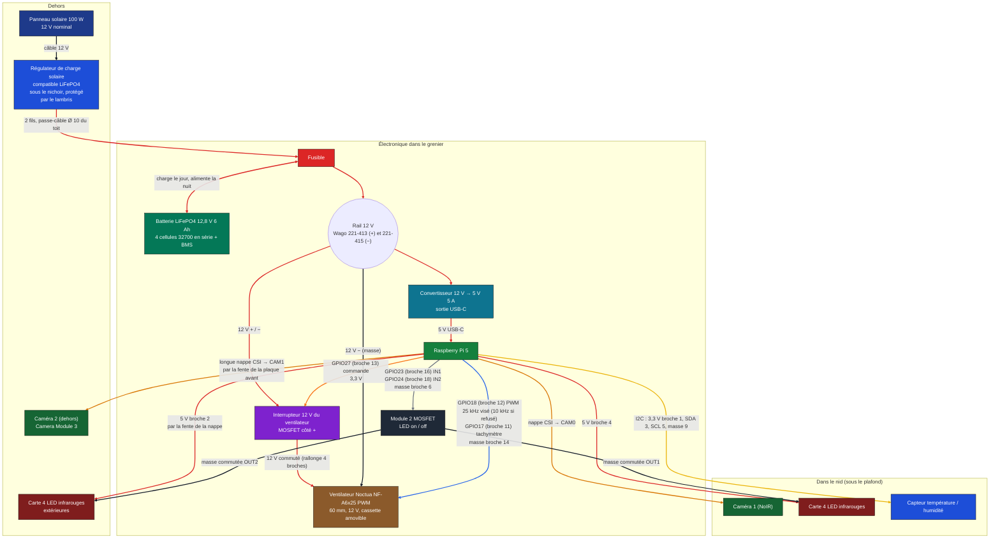

# Schéma électronique du nichoir isolé

Un panneau solaire de 100 W charge une batterie LiFePO4 12,8 V ; la batterie alimente un Raspberry Pi 5 (via un convertisseur 12 V → 5 V) et un ventilateur silencieux de 60 mm qui aspire l'air chaud du nid à travers le toit (l'entrée d'air est le trou d'envol et une prise d'air basse dans l'isolant). Le ventilateur ne tourne que quand il fait chaud : le Pi le pilote en PWM et peut couper son 12 V par un petit interrupteur. Ce document décrit le montage tel qu'il est modélisé dans l'outil « Plaques » (groupe « Électronique »), puis donne, composant par composant, les paramètres à respecter. (Le Peltier, son pont en H et son filtre ont été retirés le 2026-10-11 : trop faible en refroidissement.)

## Schéma général

Couleur des blocs = couleur des composants dans la 3D (panneau bleu nuit, régulateur bleu, fusible rouge, batterie verte, convertisseur bleu-vert, Pi vert, interrupteur violet, ventilateur brun, LED brun-rouge…). Couleur des traits = couleur des fils dans la 3D : rouge pour le + (12 V, 5 V), noir pour la masse et le câble du panneau, orange (violet-orangé) pour la commande de l'interrupteur, bleu pour le PWM du ventilateur, jaune pour l'I2C, gris pour la commande des LED, orange foncé pour les nappes caméra.

## Branchements, fil par fil

| Liaison | De | Vers | Remarque |
| --- | --- | --- | --- |
| Câble 12 V | Panneau solaire | Régulateur de charge, sous le nichoir | Longe le sol et arrive sous le nichoir, à l'abri du lambris |
| Charge | Régulateur | Batterie, via le fusible | Deux fils (rouge et noir) montent dans une gaine de Ø 16 mm, dans l'isolant du coin arrière droit (à 1 cm du mur arrière, pile sur le joint entre la plaque d'isolant du mur droit et celle du mur arrière) : ils traversent le fond, le plancher intérieur, le cadre du toit et le plancher du toit par des trous de 16 mm, pile le diamètre de la gaine, puis arrivent sur le dessus du toit. Le fusible protège la batterie et le câblage |
| Rail 12 V | Batterie / fusible | Convertisseur 12 → 5 V et ventilateur (par son interrupteur) | Fils rouge (+) et noir (−), répartis par un **Wago 221-413 à 3 entrées pour le +** (fusible, interrupteur du ventilateur, convertisseur) et un **Wago 221-415 à 5 entrées pour le −** (batterie, convertisseur, ventilateur, masse de l'interrupteur, une entrée de réserve), posés à droite du fusible : chaque fil a sa propre entrée |
| Alimentation du Pi | Convertisseur 12 → 5 V | Prise USB-C du Pi 5 | 5 V, 5 A recommandés pour le Pi 5 |
| Interrupteur du ventilateur | Wago + (12 V) ; Pi GPIO27 (broche 13) ; masse sur le Wago − | Entrée, commande 3,3 V et masse du module interrupteur 12 V (côté +) | Le Noctua ne s'arrête pas à 0 % de PWM (il tourne à environ 20 %) : on coupe son 12 V. Côté **+**, pas côté masse : une masse coupée ferait remonter jusqu'à 12 V dans les fils PWM et tachymètre vers les GPIO |
| 12 V du ventilateur | Sortie de l'interrupteur (+, rouge) ; Wago − (−, noir) | Prise 4 broches d'origine du ventilateur (sur le couvercle de la cassette) + rallonge 4 broches | Fils de 1,6 mm de diamètre ; la prise de la rallonge se débranche à la main (cassette amovible), aucune soudure |
| Commande du ventilateur | Pi GPIO18 (broche 12, PWM par gpiozero / lgpio : 25 kHz visé, repli à 10 kHz si le Pi le refuse), GPIO17 (broche 11, tachymètre), masse commune broche 14 | Fils PWM (bleu) et tachymètre (jaune) du Noctua, par la prise 4 broches d'origine et la rallonge | Le PWM est référencé à la masse du ventilateur : d'où le fil de masse commune vers la broche 14. Le tachymètre est collecteur ouvert : tirage interne du GPIO17 (pull-up logiciel) |
| Caméra 1 | Pi, port CSI CAM0 | Camera Module 3 NoIR, dans le nid | Courte nappe, passe par l'ouverture du toit |
| Caméra 2 | Pi, port CSI CAM1 | Caméra 2, dehors sous le débord, dans une boîte carrée crénelée en okoumé 5 mm peint (50 × 50 × 40 mm) | Longue nappe, sort par une fente rectangulaire 20 × 4 mm de la plaque avant |
| LED infrarouges | Pi broche 4 (5 V) | Carte 4 LED IR | Masse par le module MOSFET (OUT1) : le Pi les allume ou les éteint |
| LED infrarouges extérieures | Pi broche 2 (5 V) | Carte 4 LED IR à côté de la caméra 2 | Masse par le module MOSFET (OUT2) ; les fils suivent la nappe, sortent par la même fente et entrent dans la boîte par la fente du côté |
| Module MOSFET | Pi GPIO23 (broche 16), GPIO24 (broche 18), masse broche 6 | Module 2 canaux (MOSFET logique 3,3 V) | Coupe la masse de chaque carte de LED ; 5 V direct, courant des LED hors du GPIO |
| Capteur température / humidité | Pi broches 1 (3,3 V), 3 (SDA), 5 (SCL), 9 (masse) | Capteur dans le compartiment de la caméra, à fleur du plafond | Liaison I2C, 4 fils |
| Prise d'air basse | — (pas d'électronique) | Conduit de contreplaqué dans l'isolant du mur gauche avant, fente dans la paroi intérieure à mi-hauteur | Section libre 10,9 cm² ; clapet à gravité et grillage sur la fente, sous-boîte isolante amovible par le dessous (lèvre de 11 mm sous le fond) |

**Fiche d'un fil dans l'application.** Un clic sur un fil (ou sur sa carte dans « Pièces ») de la vue 3D ouvre sa fiche : couleur, diamètre dessiné et section, longueur du trajet, longueur de cordon à prévoir, de → vers (broche et GPIO du Pi, borne, Wago), rôle, tension, courant, raccord. Les broches de cette fiche sont celles de ce tableau ; la longueur est calculée sur le trajet dessiné.

## Explication, bloc par bloc

**Production.** Le panneau de 100 W est déporté à environ 70 cm du nichoir, incliné de 35° vers l'avant, sans piquet en bois. Son câble 12 V longe le sol et arrive sous le nichoir, où est le régulateur de charge, posé à plat sous le plancher. Le lambris descend plus bas (45 mm au lieu de 10) pour le protéger de la pluie. Le câble du panneau passe sous l'habillage, sans le percer. Deux fils montent dans l'isolant du coin arrière droit, dans une gaine de Ø 16 mm (tuyau multicouche ou gaine électrique ICTA de diamètre minimal), jusqu'au dessus du toit.

**Stockage.** La batterie est un pack LiFePO4 12,8 V de 6 Ah, soit 4 cellules 32700 en série (environ 77 Wh). Ce chimisme est plus sûr que le lithium-ion classique, mais le régulateur doit avoir un profil de charge LiFePO4 et le pack doit avoir un BMS. Dans le modèle, la batterie est dans le grenier, posée à plat sur le dessus du toit dans le coin avant droit, à 1 cm des murs, avec une cale de bois basse tout autour ; le toit a été relevé pour elle.

**Régulation.** Le régulateur de charge reçoit le panneau, charge la batterie et empêche la surcharge. Un fusible placé juste après la batterie protège tout le reste.

**Cerveau.** Le Raspberry Pi 5 est posé sur des entretoises de 6 mm dans le coin arrière gauche du toit, avec des cales de bois sur tous les côtés. Il pilote le ventilateur (PWM, tachymètre, interrupteur 12 V), lit le capteur, commande les deux caméras et allume les LED infrarouges. Ses prises (USB, Ethernet, HDMI) regardent la plaque arrière, percée d'une fenêtre : on branche sans ouvrir le nichoir. Il lui faut un convertisseur 12 V → 5 V capable de fournir 5 A.

**Ventilation.** Un ventilateur silencieux de 60 mm (Noctua NF-A6x25 PWM) aspire l'air chaud du nid à travers le plafond et le rejette à l'arrière, sous le débord du toit en chêne ; l'air frais entre par le trou d'envol et par une prise d'air basse dans l'isolant (voir la fiche « Prise d'air basse »). Le ventilateur n'est pas dans la zone de l'électronique : il tourne dans une **cassette amovible à la main** (quatre parois de contreplaqué, un cadre, un couvercle à poignée, le ventilateur posé sur quatre plots en caoutchouc) qui se pose par gravité dans un **siège fixe** collé sur le plancher du toit (la goulotte : trois parois, la plaque arrière du toit fait la quatrième). La cassette a une fenêtre de sortie en face de celle de la plaque arrière (la cassette est posée contre la plaque arrière, sans joint) ; dehors, un grillage inox à mailles de 5 mm est posé à plat contre la plaque (rien ne dépasse derrière). Il n'y a pas de clapet : l'ouverture du plafond reste ouverte quand le ventilateur est arrêté, et par temps froid on pose le bloc isolant à la place de la cassette. Le câble d'origine du ventilateur finit par sa prise 4 broches posée sur le couvercle ; une rallonge 4 broches (12 V commuté, masse, PWM, tachymètre) s'y emboîte : on la débranche à la main, sans soudure. Le Pi allume le ventilateur seulement quand il fait chaud : il règle sa vitesse par PWM, et peut couper son 12 V avec l'interrupteur (le Noctua tourne encore à environ 20 % à 0 % de PWM). **Pour soulever le toit** : tirer les 4 barres de MDF (60 mm, à fleur du lambris, par une petite fenêtre ; on accroche la pointe d'un crochet dans le trou de 3 mm de leur bout), puis soulever le toit ; à la repose, les repousser jusqu'à ce qu'elles affleurent. **Été / hiver, en 4 lignes** : 1) retirer le toit en chêne (on accède au grenier) ; 2) débrancher la rallonge 4 broches et sortir la cassette à la main ; 3) poser à sa place le bloc isolant d'hiver (même empreinte, mousse de 35 mm : il rend au plafond son isolation) ; 4) l'été, faire l'inverse et rebrancher la rallonge.

**Vision.** (Habillage et boîte de la caméra 2 : contreplaqué okoumé extérieur de 5 mm peint en blanc, découpé au laser sur ses propres planches, « Planche okoumé 5 mm ».) La caméra 1 regarde dans le nid, éclairée par 4 LED infrarouges ; la caméra 2 est dehors, sous le débord du toit en chêne, à l'avant gauche, tournée vers le trou d'entrée, avec une seconde carte de 4 LED infrarouges à côté d'elle pour éclairer le trou la nuit. Sa boîte est collée à l'habillage, et sa longue nappe part du Pi, traverse le toit, sort par la fente de la plaque avant puis entre dans la boîte par une fente de son côté qui touche l'habillage. **Toutes les caméras, toutes les LED infrarouges et la puce du capteur sont à fleur du bois** : la carte s'appuie contre la face intérieure, l'objectif, les LED et la puce traversent leur trou et leur bout affleure la face extérieure (écart < 0,1 mm, jeu ≥ 0,4 mm autour de chaque corps).

## Paramètres à respecter, composant par composant

Les valeurs viennent de fiches de revendeurs et de constructeurs (liens en bas) ; la dernière ligne de chaque tableau donne le modèle exact à acheter, avec son lien. Les cases « à déterminer » dépendent du matériel exact que tu achèteras. Vérifie toujours la fiche du modèle choisi.

### Panneau solaire 100 W

| Paramètre | Valeur à viser | Dans le modèle |
| --- | --- | --- |
| Type | 12 V nominal, monocristallin, cadre alu | Oui |
| Puissance | 100 W | 100 W |
| Tension à puissance max (Vmp) | environ 17 à 18 V | — |
| Courant à puissance max (Imp) | environ 5,8 A | — |
| Tension à vide (Voc) | environ 21 à 22 V : doit rester sous la limite d'entrée du régulateur | — |
| Dimensions | selon le modèle, par exemple 970 × 585 × 30 mm | 970 × 585 × 30 mm |
| Connecteurs et câble | MC4, 2 fils de 4 mm² environ, boîte de jonction étanche | câble Ø 7 mm |
| Modèle exact / lien | [Panneau 100 Wc monocristallin AST100-17M, 970 × 585 × 30 mm (Wattuneed)](https://www.wattuneed.com/fr/panneaux-solaires/8120-panneau-solaire-12v-100wc-monocristallin-0712971138629.html) | — |

### Régulateur de charge solaire

| Paramètre | Valeur à viser | Dans le modèle |
| --- | --- | --- |
| Tension batterie | 12 V | 12 V |
| Profil de charge | LiFePO4 obligatoire (fin de charge 14,2 à 14,6 V pour 4 cellules) | — |
| Courant | au moins 10 A (le panneau donne environ 6 A) | 10,5 A (Genasun) |
| Tension d'entrée maximale | au moins 25 V, mieux 30 V ou plus | — |
| Type | MPPT (meilleur rendement) ou PWM (moins cher) | — |
| Protections | surcharge, décharge profonde, inversion de polarité, court-circuit | — |
| Dimensions | exemple Genasun GV-10-Li : 137 × 61 × 33 mm | 137 × 61 × 33 mm (vraie taille), à plat sous le nichoir |
| Modèle exact / lien | [Genasun GV-10-Li-14.2V (4S LiFePO4, 10,5 A)](https://sunforgellc.com/product/gv-10/) ; revendeur : [DigiKey GV-10-Li-14.2V-OEM](https://www.digikey.com/en/products/detail/genasun/GV-10-Li-14-2V-OEM/24614948) | — |

### Batterie LiFePO4 12,8 V

| Paramètre | Valeur à viser | Dans le modèle |
| --- | --- | --- |
| Montage | 4 cellules 32700 en série (4S) | 4 × 32700 |
| Tension nominale | 12,8 V | 12,8 V |
| Tension de charge max | 14,6 V (3,65 V par cellule) | — |
| Tension de coupure basse | environ 10 à 10,5 V (2,5 V par cellule ; certaines fiches annoncent 2 V) | — |
| Capacité | 6 Ah, soit environ 77 Wh | 6 Ah |
| Courant de décharge continu du BMS | au moins 5 A (Pi, caméras, ventilateur et marge) | — |
| BMS | obligatoire : équilibrage, coupure haute et basse, court-circuit | — |
| Température de charge | pas de charge sous 0 °C : BMS avec protection basse température (important pour un nichoir dehors) | — |
| Dimensions du pack | environ 70 × 128 × 32 mm pour 4 cellules côte à côte | 128 × 70 × 32 mm (vraie taille), dans le grenier |
| Modèle exact / lien | [Cellule HX IFR32700 3,2 V 6000 mAh (Robu)](https://robu.in/?p=2024523) ; BMS 4S LiFePO4 et support : lien à trouver | — |

### Fusible

| Paramètre | Valeur à viser | Dans le modèle |
| --- | --- | --- |
| Calibre | 15 A suffit (charge au plus 10 A, décharge environ 8 A) ; il doit être inférieur à ce que le câble supporte | 15 A |
| Type | fusible à lame automobile 12 V avec porte-fusible, placé au plus près du + de la batterie | 19 × 18,5 × 5 mm, posé à plat |
| Modèle exact / lien | lien à trouver — référence exacte : fusible à lame 15 A + porte-fusible à fils tout fait (2,5 mm²) | — |

### Convertisseur 12 V → 5 V

| Paramètre | Valeur à viser |
| --- | --- |
| Tension d'entrée | au moins 10 à 15 V (la batterie va de 10 V à 14,6 V) |
| Sortie | 5,1 V, 5 A (25 W), sortie USB-C |
| Rendement | plus de 90 % |
| Négociation USB-PD | souhaitable : sans elle, le Pi 5 limite le courant de ses ports USB |
| Protections | surintensité, court-circuit, surtempérature |
| Dimensions dans le modèle | environ 60 × 36 × 16 mm : estimation à confirmer avec le module acheté |
| À déterminer | fixation dans le toit |
| Modèle exact / lien | lien à trouver — référence exacte : convertisseur DC-DC 12 V → 5 V, 5 A continus, sortie USB-C, entrée à bornier à vis |

### Raspberry Pi 5

| Paramètre | Valeur à viser | Dans le modèle |
| --- | --- | --- |
| Alimentation | 5 V, 5 A en USB-C (bloc officiel 27 W) | via le convertisseur |
| Niveaux GPIO | 3,3 V seulement (ne tolère pas 5 V) | — |
| Ports caméra | 2 ports CSI/DSI de 22 broches : nappes adaptatrices vers la caméra | position provisoire |
| Dimensions | 85 × 56 mm, hauteur du composant environ 17 mm | 85 × 56 mm |
| Stockage | carte microSD ou SSD | — |
| Refroidissement | dissipateur ou ventilateur d'origine si le toit chauffe (le Pi est dans le grenier, que le ventilateur du nid ne refroidit pas) | — |
| Modèle exact / lien | [Raspberry Pi 5 (4 Go) — page officielle](https://www.raspberrypi.com/products/raspberry-pi-5/) ; en France : [Kubii, Raspberry Pi 5 (choisir « 4 Go » ; le prix affiché, 76,80 €, est celui du 2 Go)](https://www.kubii.com/fr/cartes-nano-ordinateurs/4106-2106-raspberry-pi-5-3272496315938.html) + [carte micro-SD officielle 32 Go (Kubii, 34,20 €)](https://www.kubii.com/fr/support-de-stockage/4392-2101-carte-sd-officielle-raspberry-pi-3272496319158.html) | — |

### Ventilateur Noctua NF-A6x25 PWM

| Paramètre | Valeur à viser | Dans le modèle |
| --- | --- | --- |
| Modèle | Noctua NF-A6x25 PWM, 4 fils (+12 V, masse, tachymètre, PWM), silencieux | oui |
| Dimensions | 60 × 60 × 25 mm | 60 × 60 × 25 mm |
| Tension | 12 V (la fiche annonce 10,8 à 13,2 V) | 12 V commuté par l'interrupteur |
| Puissance | environ 0,6 W (environ 0,05 A) : négligeable pour la batterie | — |
| Vitesse et bruit | environ 3 000 tr/min, environ 19 dB(A) à pleine vitesse (à vérifier à l'achat) ; à vitesse réduite il est quasi inaudible | — |
| Arrêt | il tourne encore à environ 20 % quand le PWM est à 0 % : couper son 12 V avec l'interrupteur | module interrupteur côté + |
| Commande | PWM par gpiozero / lgpio sur GPIO18 (broche 12) : 25 kHz visé, repli à 10 kHz signalé sur la page si le Pi le refuse (à valider sur le matériel) ; tachymètre 2 impulsions par tour sur GPIO17 (broche 11) avec tirage interne ; masse commune sur la broche 14 | fils bleu, jaune, noir |
| Montage | cassette amovible à la main, **boîte crénelée** (quatre parois qui s'emboîtent par leurs arêtes verticales, cadre du bas et couvercle emboîtés dans les parois, dents d'environ 16 mm, comme les autres boîtes ; contreplaqué 3 mm) avec une petite poignée en U de contreplaqué centrée sur le couvercle (trois couches de 3 mm collées face à face, 9 mm d'épaisseur ; pieds incrustés dans deux fentes du couvercle ; ouverture 24 × 6 mm au-dessus du couvercle : on glisse le bout des doigts ; la même sur le bloc d'hiver ; le centre de gravité de la cassette est à moins de 1 mm de la poignée), quatre plots en caoutchouc de 12 × 2 × 3 mm sous le ventilateur, pas de joint de mousse : la cassette est ajustée pile au siège (jeu 0), l'étanchéité vient de l'ajustement ; fuites faibles mais non nulles (jeux de découpe, quelques dixièmes de mm), à compenser en tapant la cassette au maillet ou en collant un ruban de mousse à la demande ; les vibrations ne passent que par les 4 plots en caoutchouc | oui, dans un siège fixe (la goulotte) |
| Prise 4 broches (d'origine) + rallonge | le câble d'origine du Noctua (≈ 30 cm, quatre fils) monte dans la cassette, traverse le couvercle par un passage de 6 × 12 mm et finit par sa prise 4 broches femelle d'origine (bloc noir de 6 × 10 × 6 mm posé sur le couvercle) ; la rallonge 4 broches Noctua (mâle ⇄ femelle, ≈ 30 cm) s'y emboîte horizontalement ; ses fils font ≈ 50 mm de mou au-dessus du dessus du toit, de quoi sortir la cassette prise débranchée. Pas de plaque de prototypage, pas de soudure | prise sur le couvercle : 6 mm de haut, marge de 8 mm sous la pente ; la prise mâle reste sur le toit (posée sur le bloc d'hiver quand la cassette est sortie) |
| Ouverture du plafond | 56 de large ; la profondeur (environ 21 mm) est limitée par le mur du nid et le compartiment de la caméra : c'est le point étroit, 11,8 cm² soit environ un tiers de la face de 60 × 60 du ventilateur (36 cm²). Sans bouger le siège elle peut aller jusqu'à 67 × 26 mm (17,4 cm², 48 %) ; en élargissant le siège en x, le plafond est libre de −59 à +59 mm (rien dessous : la caméra, ses LED et le capteur sont plus en avant, la batterie est au-dessus du toit), mais le ventilateur de 60 mm n'en aspire qu'une partie. L'ouverture est nue : la grille de protection en fil d'acier (60 × 60 × 3 mm, environ 90 % ouverte, pas de 6 à 8 mm entre fils, composant acheté) est fixée sur la face d'aspiration du ventilateur, dans la cassette, à environ 3 mm du plafond ; le débit réel est à mesurer | 56 × 21 mm ; grille de fil dans la cassette |
| Sortie d'air | fenêtre de 51,4 × 40,5 mm (≈ 20,8 cm², entre les crans de la cassette) dans la cassette puis dans la plaque arrière, grillage inox à mailles de 5 mm posé à plat dehors, sous le débord du toit en chêne, sans clapet (la sortie reste ouverte ventilateur arrêté : bloc isolant par temps froid) ; aucune communication avec la zone du Pi et de la batterie | oui |
| Hiver | remplacer la cassette par le bloc isolant d'hiver (même empreinte, mousse de 35 mm) pour supprimer la déperdition de chaleur par l'ouverture. Le bloc est une boîte pleine fermée, sans aucune ouverture (sa poignée est une plaque pleine) ; les pièces d'hiver (le bloc et la sous-boîte isolante du conduit d'aération) sont **dessinées à côté du nichoir, sur le sol, à gauche** ; deux boutons en haut de la vue 3D (« Cassette : ventilateur / isolante » et « Prise d'air : ouverte / bouchée ») les mettent en place ou les rangent. Ces boutons ne font que montrer la cassette en place dans la 3D : le réglage « Mode hiver » du Pi est à part | pièces de rechange visibles à côté du nichoir |
| Grillages | grillage inox (ou galvanisé) à mailles carrées de 5 mm, fil de 0,5 mm, environ 85 à 90 % d'ouverture, sur la sortie du ventilateur, le dessous de la prise d'air basse et sa fente. Il arrête guêpes, frelons, rongeurs et araignées ; il ne retient pas les moustiques et les petits insectes, ce qui est voulu : le trou d'envol reste ouvert à tout, et une moustiquaire fine (55 à 65 % d'ouverture) étoufferait le débit d'un ventilateur qui ne développe qu'environ 20 Pa | « Grillage inox maille 5 mm » (sortie, prise d'air, fente) |
| Modèle exact / lien | [Noctua NF-A6x25 PWM](https://noctua.at/en/nf-a6x25-pwm) (60 × 60 × 25 mm, 12 V, 4 broches) ; en France : [Amazon.fr, NF-A6x25 PWM marron](https://www.amazon.fr/dp/B00VXTANZ4) ; lien à trouver — référence exacte : grille de protection de ventilateur 60 mm en fil d'acier, trous de vis 50 mm | — |

### Interrupteur 12 V du ventilateur (côté +)

| Paramètre | Valeur à viser | Dans le modèle |
| --- | --- | --- |
| Rôle | couper complètement le 12 V du ventilateur (le Noctua ne s'arrête pas à 0 % de PWM) | oui |
| Côté | **côté +12 V** (« high-side »), pas côté masse : couper la masse ferait remonter jusqu'à 12 V dans les fils PWM et tachymètre, vers les GPIO du Pi (qui ne tolèrent que 3,3 V) | côté + |
| Type | module « high side switch » à P-MOSFET avec son petit étage de commande, ou module « load switch » 12 V | module violet 17 × 25 × 8 mm |
| Tension et courant | 12 V (la batterie va de 10 à 14,6 V), 1 A au moins (le ventilateur prend 0,05 A) | — |
| Commande | logique 3,3 V compatible, sur GPIO27 (broche 13) du Pi | broche 13 |
| Montage | à côté du Wago +, dans le coin arrière droit du grenier, quatre cales de bois basses | oui |
| Modèle exact / lien | lien à trouver — référence exacte : module « high side switch » à P-MOSFET, 12 V, commande logique 3,3 V, borniers à vis | — |

### Caméras (Camera Module 3 NoIR)

| Paramètre | Valeur à viser | Dans le modèle |
| --- | --- | --- |
| Modèle | Camera Module 3 NoIR (sans filtre infrarouge, pour la vision de nuit) | Oui |
| Dimensions | environ 25 × 24 mm | 25 × 24 mm |
| Liaison | nappe CSI, adaptateur vers le port 22 broches du Pi 5 | oui |
| Caméra 2 : longueur de nappe | longue ; au-delà d'environ 30 cm, le signal peut devenir instable : à valider ou utiliser une nappe protégée / un prolongateur | longue nappe de 16 mm de large |
| Caméra 2 : étanchéité | protéger l'objectif de la pluie sous le débord | sous le débord du toit |
| Affleurement | la carte s'appuie contre le bois et l'objectif (embase Ø 8,5 + objectif Ø 7,4, de la hauteur du bois) traverse le trou et affleure la face extérieure | caméra 1 : trou Ø 10 dans le plafond (jeu 0,75), objectif au ras du dessous ; caméra 2 : trou Ø 12 (jeu 1,7) dans la face avant de 5 mm |
| Modèle exact / lien | [Camera Module 3 NoIR (choisir « NoIR » dans la page)](https://www.raspberrypi.com/products/camera-module-3/) ; nappes : [Adafruit 5818, Pi 5 FPC 22 broches → 15 broches, 200 mm](https://www.adafruit.com/product/5818) ; en France : [Kubii, module caméra v3 « Infrarouge » (39 €) : c'est le NoIR de Raspberry Pi, mais sa fiche parle d'un filtre IR intégré — demander confirmation à Kubii avant de commander](https://www.kubii.com/fr/cameras-capteurs/3879-module-camera-v3-infrarouge-raspberry-pi-3272496313682.html) + [Kubii, nappe CSI / MIPI pour Pi 5 (2,40 €, 22 broches côté Pi → 15 broches côté caméra, 200 / 300 / 500 mm, 16 mm de large)](https://www.kubii.com/fr/nappes-cables-adaptateurs/4116-1860-nappe-csi-mipi-camera-pour-raspberry-pi-5-3272496316669.html) | — |

### Prise d'air basse (conduit dans l'isolant)

| Paramètre | Valeur à viser | Dans le modèle |
| --- | --- | --- |
| Rôle | une entrée d'air de plus, en bas, pour que l'air traverse le nid jusqu'au ventilateur (à l'arrière) ; le trou d'envol reste l'entrée principale. À faire dès la construction : impossible à rajouter une fois monté | oui, toujours présente |
| Électronique | aucune | — |
| Position | dans l'épaisseur d'isolant (39 mm) du mur gauche, à l'avant (centre à 30 mm du mur avant, côté opposé au ventilateur), du dessous de la boîte à mi-hauteur du nid | fente à 74 à 104 mm au-dessus du fond du nid, sous le trou d'envol |
| Section libre | au moins 8 cm² | intérieur 23,6 × 46 mm = 10,9 cm² (empreinte extérieure 29,6 × 52 mm, centrée à 35 mm du mur avant intérieur : 6 mm plus longue que d'abord, vers l'AVANT) ; fente de 34 × 30 mm (10,2 cm²) ; ligaments de bois mini 4,5 mm (avant : 0,8 mm sur le fond intérieur à l'est et 2 mm sur la paroi du conduit à l'arrière de la fente) |
| Pièces | une boîte de contreplaqué crénelée, comme les autres boîtes du nichoir (« Conduit d'air 1 à 5 » : 4 parois qui s'emboîtent par 11 dents verticales par arête, et un couvercle à 3 dents par bord qui s'emboîte dans le haut des parois ; ouverte en dessous), **incrustée dans le fond par crénelage** : les dents du bas des parois traversent des fentes de « Dessous ext » (ouverture et fentes forment un seul trou en peigne) et affleurent la face extérieure du fond ; « Plancher int » n'a que le passage du conduit ; quatre petites plaques (« Conduit d'air manchon ») ferment le jour de 4,7 mm entre le conduit et la paroi intérieure autour de la fente ; étanche à l'air et à l'humidité de la laine | oui |
| Protection | grillage inox à mailles de 5 mm sur la fente (pas de grillage sous l'ouverture du dessous : il gênerait la sous-boîte ; les guêpes peuvent entrer dans le conduit en été, c'est accepté, le remède est de poser la sous-boîte isolante quand on n'a pas besoin de la prise d'air), clapet léger à gravité à l'intérieur (s'ouvre sous l'aspiration, retombe sinon). Pas d'auvent : une chicane de bois sous la boîte était prévue contre la pluie qui remonte et les éclaboussures, mais l'ouverture étant sous la boîte ce n'est pas nécessaire ; seul le grillage plat de 0,8 mm est sous le fond | oui |
| Sous-boîte isolante (bouchon) | boîte de contreplaqué crénelée fermée (4 parois, fond, couvercle emboîté), pleine hauteur et sans ouverture, qui passe pile dans l'intérieur libre du conduit (23,6 × 46 mm, jeu 0) et tient en force, sans aucun verrou (au besoin un point de ruban adhésif). Son fond est à fleur du dessous du nichoir (rien ne dépasse) ; un U de contreplaqué (trois couches de 3 mm collées, 9 mm d'épaisseur) incrusté par ses deux pieds dans deux fentes du fond, centré, dépasse de 15 mm sous le fond (ouverture 12 × 24 mm pour les doigts). Mode d'emploi hiver : on pousse la sous-boîte par le dessous jusqu'à ce que son fond affleure, on la ressort par la languette | pièce de rechange (parois « Bouchon-boîte prise d'air 1 à 4 », fond, couvercle, poignée, « Laine bouchon prise d'air ») |
| Habillage | le lambris descend de 10 mm (45 mm avec le solaire) sous la boîte : il ne ferme pas le dessous, l'air entre par en bas ; le régulateur solaire est à droite et ne bouche pas l'ouverture | oui |

### Carte de 4 LED infrarouges

| Paramètre | Valeur à viser | Dans le modèle |
| --- | --- | --- |
| Longueur d'onde | 850 nm (compatible avec la caméra NoIR) | — |
| Fils | modèle à fils pré-soudés ou à bornier à vis (aucune soudure à faire) | — |
| Alimentation | 5 V depuis le Pi | broche 4 |
| Courant | à déterminer selon la carte (plus que la limite d'une broche GPIO : ne jamais l'alimenter par un GPIO) | — |
| Commande | module 2 × MOSFET (niveau logique 3,3 V, ex. IRLZ44N ou module « 2 channel MOSFET »), coupure côté masse | module MOSFET, GPIO23 / GPIO24 |
| Dimensions | 12 × 24 mm | 12 × 24 mm ; les 4 LED (3,2 × 3,2) ont la hauteur du bois traversé : carte contre le bois, bout des LED à fleur de l'autre face. Fenêtre de 10 × 20 dans le plafond du nid (jeu 0,4 mm), de 10 × 17 dans la face avant de la boîte de la caméra 2 |
| Modèle exact / lien | lien à trouver — référence exacte : carte de 4 LED infrarouges 850 nm, 5 V, environ 12 × 24 mm, fils pré-soudés | — |

### Capteur de température et d'humidité (BME280)

| Paramètre | Valeur à viser | Dans le modèle |
| --- | --- | --- |
| Version | carte « avec broches soudées » (aucune soudure à faire) | — |
| Alimentation | 3,3 V | broche 1 |
| Bus | I2C (SDA, SCL), adresse 0x76 ou 0x77 | broches 3 et 5 |
| Mesures | température, humidité et pression | — |
| Dimensions de la carte | 19 × 19 × 2,75 mm (Pimoroni PIM472, fiche Kubii) | 19 × 19 mm dans le modèle ; la carte s'appuie sur le plafond, seule la puce (6 × 6) traverse un logement de 9 × 9 et affleure le dessous |
| Contrainte | la condensation est possible sous le plafond : choisir un capteur protégé ou le vernir | puce à fleur du plafond (écart < 0,1 mm), dans le compartiment de la caméra (x = 33, y = −14), ses fils sortent par l'ouverture du dessus du toit, sans passer dans l'isolant ; ≥ 4,5 mm de bois autour de son logement |
| Rôle | donne au Pi la température du nid pour piloter le ventilateur ; toujours présent | oui |
| Modèle exact / lien | [Pimoroni BME280 Breakout (PIM472), Kubii, 15,88 €, 16 en stock](https://www.kubii.com/fr/modules-capteurs/2858-capteur-de-pression-temperature-et-humidite-bme280-breakout-0606034879638.html) : I2C, 19 × 19 × 2,75 mm, brochage fait pour les broches 1, 3, 5, 7, 9 du Pi ; puce : [Bosch BME280](https://www.bosch-sensortec.com/products/environmental-sensors/humidity-sensors-bme280/) | — |

### Module 2 × MOSFET (LED infrarouges)

| Paramètre | Valeur à viser | Dans le modèle |
| --- | --- | --- |
| Rôle | allumer et éteindre les deux cartes de LED depuis le Pi, en coupant leur masse | module 20 × 14 × 6 mm |
| Commande | niveau logique 3,3 V (MOSFET « logic level », par exemple IRLZ44N), IN1 sur GPIO23 (broche 16), IN2 sur GPIO24 (broche 18) | broches 16, 18 et masse 6 |
| Courant | largement au-dessus des LED (quelques centaines de mA) | — |
| Alimentation des LED | 5 V direct depuis les broches 2 et 4 du Pi, la masse passe par le module (OUT1 : nid, OUT2 : extérieur) | — |
| Modèle exact / lien | lien à trouver — référence exacte : module 2 canaux MOSFET à niveau logique 3,3 V (IRLZ44N ou équivalent), borniers à vis | — |

### Wago 221 du rail 12 V

| Paramètre | Valeur à viser | Dans le modèle |
| --- | --- | --- |
| Rôle | répartir le + et le − de la batterie vers l'interrupteur du ventilateur et le convertisseur | pavés aux cotes officielles de la fiche technique WAGO (version du 08.05.2024, [221-413](https://www.wago.com/221-413) / [221-415](https://www.wago.com/221-415)) : 221-413 = 18,8 × 8,4 × 18,8 mm, 221-415 = 30 × 8,4 × 18,8 mm (largeur de la rangée × hauteur × profondeur dans le sens des fils) ; d'anciennes fiches de revendeurs donnent 18,7 × 8,3 × 18,6 mm : on retient la fiche WAGO actuelle |
| Modèle | Wago 221-413 (3 entrées) pour le + et 221-415 (5 entrées) pour le − : à levier, tension 12 V, courant ≤ 32 A, sections de 0,2 à 4 mm², fils souples sans embout acceptés | pas de 6 mm (3 × 6 + 0,8 = 18,8 et 5 × 6 = 30, déduit des cotes), **tous les fils du même côté** : face ouest ; chaque fil arrive perpendiculairement à la face, parallèle aux autres, au même niveau (mi-hauteur), sur au moins 12 mm rectilignes |
| Entrées du + | fusible, interrupteur du ventilateur, convertisseur : une entrée chacun | 3 sur 3 |
| Entrées du − | batterie, convertisseur, ventilateur, masse de l'interrupteur : une entrée chacun, la 5ᵉ est libre | 4 sur 5 |
| Courant | nous sommes à environ 1 A | — |
| Précaution | enfoncer les fils jusqu'au fond ; pour un montage définitif, bornier à vis ou cosses serties | à droite du fusible |
| Modèle exact / lien | [WAGO 221-413, borne à levier 3 conducteurs](https://www.wago.com/221-413) ; [WAGO 221-415, borne à levier 5 conducteurs](https://www.wago.com/221-415) ; en magasin : [Leroy Merlin, lot de 5 bornes automatiques 5 fils WAGO](https://www.leroymerlin.fr/produits/lot-de-5-bornes-automatiques-5-fils-wago-88899421.html) (fiche non lisible en ligne : vérifier « 32 A, fils souples ET rigides » et la référence 221-415, pas une borne « rigide seulement » 2273-205) | — |

### Câblage

| Paramètre | Valeur à viser |
| --- | --- |
| Puissance 12 V (batterie, fusible, rail) | au moins 2,5 mm², le plus court possible |
| Ventilateur (12 V commuté) | 0,25 mm² suffit (0,05 A) ; fils du Noctua d'origine |
| Panneau vers régulateur | environ 4 mm² (tirage d'environ 70 cm à plusieurs mètres) |
| Signaux (PWM, tachymètre, commande de l'interrupteur, I2C) | 0,25 mm² environ |
| Masse | commune entre le Pi, le ventilateur (broche 14) et le rail 12 V |

## Montage sans soudure

**Principe.** Tout se branche à la main, sans fer à souder ni pince à sertir : cordons Dupont tout faits, borniers à vis ou à ressort, Wago 221, prises d'origine. On achète des composants **avec leurs broches ou leurs fils déjà soudés**.

| Composant | À acheter (référence type) | Section de fil | Comment le brancher |
| --- | --- | --- | --- |
| Raspberry Pi 5 (GPIO) | cordons Dupont femelle-femelle de **40 cm**, lot de 40 (les fils du modèle mesurent de 20 à 36 cm vers le Pi, 36 cm pour la commande de l'interrupteur GPIO27 : 40 cm partout, on plie le surplus en S) | fil du cordon (≈ 0,1 mm²) | un cordon par picot : PWM ventilateur GPIO18 (broche 12), tachymètre GPIO17 (broche 11), commande de l'interrupteur GPIO27 (broche 13), masse (broche 14), capteur (broches 1, 3, 5, 9), LED et module MOSFET (broches 2, 4, 6, 16, 18, 20) ; l'autre bout dans le bornier ou la broche du module |
| Capteur BME280 | Pimoroni BME280 Breakout (PIM472, Kubii) : rangée de 5 broches faite pour les broches 1, 3, 5, 7 et 9 du Pi (3,3 V, SDA, SCL, GPIO4 non utilisé, masse) | cordons Dupont | sur le modèle, 4 cordons Dupont vont de la rangée de broches de la carte aux broches 1, 3, 5 et 9 du Pi ; la fiche Kubii ne dit pas si les broches sont fournies ou à souder : à vérifier avant de commander |
| Cartes de 4 LED infrarouges 850 nm | modèle à **fils pré-soudés** ou à **bornier à vis** | fils fournis (≈ 0,3 mm²) | 5 V sur la broche 2 ou 4 du Pi par un cordon Dupont ; l'autre fil dans le bornier du module MOSFET |
| Module 2 × MOSFET (LED) et module interrupteur 12 V du ventilateur | cartes **avec borniers à vis** | 0,25 à 0,5 mm² | fil dénudé de 6 mm dans le bornier, vis serrée au tournevis plat de 2 mm ; commande par cordon Dupont sur le GPIO |
| Régulateur solaire Genasun | modèle d'origine à **borniers à vis** | 4 mm² côté panneau, 2,5 mm² côté batterie | fils dénudés de 8 mm avec embouts, vis serrées à fond |
| Fusible | porte-fusible lame **avec fils déjà montés** | 2,5 mm² | on le met en série sur le fil + de la batterie, avec les Wago |
| Rail 12 V | Wago 221-413 (3 entrées) pour le + et Wago 221-415 (5 entrées) pour le −, sans outil, aucune soudure | 0,2 à 4 mm² | on lève le levier, on glisse le fil dénudé de 11 mm (fil souple avec embout conseillé), on rabat le levier |
| Convertisseur 12 V → 5 V | modèle avec **sortie USB-C** et entrée à bornier à vis | 2,5 mm² côté 12 V | sortie USB-C directement dans le Pi, pas de câble à confectionner |
| Batterie LiFePO4 | batterie avec **bornes à visser** ou fils livrés | 2,5 mm² | cosses ou embouts vissés sur les bornes |
| Caméras | caméras Camera Module 3 NoIR avec **nappes plates** | nappe 15 ou 22 broches | la nappe s'enfiche dans le connecteur à levier (CSI) du Pi, sans outil |
| Ventilateur Noctua | **prise 4 broches d'origine du ventilateur** + **rallonge 4 broches Noctua** (mâle ⇄ femelle, ≈ 30 cm) | fils du Noctua | la rallonge s'emboîte sur la prise d'origine ; l'autre bout se branche sur le toit ; aucune soudure ni sertissage |
| Module INA219 (facultatif) | version **avec broches soudées** | cordons Dupont F/F | I2C : 3,3 V, SDA, SCL, masse |
| Passage des fils | passe-câbles, gaine annelée de Ø 16 | — | on enfile les fils dans la gaine avant de brancher |

**Liste de courses sans soudure** (prix indicatifs) : cordons Dupont F/F 40 cm, lot de 40 (lien à trouver), 8 € (20 cm ne suffisent pas : les fils vers le Pi font 20 à 36 cm) ; embouts de câble assortis avec leur kit, 8 € ; tournevis plat de 2 mm, 4 € ; pince à dénuder, 8 € ; Wago 221-413 (déjà comptés dans le prix du rail 12 V) ; porte-fusible à fils tout fait (déjà compté) ; rallonge ventilateur Noctua 4 broches (déjà comptée). Ces achats sont ajoutés à la table des prix, groupe « Électronique ».

**Trois conseils.**

1. Étiqueter chaque cordon (ruban adhésif et feutre) : « PWM », « tacho », « 5 V LED nid »…
2. Tirer légèrement sur chaque fil après l'avoir serré : s'il bouge, le bornier ou le Wago n'est pas bien fermé.
3. Avant la mise sous tension, mesurer au multimètre : continuité sur le rail 12 V, et surtout jamais de court-circuit entre le + et le − du rail.

## Vérification que rien ne coince

Contrôle fait par calcul sur le modèle : recouvrement entre chaque composant et chaque plaque, et hauteur de chaque composant sous la pente du toit (le dessus du toit est à 268 mm, la pente passe de 281 mm à l'avant à 311 mm à l'arrière).

| Composant | Résultat |
| --- | --- |
| Ventilateur et son siège | cassette (66 × 66 mm, 97 mm de haut) posée dans un siège de 73 × 72 mm collé sur le plancher du toit, contre la plaque arrière : à environ 8 mm de la gaine, à environ 5 mm des cales du Pi, loin de la batterie (plus de 5 cm) ; la poignée de la cassette est à environ 3 mm sous la pente du toit |
| Régulateur | sous le nichoir, à plat (61 × 137 × 33 mm), sans conflit : le lambris descend de 45 mm pour le protéger. Sans le lambris (option « Habillage »), il est exposé |
| Fusible | passe (9 mm de jeu sous la pente) |
| Batterie | vraie taille (128 × 70 × 32 mm), montée dans le grenier, dans le coin avant droit, à 1 cm du mur de droite et du mur avant, sur le dessus du toit, avec une cale de bois de 3 mm tout autour : le toit a été relevé (58 → 84 mm devant) pour elle, 6 mm de jeu sous la pente ; le compartiment caméra est réduit à 38 mm pour que la cale ne soit pas dans le vide |
| Raspberry Pi | passe (13 mm sous la pente) ; environ 5 mm d'écart avec le siège du ventilateur |
| Convertisseur 12 → 5 V | ajouté à l'avant, taille estimée ; il passe sous la pente avec très peu de jeu |
| Nappe de la caméra 1 | corrigée pour contourner le siège du ventilateur : elle passe devant lui, au-dessus des fils des LED |
| Caméra 1, capteur | passent ; le compartiment de la caméra est agrandi vers l'est (intérieur 66,25 × 38 mm au lieu de 38 × 38) pour contenir le capteur |
| Prise d'air basse | le conduit (35 × 46 mm) traverse l'isolant sous le plancher, le fond intérieur (par un passage découpé) et l'isolant du mur gauche ; libre dessous, loin du régulateur |
| Fils et nappes | corrigé : plusieurs fils sortaient de 0,5 à 5 mm au-dessus de la pente, ils sont maintenant ramenés dessous |
| Pièces en bois | contrôle de recouvrement par boîtes orientées : les seuls recouvrements restants sont voulus (dents dans leurs fentes, parois du siège et de la cassette qui traversent le dessus du toit par son encoche, conduit d'air dans le passage du fond) |
| Caméra 2 | dehors, dans sa boîte carrée crénelée (56 × 56 × 46, okoumé 5 mm peint en blanc, avec la carte de LED infrarouges à côté de la caméra : trou d'objectif Ø 12, fenêtre des LED 10 × 17 ; cartes contre la face avant, objectif et LED à fleur de sa face extérieure ; la nappe et les deux fils des LED entrent par une fente d'environ 28 × 6,4 percée dans le CÔTÉ de la boîte qui regarde l'habillage, plus rien au-dessus), **collée à l'habillage** (son coin le plus proche touche la face extérieure du lambris, jeu 0,05 mm, sans le traverser) et sous le pan de chêne (≥ 1,5 mm) ; sa nappe passe par la fente de la plaque avant |

Contrôle des fils : les fils du ventilateur côté 12 V ne traversent ni nappe ni autre fil ; les quatre fils vers le Pi (PWM, tachymètre, masse commune, commande de l'interrupteur) restent sur le dessus du toit, passent par-dessus la cassette sous la pente (2 mm au moins) et peuvent croiser les nappes et d'autres fils : à reprendre au cas par cas au montage. Limite du contrôle : les formes des pièces sont des boîtes, donc les trous et encoches ne sont pas pris en compte. Les composants sont dessinés à leur vraie taille même quand ils ne tiennent pas : les chevauchements restants (régulateur, batterie) sont à corriger en choisissant d'autres emplacements ou composants.

## Stratégie d'énergie (décision : on commence comme ça)

- Batterie de 6 Ah (4 cellules 32700, 77 Wh) conservée pour le premier montage.
- Consommation moyenne d'environ 7 W : Pi 3,5 W + caméras 1,4 W + LED, plus 0,6 W de ventilateur quand il tourne : la batterie de 77 Wh et le panneau de 100 W sont largement dimensionnés, sans changer le matériel.
- Le ventilateur ne tourne que quand il fait chaud (le Pi le règle en PWM, et coupe son 12 V par l'interrupteur quand il est inutile).
- Le Peltier (60 W à pleine puissance) a été retiré : trop faible en refroidissement, et gros consommateur.
- Si la marge est trop courte à l'usage, passer à 12 Ah (8 cellules) : à mesurer avec le vrai matériel avant de conclure.

## Poids (estimation)

Masses calculées d'après les surfaces du modèle (contreplaqué peuplier 3 mm ≈ 1,4 kg/m², contreplaqué okoumé extérieur 5 mm ≈ 2,9 kg/m², chêne 18 mm ≈ 13 kg/m², laine de bois ≈ 50 kg/m³) et d'après les fiches des composants. À ± 15 %.

| Élément | Poids |
| --- | --- |
| Contreplaqué 3 mm (91 pièces, 0,93 m²) | 1,3 kg |
| Habillage et boîte de la caméra 2 : okoumé extérieur 5 mm peint en blanc (28 pièces, 0,33 m²) | 0,95 kg |
| Toit en chêne 18 mm | 1,1 kg |
| Isolant laine de bois 39 mm (murs, fond, toit) | 0,55 kg |
| Batterie 4 × 32700 + BMS + support | 0,6 kg |
| Régulateur de charge Genasun | 0,25 kg |
| Raspberry Pi 5 + carte microSD | 0,05 kg |
| Caméras, LED, capteur, convertisseur, modules, fusible | 0,15 kg |
| Ventilateur, prise et rallonge, interrupteur, plots, mousse, bloc d'hiver | 0,15 kg |
| Câbles, gaine, nappes | 0,15 kg |
| Cales, barres, étriers, clavettes | 0,1 kg |
| **Total accroché à l'arbre** | **≈ 5,3 kg** |
| Panneau solaire 100 W (au sol, à part) | 8 kg |

**Tenue de la fixation.** 5,3 kg font 52 N. Ils sont repris par 4 dents de 9 × 32 mm dans du contreplaqué de 3 mm : la pression sur le bois reste sous 1 MPa, pour une résistance d'au moins 20 MPa. Le centre de gravité est à environ 11 cm du dos, ce qui ajoute un couple de 6 N·m, soit un effort d'environ 60 N sur la dent du haut : toujours loin de la limite. Les 4 vis Ø 5 dans le tronc (ou une sangle) tiennent cela sans difficulté. Les points à soigner : le collage des 3 plaques de chaque nervure, et des vis inox de 5 × 60 dans du bois sain.

## Prix (ordre de grandeur, 2026)

Prix moyens constatés chez les revendeurs cités en bas, hors port ; à vérifier au moment de l'achat. Décoche une ligne ou un groupe entier pour l'enlever du total (le choix est gardé).

| Groupe | Élément | Prix | Modèle exact / lien |
| --- | --- | --- | --- |
| Électronique | Raspberry Pi 5 (4 Go) + microSD 32 Go | 75 € | [Raspberry Pi 5 (4 Go) — page officielle](https://www.raspberrypi.com/products/raspberry-pi-5/) ; en France : [Kubii, Raspberry Pi 5 (choisir « 4 Go » ; le prix affiché, 76,80 €, est celui du 2 Go)](https://www.kubii.com/fr/cartes-nano-ordinateurs/4106-2106-raspberry-pi-5-3272496315938.html) + [carte micro-SD officielle 32 Go (Kubii, 34,20 €)](https://www.kubii.com/fr/support-de-stockage/4392-2101-carte-sd-officielle-raspberry-pi-3272496319158.html) |
| Électronique | 2 × Camera Module 3 NoIR + 2 nappes adaptatrices 22 → 15 broches | 70 € | [Camera Module 3 NoIR (choisir « NoIR » dans la page)](https://www.raspberrypi.com/products/camera-module-3/) ; nappes : [Adafruit 5818, Pi 5 FPC 22 broches → 15 broches, 200 mm](https://www.adafruit.com/product/5818) ; en France : [Kubii, module caméra v3 « Infrarouge » (39 €) : c'est le NoIR de Raspberry Pi, mais sa fiche parle d'un filtre IR intégré — demander confirmation à Kubii avant de commander](https://www.kubii.com/fr/cameras-capteurs/3879-module-camera-v3-infrarouge-raspberry-pi-3272496313682.html) + [Kubii, nappe CSI / MIPI pour Pi 5 (2,40 €, 22 broches côté Pi → 15 broches côté caméra, 200 / 300 / 500 mm, 16 mm de large)](https://www.kubii.com/fr/nappes-cables-adaptateurs/4116-1860-nappe-csi-mipi-camera-pour-raspberry-pi-5-3272496316669.html) |
| Électronique | 2 × carte 4 LED infrarouges 850 nm (fils pré-soudés) | 10 € | lien à trouver — référence exacte : carte de 4 LED infrarouges 850 nm, 5 V, environ 12 × 24 mm, fils pré-soudés |
| Électronique | Capteur BME280 Pimoroni PIM472 (Kubii) + cordons Dupont | 16 € | [Pimoroni BME280 Breakout (PIM472), Kubii, 15,88 €, 16 en stock](https://www.kubii.com/fr/modules-capteurs/2858-capteur-de-pression-temperature-et-humidite-bme280-breakout-0606034879638.html) : I2C, 19 × 19 × 2,75 mm, brochage fait pour les broches 1, 3, 5, 7, 9 du Pi ; puce : [Bosch BME280](https://www.bosch-sensortec.com/products/environmental-sensors/humidity-sensors-bme280/) |
| Électronique | Ventilateur Noctua NF-A6x25 PWM (avec ses plots en caoutchouc) | 17 € | [Noctua NF-A6x25 PWM](https://noctua.at/en/nf-a6x25-pwm) (60 × 60 × 25 mm, 12 V, 4 broches) ; en France : [Amazon.fr, NF-A6x25 PWM marron](https://www.amazon.fr/dp/B00VXTANZ4) |
| Électronique | Grille de protection ventilateur 60 mm (fil d'acier) | 1 € | lien à trouver — référence exacte : grille de protection de ventilateur 60 mm en fil d'acier, trous de vis 50 mm |
| Électronique | Module interrupteur 12 V côté + (P-MOSFET, commande 3,3 V) | 4 € | lien à trouver — référence exacte : module « high side switch » à P-MOSFET, 12 V, commande logique 3,3 V, borniers à vis |
| Électronique | Rallonge Noctua NA-EC1 4 broches (mâle ⇄ femelle, 30 cm), fournie avec le ventilateur | 0 € | incluse dans la boîte du ventilateur (câble NA-EC1, 4 broches, 30 cm) : voir [Noctua NF-A6x25 PWM](https://noctua.at/en/nf-a6x25-pwm) |
| Électronique | Module 2 × MOSFET | 5 € | lien à trouver — référence exacte : module 2 canaux MOSFET à niveau logique 3,3 V (IRLZ44N ou équivalent), borniers à vis |
| Électronique | Convertisseur 12 V → 5 V 5 A USB-C | 15 € | lien à trouver — référence exacte : convertisseur DC-DC 12 V → 5 V, 5 A continus, sortie USB-C, entrée à bornier à vis |
| Électronique | 4 cellules LiFePO4 32700 + BMS 4S + support | 40 € | [Cellule HX IFR32700 3,2 V 6000 mAh (Robu)](https://robu.in/?p=2024523) ; BMS 4S LiFePO4 et support : lien à trouver |
| Électronique | Fusible + porte-fusible | 3 € | lien à trouver — référence exacte : fusible à lame 15 A + porte-fusible à fils tout fait (2,5 mm²) |
| Électronique | Cordons Dupont F/F 40 cm, lot de 40 | 8 € | lien à trouver — référence exacte : cordons Dupont femelle-femelle 40 cm, lot de 40 |
| Corps | Feuille de MDF 3 mm (quatre barres du toit de 60 × 10 mm, découpées au laser) | 3 € | lien à trouver — référence exacte : MDF 3 mm, feuille d'au moins 410 × 400 mm |
| Électronique | Embouts de câble assortis (kit) | 8 € | lien à trouver — référence exacte : kit d'embouts de câble isolés 0,25 à 4 mm² |
| Outils | Tournevis plat 2 mm | 4 € | lien à trouver — référence exacte : tournevis plat 2 mm (lame de 2,0 × 0,4 mm) |
| Outils | Pince à dénuder | 8 € | lien à trouver — référence exacte : pince à dénuder automatique 0,2 à 6 mm² |
| Électronique | Wago 221-413 (3 entrées) pour le + du rail 12 V | 1 € | [WAGO 221-413, borne à levier 3 conducteurs](https://www.wago.com/221-413) ; en magasin : [Leroy Merlin, lot de 10 bornes automatiques 3 fils WAGO, 6,69 €](https://www.leroymerlin.fr/produits/lot-de-10-bornes-automatiques-3-fils-wago-88899414.html) (fiche annoncée : 32 A, fils rigides et souples = série 221 ; la page n'était pas lisible en ligne, vérifier la référence 221-413 sur l'emballage) |
| Électronique | Wago 221-415 (5 entrées) pour le − du rail 12 V | 1,5 € | [WAGO 221-415, borne à levier 5 conducteurs](https://www.wago.com/221-415) |
| Électronique | Gaine ICTA Ø 16 mm, rouleau de 100 m (il en faut environ 30 cm : le rouleau est 100 fois trop long, mais c'est le conditionnement vendu) | 25 € | [Leroy Merlin, gaine ICTA Ø 16 mm, 100 m (réf. 62900236)](https://www.leroymerlin.fr/produits/gaine-icta-diam-16-mm-l-100-m-62900236.html) ; prix estimé d'après d'autres revendeurs (≈ 25 € la couronne), page non lisible en ligne : à confirmer |
| Électronique | Câbles (2,5 mm², 4 mm², signaux), presse-étoupe, cosses | 20 € | lien à trouver — référence exacte : fil souple 2,5 mm² et 4 mm² (rouge / noir), fil de signal 0,25 mm², cosses isolées |
| Solaire | Panneau solaire 100 W | 90 € | [Panneau 100 Wc monocristallin AST100-17M, 970 × 585 × 30 mm (Wattuneed)](https://www.wattuneed.com/fr/panneaux-solaires/8120-panneau-solaire-12v-100wc-monocristallin-0712971138629.html) |
| Solaire | Régulateur de charge Genasun GV-10-Li | 120 € | [Genasun GV-10-Li-14.2V (4S LiFePO4, 10,5 A)](https://sunforgellc.com/product/gv-10/) ; revendeur : [DigiKey GV-10-Li-14.2V-OEM](https://www.digikey.com/en/products/detail/genasun/GV-10-Li-14-2V-OEM/24614948) |
| Corps | Contreplaqué peuplier 3 mm (10 planches de 41 × 40 cm) | 20 € | lien à trouver — référence exacte : contreplaqué peuplier 3 mm, planches de 41 × 40 cm |
| Corps | Laine de bois 40 mm (0,3 m²) | 10 € | lien à trouver — référence exacte : panneau de laine de bois 40 mm |
| Corps | Colle, vis inox | 8 € | lien à trouver — référence exacte : colle à bois vinylique D3 (résistante à l'eau), vis inox A2 |
| Corps | Bloc isolant d'hiver (mousse de 35 mm + cadre de contreplaqué) | 6 € | fabriqué : mousse de 35 mm + contreplaqué |
| Corps | Prise d'air basse (contreplaqué du conduit) | 1 € | fabriquée : contreplaqué |
| Corps | Sous-boîte isolante de la prise d'air (contreplaqué + laine de bois) | 1 € | fabriquée : contreplaqué + laine de bois |
| Corps | Grillage inox à mailles carrées de 5 mm (fil 0,5 mm), un rouleau : sortie du ventilateur et prise d'air | 3 € | lien à trouver — référence exacte : grillage inox à mailles carrées de 5 mm, fil de 0,5 mm |
| Habillage | Chêne 18 mm (27 × 30 cm) | 12 € | lien à trouver — référence exacte : planche de chêne 18 mm |
| Habillage | Contreplaqué okoumé extérieur 5 mm (3 planches de 41 × 40 cm, soit 0,33 m² de pièces : l'habillage et la boîte de la caméra 2), découpé au laser, peint en blanc | 18 € | lien à trouver — référence exacte : contreplaqué okoumé extérieur (CTBX) 5 mm, feuille d'au moins 410 × 400 mm (prix estimé, à confirmer) |
| Habillage | Peinture blanche (habillage et boîte de la caméra 2) | 7 € | lien à trouver — référence exacte : peinture blanche extérieure pour bois |

Le ventilateur, sa grille et son interrupteur coûtent environ 22 € (le Peltier, son pont en H, son filtre, sa sonde et sa plaque en coûtaient 61 €). Le poste le plus cher est le régulateur Genasun (120 €) : un régulateur PWM LiFePO4 à 20 € ferait le travail avec un rendement moindre, et enlèverait 100 € au total. La découpe laser n'est pas comptée.

## Points à vérifier avant de construire

- **Débit du ventilateur.** L'ouverture du plafond sous le ventilateur ne fait que 56 × 21 mm (le mur du nid et le compartiment de la caméra limitent la profondeur) : le débit réel est à mesurer avec le vrai matériel, et la température du nid à surveiller. Sans joint, un peu d'air rejeté peut revenir à l'aspiration par les jeux de découpe : un ruban de mousse peut être collé à la demande.
- **Batterie au-dessus du compartiment de la caméra.** La batterie dépasse de 7 mm au-dessus de l'ouverture du compartiment de la caméra (sa cale arrière saute l'ouverture) : à vérifier au montage.
- **Taille de la batterie.** Le pack de 4 cellules 32700 (70 × 128 × 32 mm) est dessiné à sa vraie taille et dépasse du mur droit. Choix à faire : pack 2×2 ou batterie hors du toit.
- **Régulateur sous le nichoir.** Il n'est protégé que par le lambris : sans l'option « Habillage », rien ne le couvre. Il chauffe de 2 à 5 W, donc ne pas le noyer dans l'isolant. La gaine de Ø 16 mm traverse sept plaques par des trous de 16 mm, serrés : elle tient sans jeu. Le nichoir doit être posé assez haut pour que le régulateur (33 mm) ne touche pas le sol.
- **Convertisseur 12 → 5 V.** Dessiné avec une taille estimée, à confirmer avec le module acheté.
- **Pi 5.** Le modèle 3D n'est pas encore intégré : les ports caméra sont à une position provisoire.

## Liens des composants

Chaque lien a été ouvert et vérifié (page et référence exacte). Les éléments sans lien sont dans le tableau des prix, avec leur référence exacte à chercher.

- [Raspberry Pi 5](https://www.raspberrypi.com/products/raspberry-pi-5/) (page officielle, « Buy a Raspberry Pi 5 »)
- [Camera Module 3, variantes standard / Wide / NoIR](https://www.raspberrypi.com/products/camera-module-3/) (page officielle)
- [Câble caméra Raspberry Pi 5, 22 broches → 15 broches, 200 mm (Adafruit 5818)](https://www.adafruit.com/product/5818)
- Chez [Kubii](https://www.kubii.com/fr/) (boutique française de Raspberry Pi) : [Raspberry Pi 5 (1 à 16 Go)](https://www.kubii.com/fr/cartes-nano-ordinateurs/4106-2106-raspberry-pi-5-3272496315938.html), [module caméra v3 Infrarouge](https://www.kubii.com/fr/cameras-capteurs/3879-module-camera-v3-infrarouge-raspberry-pi-3272496313682.html) (fiche à vérifier : filtre IR annoncé), [nappe CSI / MIPI pour Pi 5](https://www.kubii.com/fr/nappes-cables-adaptateurs/4116-1860-nappe-csi-mipi-camera-pour-raspberry-pi-5-3272496316669.html), [carte micro-SD officielle](https://www.kubii.com/fr/support-de-stockage/4392-2101-carte-sd-officielle-raspberry-pi-3272496319158.html) (pages ouvertes le 2026-10-11 ; le 4 Go du Pi 5 était en rupture à cette date)
- [Noctua NF-A6x25 PWM](https://noctua.at/en/nf-a6x25-pwm) (60 mm, 12 V, 4 broches ; la boîte contient la rallonge NA-EC1 de 30 cm) ; [la même référence sur Amazon.fr](https://www.amazon.fr/dp/B00VXTANZ4) (page ouverte : modèle NF-A6x25 PWM, 60 × 25 mm, 3000 tr/min, 4 broches ; contenu de la boîte non lisible sur la page)
- [WAGO 221-413, borne à levier 3 conducteurs](https://www.wago.com/221-413)
- [WAGO 221-415, borne à levier 5 conducteurs](https://www.wago.com/221-415)
- [Régulateur Genasun GV-10-Li-14.2V (page fabricant Sunforge)](https://sunforgellc.com/product/gv-10/)
- [Régulateur Genasun GV-10-Li-14.2V-OEM (DigiKey)](https://www.digikey.com/en/products/detail/genasun/GV-10-Li-14-2V-OEM/24614948)
- [Capteur BME280 Pimoroni PIM472, I2C (Kubii)](https://www.kubii.com/fr/modules-capteurs/2858-capteur-de-pression-temperature-et-humidite-bme280-breakout-0606034879638.html)
- [Capteur BME280, page Bosch Sensortec](https://www.bosch-sensortec.com/products/environmental-sensors/humidity-sensors-bme280/)
- [Cellule LiFePO4 HX IFR32700 3,2 V 6000 mAh (Robu)](https://robu.in/?p=2024523)
- [Panneau 100 Wc AST100-17M (Wattuneed)](https://www.wattuneed.com/fr/panneaux-solaires/8120-panneau-solaire-12v-100wc-monocristallin-0712971138629.html)
