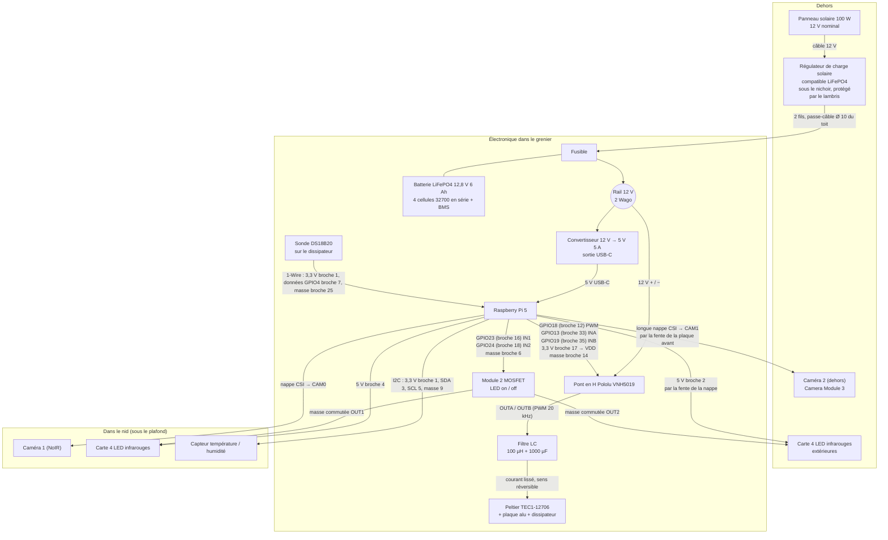

# Schéma électronique du nichoir isolé

Un panneau solaire de 100 W charge une batterie LiFePO4 12,8 V ; la batterie alimente un Raspberry Pi 5 (via un convertisseur 12 V → 5 V) et un pont en H qui inverse le courant du Peltier : froid le jour, chaud la nuit, pour garder environ 5 °C d'écart. Ce document décrit le montage tel qu'il est modélisé dans l'outil « Plaques » (groupe « Électronique »), puis donne, composant par composant, les paramètres à respecter.

## Schéma général

## Branchements, fil par fil

| Liaison | De | Vers | Remarque |
| --- | --- | --- | --- |
| Câble 12 V | Panneau solaire | Régulateur de charge, sous le nichoir | Longe le sol et arrive sous le nichoir, à l'abri du lambris |
| Charge | Régulateur | Batterie, via le fusible | Deux fils (rouge et noir) montent dans une gaine de Ø 16 mm, dans l'isolant du coin arrière droit (à 1 cm du mur arrière, pile sur le joint entre la plaque d'isolant du mur droit et celle du mur arrière) : ils traversent le fond, le plancher intérieur, le cadre du toit et le plancher du toit par des trous de 16 mm, pile le diamètre de la gaine, puis arrivent sur le dessus du toit. Le fusible protège la batterie et le câblage |
| Rail 12 V | Batterie / fusible | Convertisseur 12 → 5 V et pont en H | Fils rouge (+) et noir (−), répartis par **deux Wago 221 à 3 entrées** (un pour le +, un pour le −, posés à droite du fusible) : un fil entre, deux repartent |
| Alimentation du Pi | Convertisseur 12 → 5 V | Prise USB-C du Pi 5 | 5 V, 5 A recommandés pour le Pi 5 |
| Puissance Peltier | Pont en H, sorties OUTA / OUTB | Filtre LC puis Peltier TEC1-12706 | Le filtre lisse le PWM en courant continu ; inverser le sens du courant change la face froide |
| Commande du pont en H | Pi GPIO18 (broche 12, PWM), GPIO13 (broche 33, INA), GPIO19 (broche 35, INB), 3,3 V (broche 17) | Entrées PWM, INA, INB et VDD (alimentation logique) du VNH5019 | Masse commune : broche 14. INA / INB choisissent le sens, PWM la puissance ; ENA / ENB sont tirés à l'état haut sur la carte Pololu |
| Caméra 1 | Pi, port CSI CAM0 | Camera Module 3 NoIR, dans le nid | Courte nappe, passe par l'ouverture du toit |
| Caméra 2 | Pi, port CSI CAM1 | Caméra 2, dehors sous le débord | Longue nappe, sort par une fente rectangulaire 20 × 4 mm de la plaque avant |
| LED infrarouges | Pi broche 4 (5 V) | Carte 4 LED IR | Masse par le module MOSFET (OUT1) : le Pi les allume ou les éteint |
| LED infrarouges extérieures | Pi broche 2 (5 V) | Carte 4 LED IR à côté de la caméra 2 | Masse par le module MOSFET (OUT2) ; les fils suivent la nappe et sortent par la même fente |
| Module MOSFET | Pi GPIO23 (broche 16), GPIO24 (broche 18), masse broche 6 | Module 2 canaux (MOSFET logique 3,3 V) | Coupe la masse de chaque carte de LED ; 5 V direct, courant des LED hors du GPIO |
| Capteur température / humidité | Pi broches 1 (3,3 V), 3 (SDA), 5 (SCL), 9 (masse) | Capteur collé sous le plafond | Liaison I2C, 4 fils |
| Sonde du dissipateur | Pi broches 1 (3,3 V), 7 (GPIO4, données 1-Wire), 25 (masse) | DS18B20 glissée entre deux ailettes, sur le dissipateur | Sécurité : le Pi coupe le Peltier si la face chaude dépasse environ 60 °C ; résistance de 4,7 kΩ entre données et 3,3 V |

## Explication, bloc par bloc

**Production.** Le panneau de 100 W est déporté à environ 70 cm du nichoir, incliné de 35° vers l'avant, sans piquet en bois. Son câble 12 V longe le sol et arrive sous le nichoir, où est le régulateur de charge, posé à plat sous le plancher. Le lambris descend plus bas (45 mm au lieu de 10) pour le protéger de la pluie. Le câble du panneau passe sous l'habillage, sans le percer. Deux fils montent dans l'isolant du coin arrière droit, dans une gaine de Ø 16 mm (tuyau multicouche ou gaine électrique ICTA de diamètre minimal), jusqu'au dessus du toit.

**Stockage.** La batterie est un pack LiFePO4 12,8 V de 6 Ah, soit 4 cellules 32700 en série (environ 77 Wh). Ce chimisme est plus sûr que le lithium-ion classique, mais le régulateur doit avoir un profil de charge LiFePO4 et le pack doit avoir un BMS. Dans le modèle, la batterie est dans le grenier, posée à plat sur le dessus du toit dans le coin avant droit, à 1 cm des murs, avec une cale de bois basse tout autour ; le toit a été relevé pour elle.

**Régulation.** Le régulateur de charge reçoit le panneau, charge la batterie et empêche la surcharge. Un fusible placé juste après la batterie protège tout le reste.

**Cerveau.** Le Raspberry Pi 5 est posé sur des entretoises de 6 mm dans le coin arrière gauche du toit, avec des cales de bois sur tous les côtés. Il pilote le pont en H, lit le capteur, commande les deux caméras et allume les LED infrarouges. Ses prises (USB, Ethernet, HDMI) regardent la plaque arrière, percée d'une fenêtre avec un petit tunnel de contreplaqué : on branche sans ouvrir le nichoir. Il lui faut un convertisseur 12 V → 5 V capable de fournir 5 A.

**Climatisation.** Le Peltier est collé sur une plaque d'aluminium (la face froide, côté nid) ; son dissipateur (face chaude) est dans le compartiment unique du toit (70 × 115 mm, ouvert au-dessus), qu'il partage avec la caméra 1, les LED et les fils du capteur. Le pont en H VNH5019 envoie le courant dans un sens le jour (la plaque refroidit le nid) et dans l'autre la nuit (elle le chauffe). Le Pi règle l'intensité par PWM d'après le capteur de température du nid, et coupe tout si la sonde posée sur le dissipateur dépasse environ 55 °C : un Peltier sans refroidissement se détruit en une minute. L'eau de condensation ruisselle dans une gouttière et sort par un trou Ø 4 dans le coin arrière droit du fond.

**Vision.** La caméra 1 regarde dans le nid, éclairée par 4 LED infrarouges ; la caméra 2 est dehors, sous le débord du toit en chêne, à l'avant gauche, tournée vers le trou d'entrée, avec une seconde carte de 4 LED infrarouges à côté d'elle pour éclairer le trou la nuit. Sa longue nappe part du Pi, traverse le toit et sort par la fente de la plaque avant.

## Paramètres à respecter, composant par composant

Les valeurs viennent de fiches de revendeurs et de constructeurs (liens en bas). Les cases « à déterminer » dépendent du matériel exact que tu achèteras. Vérifie toujours la fiche du modèle choisi.

### Panneau solaire 100 W

| Paramètre | Valeur à viser | Dans le modèle |
| --- | --- | --- |
| Type | 12 V nominal, monocristallin, cadre alu | Oui |
| Puissance | 100 W | 100 W |
| Tension à puissance max (Vmp) | environ 17 à 18 V | — |
| Courant à puissance max (Imp) | environ 5,8 A | — |
| Tension à vide (Voc) | environ 21 à 22 V : doit rester sous la limite d'entrée du régulateur | — |
| Dimensions | selon le modèle, par exemple 970 × 585 × 30 mm | 970 × 585 × 30 mm |
| Connecteurs et câble | MC4, 2 fils de 4 mm² environ, boîte de jonction étanche | câble Ø 7 mm |

### Régulateur de charge solaire

| Paramètre | Valeur à viser | Dans le modèle |
| --- | --- | --- |
| Tension batterie | 12 V | 12 V |
| Profil de charge | LiFePO4 obligatoire (fin de charge 14,2 à 14,6 V pour 4 cellules) | — |
| Courant | au moins 10 A (le panneau donne environ 6 A) | 10,5 A (Genasun) |
| Tension d'entrée maximale | au moins 25 V, mieux 30 V ou plus | — |
| Type | MPPT (meilleur rendement) ou PWM (moins cher) | — |
| Protections | surcharge, décharge profonde, inversion de polarité, court-circuit | — |
| Dimensions | exemple Genasun GV-10-Li : 137 × 61 × 33 mm | 137 × 61 × 33 mm (vraie taille), à plat sous le nichoir |

### Batterie LiFePO4 12,8 V

| Paramètre | Valeur à viser | Dans le modèle |
| --- | --- | --- |
| Montage | 4 cellules 32700 en série (4S) | 4 × 32700 |
| Tension nominale | 12,8 V | 12,8 V |
| Tension de charge max | 14,6 V (3,65 V par cellule) | — |
| Tension de coupure basse | environ 10 à 10,5 V (2,5 V par cellule ; certaines fiches annoncent 2 V) | — |
| Capacité | 6 Ah, soit environ 77 Wh | 6 Ah |
| Courant de décharge continu du BMS | au moins 10 A (Peltier, Pi et marge) | — |
| BMS | obligatoire : équilibrage, coupure haute et basse, court-circuit | — |
| Température de charge | pas de charge sous 0 °C : BMS avec protection basse température (important pour un nichoir dehors) | — |
| Dimensions du pack | environ 70 × 128 × 32 mm pour 4 cellules côte à côte | 128 × 70 × 32 mm (vraie taille), dans le grenier |

### Fusible

| Paramètre | Valeur à viser | Dans le modèle |
| --- | --- | --- |
| Calibre | 15 A suffit (charge au plus 10 A, décharge environ 8 A) ; il doit être inférieur à ce que le câble supporte | 15 A |
| Type | fusible à lame automobile 12 V avec porte-fusible, placé au plus près du + de la batterie | 19 × 18,5 × 5 mm, posé à plat |

### Convertisseur 12 V → 5 V (pas encore dans le modèle)

| Paramètre | Valeur à viser |
| --- | --- |
| Tension d'entrée | au moins 10 à 15 V (la batterie va de 10 V à 14,6 V) |
| Sortie | 5,1 V, 5 A (25 W), sortie USB-C |
| Rendement | plus de 90 % |
| Négociation USB-PD | souhaitable : sans elle, le Pi 5 limite le courant de ses ports USB |
| Protections | surintensité, court-circuit, surtempérature |
| Dimensions dans le modèle | environ 60 × 36 × 16 mm : estimation à confirmer avec le module acheté |
| À déterminer | fixation dans le toit |

### Raspberry Pi 5

| Paramètre | Valeur à viser | Dans le modèle |
| --- | --- | --- |
| Alimentation | 5 V, 5 A en USB-C (bloc officiel 27 W) | via le convertisseur |
| Niveaux GPIO | 3,3 V seulement (ne tolère pas 5 V) | — |
| Ports caméra | 2 ports CSI/DSI de 22 broches : nappes adaptatrices vers la caméra | position provisoire |
| Dimensions | 85 × 56 mm, hauteur du composant environ 17 mm | 85 × 56 mm |
| Stockage | carte microSD ou SSD | — |
| Refroidissement | dissipateur ou ventilateur d'origine si le toit chauffe | — |

### Pont en H Pololu VNH5019

| Paramètre | Valeur à viser | Dans le modèle |
| --- | --- | --- |
| Tension de puissance | 5,5 à 24 V (12 V ici) | 12 V |
| Courant | 12 A continus, 30 A en pointe (le Peltier en prend environ 6) | — |
| Logique | niveaux 2,5 à 5 V : compatible avec les GPIO 3,3 V du Pi (le BTS7960, lui, a un buffer 5 V qui lit mal le 3,3 V : c'est pour ça qu'il est écarté) | — |
| Broches à câbler | VIN et GND (puissance), OUTA / OUTB (Peltier), VDD, PWM, INA, INB, GND ; ENA / ENB, CS et DIAG facultatives | VDD, PWM, INA, INB et GND |
| Fréquence PWM | jusqu'à 20 kHz | — |
| Protections | inversion de polarité (jusqu'à −16 V), surtension, sous-tension, surchauffe, surintensité | — |
| Dimensions | environ 38 × 28 mm, hauteur 8 mm sans connecteurs (10 mm avec borniers) | 38 × 28 × 10 mm |

### Filtre LC du Peltier

| Paramètre | Valeur à viser | Dans le modèle |
| --- | --- | --- |
| Rôle | transformer le PWM à 20 kHz du pont en H en courant presque continu : un Peltier alimenté en impulsions pompe moins de chaleur à puissance égale | — |
| Self | 100 µH, 10 A, faible résistance (self de puissance torique ou blindée) | — |
| Condensateur | 1 000 µF, 25 V, faible ESR, aux bornes du Peltier | — |
| Montage | en série sur un fil, condensateur en parallèle sur le Peltier, après le pont (le courant change de sens : condensateur non polarisé ou deux électrolytiques tête-bêche, ou film) | bloc 28 × 18 × 20, derrière le fusible |
| Alternative | sans filtre, ça marche aussi mais avec 10 à 20 % de rendement en moins | — |

### Peltier TEC1-12706

| Paramètre | Valeur à viser | Dans le modèle |
| --- | --- | --- |
| Tension | 12 V nominal, maximum 14,4 à 16,4 V selon la température | 12 V |
| Courant | maximum 6,4 A | — |
| Puissance de refroidissement max | environ 50 W (face chaude à 25 °C) | — |
| Écart de température max | environ 66 °C à vide | — |
| Résistance | environ 2 Ω | — |
| Dimensions | 40 × 40 × 3,8 mm | 40 × 40 × 3,8 mm |
| Contrainte | dissipateur obligatoire sur la face chaude, jamais à pleine puissance sans lui | dissipateur 40 × 40 × 30 mm |
| À déterminer | rapport cyclique PWM pour tenir 5 °C d'écart : à mesurer, il sera bien inférieur à 100 % | — |

### Caméras (Camera Module 3 NoIR)

| Paramètre | Valeur à viser | Dans le modèle |
| --- | --- | --- |
| Modèle | Camera Module 3 NoIR (sans filtre infrarouge, pour la vision de nuit) | Oui |
| Dimensions | environ 25 × 24 mm | 25 × 24 mm |
| Liaison | nappe CSI, adaptateur vers le port 22 broches du Pi 5 | oui |
| Caméra 2 : longueur de nappe | longue ; au-delà d'environ 30 cm, le signal peut devenir instable : à valider ou utiliser une nappe protégée / un prolongateur | longue nappe de 16 mm de large |
| Caméra 2 : étanchéité | protéger l'objectif de la pluie sous le débord | sous le débord du toit |

### Sonde de température du dissipateur (DS18B20)

| Paramètre | Valeur à viser | Dans le modèle |
| --- | --- | --- |
| Modèle | DS18B20 en boîtier TO-92 (ou version étanche en tube inox) | bloc 5 × 5 × 6 |
| Alimentation | 3,3 V, liaison 1-Wire sur GPIO4 avec résistance de 4,7 kΩ vers le 3,3 V | broches 1, 7, 25 |
| Plage | −55 à +125 °C, ± 0,5 °C | — |
| Fixation | glissée entre deux ailettes, sur le dissipateur, avec un point de pâte thermique | sur le dessus, au centre |
| Seuil | couper le Peltier au-dessus d'environ 55 °C (le haut des ailettes est un peu plus froid que la semelle), le relancer sous 40 °C | à régler dans le programme |

### Carte de 4 LED infrarouges

| Paramètre | Valeur à viser | Dans le modèle |
| --- | --- | --- |
| Longueur d'onde | 850 nm (compatible avec la caméra NoIR) | — |
| Alimentation | 5 V depuis le Pi | broche 4 |
| Courant | à déterminer selon la carte (plus que la limite d'une broche GPIO : ne jamais l'alimenter par un GPIO) | — |
| Commande | module 2 × MOSFET (niveau logique 3,3 V, ex. IRLZ44N ou module « 2 channel MOSFET »), coupure côté masse | module MOSFET, GPIO23 / GPIO24 |
| Dimensions | 12 × 24 mm | 12 × 24 mm |

### Capteur de température et d'humidité (BME280)

| Paramètre | Valeur à viser | Dans le modèle |
| --- | --- | --- |
| Alimentation | 3,3 V | broche 1 |
| Bus | I2C (SDA, SCL), adresse 0x76 ou 0x77 | broches 3 et 5 |
| Mesures | température, humidité et pression | — |
| Dimensions de la carte | environ 19 × 18 mm (jusqu'à 25 × 18 selon la marque) | 19 × 18 mm |
| Contrainte | la condensation est possible sous le plafond : choisir un capteur protégé ou le vernir | collé sous le plafond |

### Câblage

| Paramètre | Valeur à viser |
| --- | --- |
| Puissance 12 V (Peltier, pont en H, batterie) | au moins 2,5 mm², le plus court possible |
| Panneau vers régulateur | environ 4 mm² (tirage d'environ 70 cm à plusieurs mètres) |
| Signaux (PWM, I2C) | 0,25 mm² environ |
| Masse | commune entre le Pi, le pont en H et le rail 12 V |

## Vérification que rien ne coince

Contrôle fait par calcul sur le modèle : recouvrement entre chaque composant et chaque plaque, et hauteur de chaque composant sous la pente du toit (le dessus du toit est à 268 mm, la pente passe de 281 mm à l'avant à 311 mm à l'arrière).

| Composant | Résultat |
| --- | --- |
| Pont en H | déplacé à droite derrière la batterie ; corrigé : le BTS7960 dépassait de 9 mm de la pente à l'avant ; le VNH5019 passe avec 9 mm de jeu |
| Régulateur | sous le nichoir, à plat (61 × 137 × 33 mm), sans conflit : le lambris descend de 45 mm pour le protéger. Sans le lambris (option « Habillage »), il est exposé |
| Fusible | passe (9 mm de jeu sous la pente) |
| Batterie | vraie taille (128 × 70 × 32 mm), montée dans le grenier, dans le coin avant droit, à 1 cm du mur de droite et du mur avant, sur le dessus du toit, avec une cale de bois de 3 mm tout autour : le toit a été relevé (58 → 84 mm devant) pour elle, 6 mm de jeu sous la pente ; le compartiment caméra est réduit à 38 mm pour que la cale ne soit pas dans le vide |
| Raspberry Pi | passe (13 mm sous la pente) ; 5 mm d'écart avec le compartiment du Peltier |
| Convertisseur 12 → 5 V | ajouté à l'avant, taille estimée ; il passe sous la pente avec très peu de jeu |
| Peltier et dissipateur | passent, dans le compartiment unique (avec la caméra et le capteur), loin sous la pente. Le dissipateur chaud partage l'air de la caméra : l'aération arrière évacue la chaleur, la caméra supporte environ 50 °C |
| Caméra 1, capteur | passent |
| Tunnel des prises du Pi | corrigé : les côtés dépassaient dans la plaque du haut |
| Fils et nappes | corrigé : plusieurs fils sortaient de 0,5 à 5 mm au-dessus de la pente, ils sont maintenant ramenés dessous |
| Pièces en bois (88 : murs, planchers, cadres du toit, barres, tasseaux, cales, tunnel des prises) | contrôle de recouvrement réel, trous et encoches compris : aucune paire de pièces ne se chevauche (les barres du toit étaient en contact exact avec le cadre, sans recouvrement) |
| Caméra 2 | dehors, ne touche pas le toit ; sa nappe passe par la fente de la plaque avant |

Limite du contrôle : les formes des pièces sont des boîtes, donc les trous et encoches ne sont pas pris en compte. Les composants sont dessinés à leur vraie taille même quand ils ne tiennent pas : les chevauchements restants (régulateur, batterie) sont à corriger en choisissant d'autres emplacements ou composants.

## Stratégie d'énergie (décision : on commence comme ça)

- Batterie de 6 Ah (4 cellules 32700, 77 Wh) conservée pour le premier montage.
- Le Peltier est piloté en PWM faible par le Pi pour tenir environ 5 °C d'écart, jamais à pleine puissance (60 W = la batterie vidée en une heure).
- Le Pi coupe le Peltier la nuit dès que la batterie descend sous 12 V, et le relance quand le panneau recharge.
- Si la marge est trop courte à l'usage, passer à 12 Ah (8 cellules) : à mesurer avec le vrai matériel avant de conclure.

## Poids (estimation)

Masses calculées d'après les surfaces du modèle (contreplaqué peuplier 3 mm ≈ 1,4 kg/m², lambris pin 10 mm ≈ 5 kg/m², chêne 18 mm ≈ 13 kg/m², laine de bois ≈ 50 kg/m³) et d'après les fiches des composants. À ± 15 %.

| Élément | Poids |
| --- | --- |
| Contreplaqué 3 mm (108 pièces, 0,67 m²) | 0,95 kg |
| Habillage lambris 10 mm (0,33 m²) | 1,6 kg |
| Toit en chêne 18 mm | 1,1 kg |
| Isolant laine de bois 39 mm (murs, fond, toit) | 0,55 kg |
| Batterie 4 × 32700 + BMS + support | 0,6 kg |
| Régulateur de charge Genasun | 0,25 kg |
| Raspberry Pi 5 + carte microSD | 0,05 kg |
| Caméras, LED, capteur, convertisseur, modules, fusible | 0,15 kg |
| Peltier, dissipateur, plaque alu | 0,12 kg |
| Câbles, gaine, nappes | 0,15 kg |
| Cales, barres, étriers, clavettes | 0,1 kg |
| **Total accroché à l'arbre** | **≈ 5,6 kg** |
| Panneau solaire 100 W (au sol, à part) | 8 kg |

**Tenue de la fixation.** 5,6 kg font 55 N. Ils sont repris par 4 dents de 9 × 32 mm dans du contreplaqué de 3 mm : la pression sur le bois reste sous 1 MPa, pour une résistance d'au moins 20 MPa. Le centre de gravité est à environ 11 cm du dos, ce qui ajoute un couple de 6 N·m, soit un effort d'environ 60 N sur la dent du haut : toujours loin de la limite. Les 4 vis Ø 5 dans le tronc (ou une sangle) tiennent cela sans difficulté. Les points à soigner : le collage des 3 plaques de chaque nervure, et des vis inox de 5 × 60 dans du bois sain.

## Prix (ordre de grandeur, 2026)

Prix moyens constatés chez les revendeurs cités en bas, hors port ; à vérifier au moment de l'achat. Décoche une ligne ou un groupe entier pour l'enlever du total (le choix est gardé).

| Groupe | Élément | Prix |
| --- | --- | --- |
| Électronique | Raspberry Pi 5 (4 Go) + microSD 32 Go | 75 € |
| Électronique | 2 × Camera Module 3 NoIR + 2 nappes adaptatrices 22 → 15 broches | 70 € |
| Électronique | 2 × carte 4 LED infrarouges 850 nm | 10 € |
| Électronique | Capteur BME280 | 5 € |
| Électronique | Sonde DS18B20 + résistance 4,7 kΩ | 3 € |
| Électronique | Peltier TEC1-12706 + dissipateur 40 × 40 × 30 + pâte thermique | 12 € |
| Électronique | Plaque alu 116 × 43 × 3 | 8 € |
| Électronique | Pont en H Pololu VNH5019 | 30 € |
| Électronique | Filtre LC (self 100 µH 10 A + condensateur 1000 µF) | 8 € |
| Électronique | Module 2 × MOSFET | 5 € |
| Électronique | Convertisseur 12 V → 5 V 5 A USB-C | 15 € |
| Électronique | 4 cellules LiFePO4 32700 + BMS 4S + support | 40 € |
| Électronique | Fusible + porte-fusible | 3 € |
| Électronique | 2 × Wago 221 (3 entrées) pour le rail 12 V | 2 € |
| Électronique | Câbles (2,5 mm², 4 mm², signaux), gaine ICTA, presse-étoupe, cosses | 25 € |
| Solaire | Panneau solaire 100 W | 90 € |
| Solaire | Régulateur de charge Genasun GV-10-Li | 120 € |
| Corps | Contreplaqué peuplier 3 mm (10 planches de 41 × 40 cm) | 20 € |
| Corps | Laine de bois 40 mm (0,3 m²) | 10 € |
| Corps | Colle, vis inox | 8 € |
| Habillage | Chêne 18 mm (27 × 30 cm) | 12 € |
| Habillage | Lambris pin 10 mm (0,35 m²) | 15 € |
| Habillage | Peinture blanche | 7 € |

Le poste le plus cher est le régulateur Genasun (120 €) : un régulateur PWM LiFePO4 à 20 € ferait le travail avec un rendement moindre, et enlèverait 100 € au total. La découpe laser n'est pas comptée.

## Points à vérifier avant de construire

- **Bilan d'énergie.** Un TEC1-12706 à pleine puissance consomme environ 60 W, soit moins d'une heure sur 77 Wh. Il faut le limiter fortement par PWM (un écart de 5 °C n'en demande qu'une petite fraction) ou prévoir une batterie plus grosse. À mesurer avec le vrai matériel.
- **Taille de la batterie.** Le pack de 4 cellules 32700 (70 × 128 × 32 mm) est dessiné à sa vraie taille et dépasse du mur droit. Choix à faire : pack 2×2 ou batterie hors du toit.
- **Régulateur sous le nichoir.** Il n'est protégé que par le lambris : sans l'option « Habillage », rien ne le couvre. Il chauffe de 2 à 5 W, donc ne pas le noyer dans l'isolant. La gaine de Ø 16 mm traverse sept plaques par des trous de 16 mm, serrés : elle tient sans jeu. Le nichoir doit être posé assez haut pour que le régulateur (33 mm) ne touche pas le sol.
- **Convertisseur 12 → 5 V.** Dessiné avec une taille estimée, à confirmer avec le module acheté.
- **Pont en H.** Le BTS7960 (50 × 50 × 43 mm) a été remplacé par un Pololu VNH5019 (38 × 28 × 8 mm) : le grenier est trop bas à l'avant (environ 13 mm sous la pente au-dessus du dessus du toit) pour le BTS7960 avec son radiateur.
- **Pi 5.** Le modèle 3D n'est pas encore intégré : les ports caméra sont à une position provisoire.

## Liens des composants

- [Raspberry Pi 5](https://www.raspberrypi.com/products/raspberry-pi-5/)
- [Camera Module 3](https://www.raspberrypi.com/products/camera-module-3/)
- [Peltier TEC1-12706, fiche HB](https://www.radiolocman.com/datasheet/pdf.html?di=173597)
- [Pont en H Pololu VNH5019](https://www.pololu.com/product/1451)
- [Cellule LiFePO4 32700](https://robu.in/?p=2024523)
- [Régulateur Genasun GV-10-Li](https://azcus.digikey.com/en/products/detail/genasun/GV-10-Li-14-2V-OEM/24614948)
- [Capteur BME280, fiche Bosch](https://cdn.sparkfun.com/assets/5/3/0/f/7/BME280_Datasheet.pdf)
- [Panneau 100 W Wattuneed](https://www.wattuneed.com/fr/panneaux-solaires/8120-panneau-solaire-12v-100wc-monocristallin-0712971138629.html)
