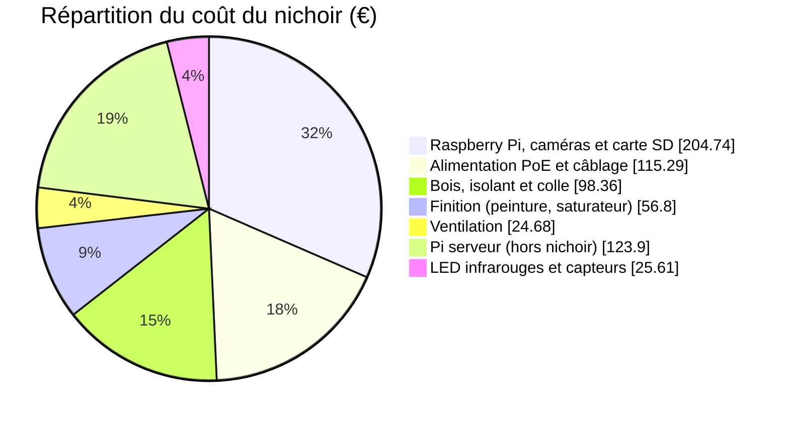

# Dossier du nichoir isolé

Un seul câble Ethernet Cat6 extérieur relie un switch PoE+ (hors du nichoir) à un splitter PoE+ 802.3at placé dans le grenier du toit ; il entre par le dessous du nichoir et monte dans une gaine ICTA Ø 16 cachée dans l'isolant du coin arrière gauche. Le splitter donne du 5 V par un câble USB-C au Raspberry Pi 5 et le réseau par un cordon RJ45. Un second Raspberry Pi 5, dans la maison et relié au même switch, héberge le site web. Le Pi du nichoir alimente à son tour, depuis sa broche 4 (5 V), un ventilateur silencieux de 60 mm (Noctua NF-A6x25 5V PWM) qui aspire l'air chaud du nid à travers le toit (l'entrée d'air est le trou d'envol et une prise d'air basse dans l'isolant). Le ventilateur ne tourne que quand il fait chaud : le Pi le pilote en PWM et peut couper son 5 V par un relais. Une sonde de température étanche, sous le débord du toit, donne la température de dehors. Ce document décrit le montage tel qu'il est modélisé dans l'outil « Plaques » (groupe « Électronique »), puis donne, composant par composant, les paramètres à respecter.

## Schéma général

```mermaid
flowchart TB
  subgraph DEHORS["Dehors"]
    SWT["Switch PoE+ (hors nichoir)<br/>alimente le nichoir et le relie au réseau"]
    SRV["Serveur Pi 5 (dans la maison)<br/>héberge le site web"]
    CAM2["Caméra 2 (dehors)<br/>Camera Module 3"]
    IR2["Carte 4 LED infrarouges<br/>extérieures"]
    SONDE["Sonde de température extérieure<br/>DS18B20 étanche, sous le débord du toit<br/>(module à bornier dans le grenier)"]
  end
  subgraph TOIT["Électronique dans le grenier"]
    POE["Splitter PoE+ 802.3at<br/>sortie USB-C 5 V"]
    subgraph V5["Côté 5 V du ventilateur"]
      RAIL(("Rail 5 V<br/>Wago 221-413"))
      SWF["Relais 3 V du ventilateur<br/>coupe le + 5 V"]
      FAN["Ventilateur Noctua NF-A6x25 5 V PWM<br/>60 mm, cassette amovible"]
    end
    subgraph V33["Logique 5 V et 3,3 V"]
      PI["Raspberry Pi 5"]
      SW["Modules MOSFET<br/>LED on / off"]
    end
  end
  subgraph NID["Dans le nid (sous le plafond)"]
    CAM1["Caméra 1 (NoIR)"]
    IR["Carte 4 LED infrarouges"]
    SENS["Capteur température / humidité"]
  end
  SWT -->|"câble Ethernet Cat6 PoE+<br/>par un passe-câble étanche"| POE
  POE -->|"5 V USB-C"| PI
  POE -->|"cordon RJ45 (données)"| PI
  PI -->|"5 V broche 4"| RAIL
  RAIL -->|"5 V +"| SWF
  SWF -->|"5 V commuté (rallonge 4 broches)"| FAN
  PI -->|"GPIO27 (broche 13) commande<br/>3,3 V"| SWF
  PI -->|"GPIO18 (broche 12) PWM 25 kHz visé (10 kHz si refusé)<br/>GPIO17 (broche 11) tachymètre<br/>masse broche 14"| FAN
  PI -->|"nappe CSI → CAM0"| CAM1
  PI -->|"longue nappe CSI → CAM1<br/>par le canal du toit en okoumé"| CAM2
  PI -->|"GPIO23 (broche 16) PWM nid<br/>GPIO24 (broche 18) PWM ext<br/>masse broche 6"| SW
  PI -->|"5 V broche 4"| IR
  PI -->|"5 V broche 2<br/>par le canal du toit"| IR2
  SW -->|"masse commutée LOAD nid"| IR
  SW -->|"masse commutée LOAD ext"| IR2
  PI -->|"I2C : 3,3 V broche 1, SDA 3, SCL 5, masse 9"| SENS
  PI -->|"1-Wire GPIO4 (broche 7)<br/>3,3 V broche 17, masse broche 20"| SONDE
  SWT -->|"cordon RJ45 Cat6"| SRV
  linkStyle 0 stroke:#2563eb,stroke-width:2.5px
  linkStyle 1 stroke:#dc2626,stroke-width:2.5px
  linkStyle 2 stroke:#2563eb,stroke-width:2.5px
  linkStyle 3 stroke:#dc2626,stroke-width:2.5px
  linkStyle 4 stroke:#dc2626,stroke-width:2.5px
  linkStyle 5 stroke:#dc2626,stroke-width:2.5px
  linkStyle 6 stroke:#f97316,stroke-width:2.5px
  linkStyle 7 stroke:#2563eb,stroke-width:2.5px
  linkStyle 8 stroke:#d97706,stroke-width:2.5px
  linkStyle 9 stroke:#d97706,stroke-width:2.5px
  linkStyle 10 stroke:#6b7280,stroke-width:2.5px
  linkStyle 11 stroke:#dc2626,stroke-width:2.5px
  linkStyle 12 stroke:#dc2626,stroke-width:2.5px
  linkStyle 13 stroke:#111827,stroke-width:2.5px
  linkStyle 14 stroke:#111827,stroke-width:2.5px
  linkStyle 15 stroke:#eab308,stroke-width:2.5px
  linkStyle 16 stroke:#eab308,stroke-width:2.5px
  linkStyle 17 stroke:#2563eb,stroke-width:2.5px
  style V5 fill:#fef2f2,stroke:#dc2626,stroke-width:2px
  style V33 fill:#eff6ff,stroke:#2563eb,stroke-width:2px
  classDef swt fill:#475569,stroke:#1c1917,color:#fff
  classDef srv fill:#15803d,stroke:#1c1917,color:#fff
  classDef poe fill:#0e7490,stroke:#1c1917,color:#fff
  classDef pi fill:#15803d,stroke:#1c1917,color:#fff
  classDef sw fill:#1f2937,stroke:#1c1917,color:#fff
  classDef swf fill:#7e22ce,stroke:#1c1917,color:#fff
  classDef fan fill:#8b5a2b,stroke:#1c1917,color:#fff
  classDef cam fill:#166534,stroke:#1c1917,color:#fff
  classDef ir fill:#7f1d1d,stroke:#1c1917,color:#fff
  classDef sens fill:#1d4ed8,stroke:#1c1917,color:#fff
  classDef sonde fill:#475569,stroke:#1c1917,color:#fff
  class SWT swt
  class SRV srv
  class POE poe
  class PI pi
  class SW sw
  class SWF swf
  class FAN fan
  class CAM1,CAM2 cam
  class IR,IR2 ir
  class SENS sens
  class SONDE sonde
```



Couleur des blocs = couleur des composants dans la 3D (splitter PoE+ bleu-vert, Pi vert, relais violet, ventilateur brun, LED brun-rouge…). Couleur des traits = couleur des fils dans la 3D : rouge pour le + (5 V), noir pour la masse, orange (violet-orangé) pour la commande du relais, bleu pour le PWM du ventilateur et pour les câbles réseau (Cat6, cordon RJ45), jaune pour l'I2C et le 1-Wire de la sonde de dehors, gris pour la commande des LED, orange foncé pour les nappes caméra.

## Branchements, fil par fil

| Liaison | De | Vers | Remarque |
| --- | --- | --- | --- |
| Câble Ethernet | Switch PoE+ (hors nichoir) | Entrée PoE du splitter, dans le grenier (avant gauche du toit) | Un câble Cat6 extérieur apporte l'énergie (PoE+ 802.3at) et le réseau ; il entre par le **dessous** du nichoir (passe-câble étanche), monte dans la gaine ICTA Ø 16 du coin arrière gauche, dans l'isolant, sort sur le dessus du toit et passe au-dessus du Pi, en l'air, jusqu'au splitter. La fiche RJ45 ne passe pas dans les 12 mm utiles de la gaine : on tire le câble sans fiche, puis on **sertit la fiche RJ45 après**. Un parafoudre protège la liaison. Le câble et la gaine sont dessinés dans la 3D (trajet indicatif) ; le passe-câble et le parafoudre ne le sont pas |
| Réseau du serveur | Switch PoE+ (hors nichoir) | Prise Ethernet du Pi serveur (dans la maison) | Cordon RJ45 Cat6 d'environ 1 m (longueur à mesurer sur place) : le serveur héberge le site web et relaie `/api/` et `/video/` vers le Pi du nichoir par le switch. Le Pi serveur a sa propre alimentation (pas de PoE). Cordon dessiné dans la 3D, hors du nichoir |
| Alimentation du Pi | Splitter PoE+ (sortie USB-C 5 V) | Prise USB-C du Pi 5 | Câble USB-C vers USB-C court (20 à 30 cm), non fourni ; 5 V avec au moins 4,5 A visés |
| Réseau du Pi | Splitter PoE+ (sortie de données RJ45) | Prise Ethernet du Pi 5 | Cordon RJ45 Cat6 de 25 à 30 cm ; le PoE reste dans le splitter, seules les données passent |
| Rail 5 V | Pi broche 4 (5 V) | Wago 221-413 du rail 5 V (2ᵉ entrée), contre le mur droit | Fil rouge du Pi au Wago ; la 1ʳᵉ entrée va à la borne COM du relais, la 3ᵉ est libre. La broche 4 porte deux fils (LED du nid et rail 5 V), comme la broche 14 porte deux fils de masse |
| Relais du ventilateur | Wago + (5 V) sur COM ; Pi GPIO27 (broche 13) sur IN ; 3,3 V du Pi (broche 17) sur VCC ; masse du Pi (broche 25) sur GND | Bornes COM / NO du relais, IN / VCC / GND du côté commande | Le relais coupe le 5 V du ventilateur, côté **+**, pas côté masse : une masse coupée ferait remonter du 5 V dans les fils PWM et tachymètre vers les GPIO. Le 3,3 V de la broche 17 est partagé avec la sonde de dehors par un Wago 221-413 |
| 5 V du ventilateur | Borne NO du relais (+, rouge) ; masse commune du ventilateur (broche 14 du Pi) | Prise 4 broches d'origine du ventilateur (sur le bord avant du couvercle de la cassette) + rallonge 4 broches (prise mâle collée sur la face avant du siège) | Fils de 1,6 mm de diamètre ; plus de fil « ventilateur − » séparé : la masse du ventilateur est le fil de masse commune vers la broche 14 ; on débranche la prise à la main, une seule fois, avant de sortir la cassette ; aucune soudure |
| Commande du ventilateur | Pi GPIO18 (broche 12, PWM par gpiozero / lgpio : 25 kHz visé, repli à 10 kHz si le Pi le refuse), GPIO17 (broche 11, tachymètre), masse commune broche 14 | Fils PWM (bleu) et tachymètre (jaune) du Noctua, par la prise 4 broches d'origine et la rallonge | Le PWM est référencé à la masse du ventilateur : d'où le fil de masse commune vers la broche 14. Le tachymètre est collecteur ouvert : tirage interne du GPIO17 (pull-up logiciel) |
| Caméra 1 | Pi, port CSI CAM0 | Camera Module 3 NoIR, dans le nid | Courte nappe, passe par l'ouverture du toit |
| Caméra 2 | Pi, port CSI CAM1 | Caméra 2, dehors, sur sa plaque au-dessus du trou d'envol, au centre, sous le débord du toit en okoumé | Longue nappe, passe DANS le toit : par le canal oblong du pan (50 mm de large), entre ses deux plaques collées |
| LED infrarouges | Pi broche 4 (5 V, deuxième fil de cette broche avec le rail 5 V) | Carte 4 LED IR | Masse par le module MOSFET du nid (LOAD) : le Pi les allume ou les éteint |
| LED infrarouges extérieures | Pi broche 2 (5 V) | Carte 4 LED IR devant la caméra 2, sur la même plaque | Masse par le module MOSFET extérieur (LOAD) ; les fils suivent la nappe dans le même canal |
| Module MOSFET | Pi GPIO23 (broche 16), GPIO24 (broche 18), masse broche 6 | Deux modules à 1 canal (MOSFET LR7843, logique 3,3 V), un par carte de LED | Coupe la masse de chaque carte de LED ; 5 V direct, courant des LED hors du GPIO |
| Capteur température / humidité | Pi broches 1 (3,3 V), 3 (SDA), 5 (SCL), 9 (masse) | Capteur dans le compartiment de la caméra, à fleur du plafond | Liaison I2C, 4 fils |
| Sonde de température extérieure | Pi : broche 17 (3,3 V), GPIO4 (broche 7, donnée 1-Wire), broche 20 (masse) | Module 3 broches DS18B20 (résistance de rappel de 4,7 kΩ), puis la sonde étanche par son câble de 3 conducteurs | Trois cordons Dupont du Pi au module ; le câble de la sonde (rouge 3,3 V, noir masse, jaune donnée) entre dans le toit par un canal oblong de 8 mm de la plaque crénelée du pan (fermé par la plaque pleine) et ressort dans le caisson, derrière la baguette gauche du couvercle. Le 1-Wire est activé par `dtoverlay=w1-gpio` dans `/boot/firmware/config.txt` |
| Prise d'air basse | — (pas d'électronique) | Conduit de contreplaqué dans l'isolant du mur gauche avant, fente dans la paroi intérieure à mi-hauteur | Section libre 10,9 cm² ; grille de bois sur la fente (la prise d'air reste toujours ouverte, sans clapet), ouverture de 26 × 6 mm au ras du plancher pour l'eau, sous-boîte isolante amovible par le dessous (lèvre de 11 mm sous le fond) |

**Fiche d'un fil dans l'application.** Un clic sur un fil (ou sur sa carte dans « Pièces ») de la vue 3D ouvre sa fiche : couleur, diamètre dessiné et section, longueur du trajet, longueur de cordon à prévoir, de → vers (broche et GPIO du Pi, borne, Wago), rôle, tension, courant, raccord. Les broches de cette fiche sont celles de ce tableau ; la longueur est calculée sur le trajet dessiné.

## Explication, bloc par bloc

**Alimentation et réseau (PoE).**

- Un câble Ethernet Cat6 extérieur relie un switch PoE+ (hors du nichoir, dans la maison) au nichoir et lui apporte à la fois l'énergie et le réseau. Une coupure du switch coupe tout le nichoir : il n'y a plus de batterie.
- Il entre par le **dessous** du nichoir (passe-câble étanche, emplacement à choisir, non dessiné, comme le parafoudre), monte dans une gaine ICTA Ø 16 (environ 12 mm utiles) cachée dans l'isolant du **coin arrière gauche** (centre à 5 mm du mur arrière et du mur de gauche), sort sur le dessus du toit et finit sur l'entrée PoE d'un splitter PoE+ 802.3at posé dans le grenier du toit, à l'avant gauche, à 1 cm des murs, couché dans le sens gauche-droite (60 × 36 × 16 mm, taille estimée à confirmer).
- **Gaine** : elle traverse le fond et le plancher intérieur par des trous de Ø 16 mm (pile son diamètre), la pièce en C et les trois planches du cadre par des trous de Ø 18 mm, puis le dessous du toit, un fourreau de 13 petits carrés de contreplaqué empilés (« Fourreau gaine toit 1 à 13 », 26 mm de côté, percés de Ø 18 mm) et le dessus du toit. L'isolant du toit est découpé autour du fourreau ; celui des murs et du fond est plein : on pousse la gaine dans la laine.
- **Fiche RJ45** : elle ne passe pas dans la gaine. On tire le câble Cat6 sans fiche depuis le dessous, puis on sertit la fiche RJ45 sur le dessus du toit, après (outil de sertissage RJ45 non compté).
- Le splitter sépare l'énergie et les données : sa sortie USB-C 5 V (au moins 4,5 A visés) alimente le Pi par un câble USB-C court, et sa sortie RJ45 rejoint la prise Ethernet du Pi par un cordon de 25 à 30 cm.
- Le Pi redistribue du 5 V : sa broche 4 (déjà prise par les LED du nid) alimente aussi un rail 5 V, un Wago 221-413 contre le mur droit ; de là, un fil va à la borne COM du relais du ventilateur. La broche 4 porte donc deux fils, comme la broche 14 (deux fils de masse).
- Plus de panneau, de batterie, de régulateur, de fusible ni de convertisseur : sous le nichoir il n'y a plus rien à protéger à part l'arrivée du câble, le lambris ne descend plus que de 10 mm.
- **Hors du nichoir** (groupe « Réseau (hors nichoir) » dans la 3D, à droite) : le switch PoE+ (pavé d'environ 160 × 100 × 28 mm, taille à confirmer) et un second Raspberry Pi 5, le **serveur**, qui héberge le site web ; un cordon RJ45 Cat6 d'environ 1 m les relie. Voir les fiches « Switch PoE+ » et « Serveur Pi 5 ».

**Cerveau.** Le Raspberry Pi 5 pilote tout le montage.

- Il est posé sur des entretoises de 6 mm sur le côté gauche du toit, **avancé de 18 mm** vers l'avant pour libérer le coin arrière gauche à la gaine du câble Ethernet : son bord arrière est à 7 mm du fourreau de la gaine (12 mm de la gaine elle-même) et à 33 mm de la plaque arrière. Il est calé au montage par des morceaux de baguette de contreplaqué collés sur tous les côtés (voir « Cales »). Les modules MOSFET ont avancé de la même distance.
- Il pilote le ventilateur (PWM, tachymètre, relais 5 V), lit le capteur du nid et la sonde de dehors, commande les deux caméras et allume les LED infrarouges.
- Ses prises USB (2 × USB 3 et 2 × USB 2) et sa prise Ethernet (reliée au splitter par le cordon RJ45) regardent la plaque arrière, percée d'une fenêtre de 60 × 35,5 mm en face d'elles (la même hauteur que la sortie du ventilateur) : on branche sans ouvrir le nichoir, en retirant au besoin la plaque de ventilation arrière de l'habillage. Son USB-C d'alimentation et ses deux micro-HDMI sont sur l'autre grand bord, tourné vers le centre du toit, hors de cette fenêtre. Le Pi 5 n'a pas de prise jack audio.
- Il est alimenté par le splitter PoE+ : sortie USB-C 5 V d'au moins 4,5 A visés (le Pi 5 voudrait 5 A ; avec moins il limite le courant de ses ports USB, sans effet ici). Le réseau passe par le cordon RJ45 du même splitter.
- Ses deux ports caméra sont des connecteurs de 22 broches côte à côte sur le bord tourné vers le centre du toit ; les caméras (nappes de 15 broches) s'y branchent par des nappes adaptatrices 22 → 15 broches.
- Il possède un connecteur de pile RTC : une pile rechargeable dédiée garde l'heure sans réseau (option, voir « Points à vérifier »).

**Température de dehors.** Une sonde DS18B20 étanche mesure l'air extérieur ; aucun service en ligne n'intervient.

- **Position** : sur le côté gauche, sous le débord de 30 mm du toit, collée contre le dessous du pan en okoumé, à y = +42 mm (vers l'arrière). Elle est à l'ombre, à 129 mm du ventilateur et de sa sortie (arrière droit), à 176 mm de la caméra 2 et de ses LED infrarouges (avant gauche).
- **Passage du câble** : il passe dans le toit, comme la nappe de la caméra 2. Un canal oblong de 8 mm de large et 37 mm de long (bouts ronds) est percé dans la plaque crénelée du pan en okoumé, de l'à-plomb du bout de la sonde (x = −121 mm) jusque dans le caisson (x = −84 mm), 15 mm derrière la baguette gauche du couvercle ; la plaque pleine le ferme. Le câble sort du bout de la sonde, monte dans le canal, circule entre les deux plaques à 2,5 mm du dessous du pan, passe au-dessus du chant de la baguette gauche et ressort dans le caisson ; il n'y a aucun trou dans la lame d'habillage gauche ni dans la plaque gauche du toit.
- **Baguette gauche** : elle n'a pas de dent dans le canal ni à 3 mm de chaque côté (une dent sur six omise) ; ligaments de bois autour du canal : 14 mm au moins, contre 3 mm exigés.
- **Module** : le câble de 3 conducteurs finit dans un module à bornier à vis (résistance de rappel de 4,7 kΩ, 20,5 × 23 mm) posé sur le dessus du toit, devant le Pi, contre le mur gauche. Trois cordons Dupont le relient au Pi : 3,3 V (broche 17), donnée sur GPIO4 (broche 7), masse (broche 20).
- **Lecture** : le noyau lit la sonde par le 1-Wire dans `/sys/bus/w1/devices/28-*/w1_slave`. Le programme refuse un CRC mauvais, la valeur d'erreur 85,0 °C du DS18B20 et toute valeur hors −40 à 60 °C.
- **Ventilation automatique** : la comparaison nid / dehors utilise cette mesure. Sans mesure valable de dehors (sonde absente, muette ou hors plage), l'automatique ne démarre pas, la page l'indique (état « sécurité », avertissement) ; l'alerte à 35 °C du nid ne dépend pas de la sonde.

**Cales.** Le Pi et le relais du ventilateur se calent avec des morceaux de baguette (10 morceaux, 192 mm en tout : 6 pour le Pi, 4 pour le relais) ; chaque carte de LED infrarouges est posée sur deux morceaux de 8 mm (4 morceaux de plus, 32 mm en tout). Le besoin est donc de 14 morceaux et 224 mm. L'avance du Pi ne change pas le besoin (mêmes six cales de 16 mm) : 2 baguettes suffisent toujours. Le splitter PoE+, s'il en a besoin, se cale avec les mêmes baguettes (non compté dans ce besoin).

- Le groupe « Baguettes de cale (à couper) » contient **2 baguettes** de contreplaqué de 3 mm : 384 mm de long (la plus grande longueur qui tient sur une planche de 400 × 320 mm, zone de la Sculpfun E1 Pro, comme sur 410 × 400 ou 400 × 400, avec 8 mm de marge) et 5 mm de large, soit le triple du besoin (3 × 224 mm = 672 mm) pour garder de la marge.
- Elles sont découpées au laser avec le reste du contreplaqué (elles se rangent dans les creux des planches) et posées dans la 3D au sol, à gauche des pièces d'hiver, hors du nichoir.
- Posée à plat, une baguette fait 3 mm de haut et 5 mm de large.
- **Mode d'emploi : au montage, on coupe un morceau de baguette à la longueur voulue et on le colle contre le composant, une fois celui-ci posé à sa place.**

**Baguettes du dessus du toit.** Le dessus du toit (« Dessus toit ») repose sur cinq **baguettes de contreplaqué de 3 mm découpées au laser** (« Baguette dessus toit gauche / droite / avant / arrière 1 et 2 », groupe « Toit », codes T-10 à T-14).

- Elles sont posées **à plat** juste sous le dessus, contre la face intérieure des quatre plaques du toit.
- Chaque baguette a un corps de 5 mm de large (la surface d'appui) plus des **dents de 3 mm** (en nombre impair, d'environ 16 mm ; aux deux bouts, un bout de corps sans dent).
- Les dents traversent des fentes de 3 mm percées dans la plaque du toit qui porte la baguette (« Face avant toit », « Face arrière toit », « Côté gauche toit », « Côté droit toit ») : elles s'emboîtent comme les autres crénelages.
- La baguette arrière est en deux morceaux : elle contourne le siège du ventilateur et s'arrête, à gauche, avant le fourreau de la gaine. La baguette gauche est **raccourcie** autour du fourreau (177 mm au lieu de 204 mm, coin arrière gauche) : elle n'est plus identique à la droite (codes T-10 pour la gauche et T-11 pour la droite).
- Le dessus des baguettes affleure le dessous du dessus du toit ; chaque baguette fait 3 mm de haut (l'épaisseur du contreplaqué) sur 5 mm de large.
- Ligaments de bois autour des fentes : 4,5 mm ou plus.

**Corps, isolant et cadre.** Le corps est fait de huit parois de contreplaqué 3 mm : quatre extérieures (« Face avant ext », « Face arrière ext », « Côté gauche ext », « Côté droit ext ») hautes de 227 mm et quatre intérieures (« … int ») hautes de 185 mm, dont le haut est au niveau du dessous du toit.

- **Isolant** : de la fibre de bois de 39 mm remplit la couronne entre les murs extérieurs et intérieurs ; elle s'arrête 12 mm sous le haut des parois, sous la pièce en C.
- **Gaine du câble Ethernet** (« Gaine du câble Ethernet (ICTA Ø 16, dans l'isolant) ») : gaine annelée noire dans le coin arrière **gauche**, centre à 5 mm des murs arrière et gauche, du dessous du nichoir au dessus du toit. Les pavés d'isolant du corps sont pleins (on la pousse dans la laine) ; ceux du toit (« Isolant toit 1 à 8 ») sont découpés autour du fourreau. Elle traverse « Dessous ext » (COR-07) et « Plancher int » (COR-08) par des trous de Ø 16 mm, serrés, puis « Pièce en C sous le cadre » (COR-13), les trois planches « Cadre toit » (T-16), « Dessous toit » (T-09), le fourreau (T-03) et « Dessus toit » (T-08) par des trous de Ø 18 mm.
- **Plaques qui cachent l'isolant autour du bloc d'entrée** : trois plaques de contreplaqué 3 mm (groupe « Corps ») bordent le puits du bloc d'entrée, côté gauche et côté droit (COR-14, deux plaques identiques, debout) et en dessous (COR-15, à plat). Elles sont crénelées aux deux bouts (dents impaires d'environ 16 mm) : leurs dents entrent dans des fentes de « Face avant ext » (COR-03) et de « Face avant int » (COR-09) du nid, le plat des bouts est collé contre ces deux parois, et le haut des plaques debout est collé à plat sous la pièce en C (COR-13), alignées sur les flancs de son ouverture, sans y entrer ; l'isolant avant gauche, avant droite et sous le bloc s'arrête contre elles.
- **Pièce en C crénelée** : plaque de contreplaqué 3 mm (« Pièce en C sous le cadre », groupe « Corps ») posée à plat dans la couronne d'isolant, sous le cadre ; elle n'a pas de tasseau : ses dents (≈ 16 mm, une sur deux, bouts pleins) s'encastrent directement dans des fentes des huit parois, les quatre extérieures par ses bords extérieurs et les quatre du nid par les bords de son trou. Elle revient vers l'entrée des deux côtés : devant, elle ne laisse que l'ouverture du bloc d'entrée (60 mm + 1 mm de jeu de chaque côté), qui reste enlevable par le haut. Elle enferme l'isolant ; la gaine la traverse (trou de Ø 18 mm).
- **Cadre** : trois planches de contreplaqué collées (« Cadre toit haut / milieu / bas », 9 mm, groupe « Toit »), posées pile sur la pièce en C, ferment la couronne par le haut, à fleur du chant des parois (trou de Ø 18 mm pour la gaine, coin arrière gauche) ; leur ouverture, en U, est ouverte vers l'avant sur toute la largeur du nid.
- **Plaque de ventilation arrière** : plaque d'okoumé de 5 mm (groupe « Habillage », peinte avec lui) qui remplit l'ouverture de l'habillage arrière, jeu 0 ; vue de derrière, à gauche la grille de la sortie du ventilateur (7 fentes de 4 mm, la même que celle de la plaque arrière du toit), à droite celle du Raspberry Pi (10 fentes de 4 mm devant sa fenêtre). Quatre trous de Ø 2,2 mm, un à chaque coin, la traversent et traversent la plaque arrière du toit : on y enfonce quatre cure-dents, avec un peu de colle, coupés à ras.
- **Lame d'entrée non collée** : la lame de l'habillage avant qui porte le trou d'envol (« Lambris avant 3 (percé) ») ne se colle pas : quatre trous de Ø 2,2 mm à ses coins, repris dans la paroi derrière elle (deux dans « Face avant ext », deux dans « Face avant toit »), reçoivent quatre cure-dents (« Cure-dent lame d'entrée 1 à 4 », 10 mm) ; on la retire en les tirant ou en les coupant.
- **Cure-dents de positionnement de l'habillage** : deux trous de cure-dent de Ø 2,2 mm par lame (hors la lame d'entrée, qui a les siens), à 6 mm au-dessus du bas du corps, à la hauteur des deux cure-dents du bas de la lame d'entrée, sur tout le tour du nichoir. Les mêmes trous sont percés dans « Face avant ext », « Face arrière ext », « Côté droit ext » et « Côté gauche ext » (cure-dents « Cure-dent habillage 1 à 38 », cylindres de Ø 2 × 10 mm : 5 mm de lame, 3 mm de paroi, 2 mm derrière). C'est le système qui positionne parfaitement chaque lame de l'habillage (même hauteur, bon écartement, rien à mesurer au collage). On les plante dans la paroi avant de coller : chaque lame s'enfile dessus et se place exactement. Pour les lames d'angle, qui dépassent la paroi, le cure-dent est ramené à 9 mm du bord de la paroi.
- **Toit** : le dessous du toit repose directement sur le chant des huit parois ; le haut du bloc d'entrée affleure ce chant (227 mm). **Fourreau de la gaine dans le toit** : 13 carrés de 26 mm (« Fourreau gaine toit 1 à 13 », T-03), percés de Ø 18 mm, empilés et collés entre le dessous et le dessus du toit, dans le coin arrière gauche : ils tiennent la gaine et la séparent de l'isolant du toit. **Siège du ventilateur** : les trois parois de la goulotte sont dans le groupe « Toit » (la cassette et le reste de la ventilation gardent le groupe « Ventilation »).

**Pièces fines de rechange.** Chaque plaque de contreplaqué fine a 3 exemplaires de rechange.

- **Seuil** : plus petit côté ou largeur moyenne (2 × aire / périmètre du contour) d'au plus 12 mm. Cela couvre les baguettes du couvercle et du dessus du toit, les poignées en U, les clavettes de la fixation à l'arbre et les plaques du conduit de sortie.
- Le groupe « Pièces fines de rechange » contient **3 exemplaires identiques** (« … (rechange 1) » à « (rechange 3) »), posés à plat sur le sol, à gauche du nichoir et derrière les pièces d'hiver et les baguettes de cale.
- Ils sont découpés au laser avec le reste et portent **le même numéro que l'original**.
- Les baguettes de cale (déjà en triple) et les composants achetés n'ont pas de rechange.
- Ils ne demandent pas de planche de plus (ils se rangent dans les creux des planches).

**Ventilation.** Un ventilateur silencieux de 60 mm (Noctua NF-A6x25 5V PWM) aspire l'air chaud du nid à travers le plafond et le rejette à l'arrière, sous le débord du toit en okoumé ; l'air frais entre par le trou d'envol et par une prise d'air basse dans l'isolant (voir la fiche « Prise d'air basse »).

- **Cassette** : le ventilateur n'est pas dans la zone de l'électronique ; il tourne dans une cassette amovible à la main (quatre parois de contreplaqué, un cadre, un couvercle à poignée, le ventilateur posé sur quatre plots en caoutchouc).
- **Siège** : la cassette se pose par gravité dans un siège fixe collé sur le plancher du toit (la goulotte : trois parois, dont les deux latérales vont jusqu'à la plaque arrière du toit, qui fait la quatrième). La paroi avant (largeur extérieure du siège) et les deux côtés s'emboîtent par leurs arêtes verticales, comme les parois d'une boîte : 7 dents de 13 mm environ, paroi avant en phase 0 et côtés en phase 1, ce qui forme un U d'un seul bloc ; aucune dent à l'arrière, côté plaque arrière du toit, ni en haut. L'intérieur du siège est celui de la cassette, à jeu nul. Le siège est à 1 cm du bloc de la caméra.
- **Sortie** : la cassette a une fenêtre de sortie en face de celle de la plaque arrière. Un petit conduit de sortie de 10,6 mm de long (quatre plaques de contreplaqué), fixé à la cassette par crénelage (deux dents sur chacune de ses quatre plaques, dans la paroi arrière de la cassette), sort avec elle et la relie à la plaque ; il s'appuie sur la plaque, sans joint.
- **Grille** : la grille de sortie est percée dans la plaque arrière du toit (fentes verticales de 4 mm) ; rien ne dépasse derrière.
- **Ouverture du plafond** : elle reste ouverte quand le ventilateur est arrêté (sans clapet) ; par temps froid on pose le bloc isolant à la place de la cassette.
- **Branchement** : le câble d'origine du ventilateur finit par sa prise 4 broches femelle, sur le bord avant du couvercle. La prise mâle de la rallonge 4 broches (5 V commuté, masse, PWM, tachymètre) est collée sur la face avant du siège et la femelle s'y emboîte à la verticale : on la débranche à la main avant de sortir la cassette, sans soudure. Les fils de la rallonge contournent le siège.

**Brancher le ventilateur : quoi sur quoi.** Le câble vendu avec le Noctua est un seul câble noir gainé (quatre fils dedans) : la 3D le dessine en noir, sans couleur à suivre. On branche par le **numéro de broche de la prise 4 broches** (brochage standard des ventilateurs PWM : à confirmer sur la fiche Noctua avant de brancher) :

| Broche de la prise | Fonction | Fil du toit qui s'y branche | Arrivée |
| --- | --- | --- | --- |
| 1 | masse (GND) | « Fil masse commune ventilateur » (un seul fil sur cette broche) | broche 14 du Pi (GND) |
| 2 | +5 V | « Fil interrupteur → ventilateur + » | borne NO du relais (jamais directement sur le rail) |
| 3 | tachymètre | « Fil tachymètre ventilateur » | broche 11 du Pi (GPIO17) |
| 4 | PWM | « Fil PWM ventilateur » | broche 12 du Pi (GPIO18) |

Les prises sont détrompées : la rallonge ne s'enfiche que dans le bon sens sur la prise du ventilateur. Le +5 V ne doit jamais toucher le tachymètre ni le PWM : ils vont sur des GPIO du Pi, qui ne tolèrent que 3,3 V.

- **Pilotage** : le Pi allume le ventilateur seulement quand il fait chaud, règle sa vitesse par PWM et peut couper son 5 V avec le relais (un ventilateur PWM peut tourner encore à bas régime à 0 % de PWM).
- **Toit** : il tient seul, posé sur le chant des parois du corps, calé par le cadre qui descend dans l'isolant et retenu par l'habillage collé au corps ; pour accéder au grenier, on soulève le toit en okoumé.

**Été / hiver, en 4 lignes**

1. Retirer le toit en okoumé (on accède au grenier).
2. Débrancher à la main la prise 4 broches (la femelle de la cassette, sur la prise mâle collée à l'avant du siège) et sortir la cassette par le haut.
3. Poser à sa place le bloc isolant d'hiver (même empreinte, mousse de 35 mm : il rend au plafond son isolation).
4. L'été, faire l'inverse et rebrancher la rallonge.

*Cassette qui passe mal* : elle est taillée pile (jeu 0) dans son siège. Si elle coince, la poncer légèrement (papier de verre grain 120 puis 180) sur les faces qui frottent, jusqu'à ce qu'elle coulisse sans forcer ; ne jamais la forcer au maillet.

**Couvercle.** Le groupe « Couvercle » réunit le toit en okoumé et quatre baguettes.

- **Toit** : deux plaques de contreplaqué okoumé de 5 mm collées l'une sur l'autre (**10 mm** en tout), non peintes, saturées au saturateur teck mat (voir « Finition du bois »).
- **Emprise** : 270 × 303 mm ; il déborde de 60 mm devant et de 30 mm sur les côtés et derrière ; pente de 8°. Il se découpe au laser sur « Planche okoumé 5 mm » avec les lames de l'habillage : les 22 lames, la plaque de ventilation et les 2 plaques du toit (0,45 m² de pièces) tiennent sur 5 planches de 400 × 320 mm (la zone de la Sculpfun E1 Pro) avec la marge de 8 mm par défaut : la plus longue lame mesure 351 mm. Un panneau de 800 × 600 mm donne 2 planches de 400 × 320 mm.
- **Plaque du dessous** (« Toit en okoumé (plaque crénelée) ») : elle reçoit les quatre baguettes de contreplaqué 3 mm (« Baguette couvercle avant / arrière / gauche / droite »), une par côté de l'ouverture du caisson, collées sous le pan. Elles entrent exactement dans le caisson (longueur = intérieur du caisson, mesurée dans le plan incliné, jeu 0) : le couvercle se centre tout seul.
- **Baguettes** : corps de 10 mm sous le pan et **dents de 5 mm**, d'environ 16 mm de large, qui s'enfoncent dans des fentes de la plaque crénelée (dent + 0 de jeu) et affleurent son dessus.
- **Plaque du dessus** (« Toit en okoumé (plaque pleine) », sans trou ni fente) : elle se colle à plat par-dessus, cache toutes les fentes et rend le toit étanche.
- **Montage** : enfiler les dents dans les fentes, coller les baguettes, puis coller la plaque pleine ; saturer l'ensemble assemblé (2 couches : faces visibles, chants, dessous ; les surfaces collées ne sont pas atteintes) avant la pose.
- **Canal de la caméra 2** : un seul grand trou oblong (50 mm de large, bouts arrondis, agrandi de 14 mm vers l'avant au-dessus du module de la caméra) dans la plaque crénelée ; la plaque pleine le ferme, c'est un conduit DANS le toit. La baguette avant n'a pas de dents à cet endroit (3 mm de bois de chaque côté).
- **Découpe** : les baguettes sont découpées sur le contreplaqué 3 mm (déjà compté), le pan sur l'okoumé ; tout est caché par défaut dans « Pièces ».
- **Fils du ventilateur** : « commande interrupteur » et « masse commune » longent le mur arrière à 2 mm sous la pente ; celui de la commande est à 6,5 mm de la plaque arrière pour ne pas toucher la baguette arrière, qui descend de 10 mm sous le pan.

**Vision.** (Habillage : contreplaqué okoumé extérieur de 5 mm peint en blanc, découpé au laser sur ses propres planches, « Planche okoumé 5 mm ».)

- **Caméra 1** : elle regarde dans le nid, éclairée par 4 LED infrarouges.
- **Caméra 2** : dehors, pile au-dessus du trou d'envol, au centre de la façade, sous le débord du toit en okoumé, regardant droit vers le bas. Une seconde carte de 4 LED infrarouges, devant elle, éclaire la zone la nuit.
- **Plaque de la caméra extérieure (« Plaque caméra extérieure »)** : plaque de contreplaqué 3 mm, horizontale et perpendiculaire à la façade, au centre, collée au toit : le module (plaque, caméra, carte de LED) est monté le plus haut possible, à 1 mm sous le dessous du pan en okoumé, en tenant compte de la descente du pan vers l'avant (chaque bord est vérifié). Elle fait la largeur de la lame d'entrée (44 mm) et dépasse de 42 mm devant l'habillage, sous le débord du toit. Elle est trouée : un grand trou de 21 × 20 mm, presque la taille de la carte caméra (25 × 24), et une fenêtre de 8,9 × 8,9 mm pour les LED (carte de 7,7 × 30,5 mm, posée sur deux cales de 3 mm), la caméra et la carte de LED posées dessus avec l'objectif et les LED à fleur du dessous. Elle est crénelée à l'arrière (5 segments, deux dents) dans « Face avant toit » (T-04) et traverse l'habillage par une fenêtre pleine largeur de la lame d'entrée : la lame d'entrée s'arrête sous elle : il n'y a pas d'habillage au-dessus de la plaque. Ses quatre cure-dents restent dans le morceau du bas (deux en bas, deux en haut descendus sous la plaque).
- **Montage de la caméra 2** : sans boîte, sur sa plaque ; l'objectif et les LED regardent droit vers le bas ; la nappe et les fils passent par le canal du pan.
- **Nappe** : la longue nappe part du Pi, passe au-dessus de tout, monte dans le **canal du toit** (le grand trou oblong de la plaque crénelée, fermé par la plaque pleine) par son bout arrière, juste derrière la plaque avant, court dans le canal et en ressort par son bout avant, dans le débord, à l'aplomb de la caméra, puis pend jusqu'au connecteur de la caméra.
- **Fils des LED** : à gauche de la nappe, ils suivent le même chemin. La plaque avant du toit et le lambris n'ont ni fente ni fenêtre pour elle.
- **À fleur du bois** : la caméra 1, les LED infrarouges du nid et la puce du capteur ont leur carte contre la face intérieure ; l'objectif, les LED et la puce traversent leur trou et leur bout affleure la face extérieure (écart < 0,1 mm, jeu ≥ 0,4 mm autour de chaque corps).

## Paramètres à respecter, composant par composant

Les valeurs viennent de fiches de revendeurs et de constructeurs ; la dernière ligne de chaque tableau donne le modèle exact à acheter, avec son lien. Les cases « à déterminer » dépendent du matériel exact que tu achèteras. Vérifie toujours la fiche du modèle choisi.

### Switch PoE+ (hors nichoir)

| Paramètre | Valeur à viser | Dans le modèle |
| --- | --- | --- |
| Rôle | alimenter le nichoir et le relier au réseau par un seul câble Ethernet Cat6 ; il se trouve hors du nichoir (dans la maison, à l'abri) | pavé de 160 × 100 × 28 mm (taille à confirmer) posé hors du nichoir, à droite, dans le groupe « Réseau (hors nichoir) » ; 8 prises RJ45 sur sa face avant (la 1 reçoit le câble du nichoir, la 2 le cordon vers le Pi serveur) |
| Norme | **PoE+ (IEEE 802.3at)** sur le port du nichoir : jusqu'à 30 W au port, environ 25,5 W pour l'appareil alimenté ; un switch PoE simple (802.3af, 15,4 W) est à éviter | — |
| Budget | la consommation estimée du nichoir (voir « Alimentation PoE ») est très inférieure au budget d'un port ; le budget total du switch doit couvrir tous ses ports | — |
| Câble | Cat6 (ou mieux) pour l'extérieur, gaine résistante aux UV, 100 m au plus entre le switch et le splitter ; passe-câble étanche à l'entrée du nichoir | câble dessiné du dessous du nichoir au switch (trajet indicatif) ; passe-câble et parafoudre non dessinés |
| Protection | parafoudre Ethernet compatible PoE+ ; onduleur (UPS) sur le switch pour ne pas couper le nichoir lors d'une coupure de courant | — |
| Modèle exact / lien | modèle à choisir (aucun n'est retenu) ; le switch est hors du nichoir et hors du tableau des prix | — |

### Serveur Pi 5 (héberge le site web)

| Paramètre | Valeur à viser | Dans le modèle |
| --- | --- | --- |
| Rôle | second Raspberry Pi 5, dans la maison, relié au même switch : il sert le site web (`pi/web/`) et relaie `/api/` et `/video/` vers le Pi du nichoir (nginx, voir `pi/README.md`) | Pi 5 posé hors du nichoir, à droite du switch (groupe « Réseau (hors nichoir) », tourné pour que sa prise Ethernet regarde le switch) |
| Réseau | prise Ethernet reliée au switch par un cordon RJ45 Cat6 ; adresse fixe conseillée, comme celle du Pi du nichoir | cordon dessiné du switch au serveur (longueur indicative) |
| Alimentation | alimentation officielle Raspberry Pi 5 (27 W USB-C), dans la maison ; **pas de PoE** pour ce Pi | non dessinée |
| Modèle exact / lien | un Raspberry Pi 5 comme celui du nichoir ; il n'est pas compté dans le tableau des prix du nichoir | — |

### Splitter PoE+ 802.3at → USB-C 5 V

| Paramètre | Valeur à viser | Dans le modèle |
| --- | --- | --- |
| Rôle | séparer l'énergie et les données du câble Ethernet : sortie USB-C 5 V pour le Pi, sortie RJ45 de données pour la prise Ethernet du Pi | bloc bleu-vert |
| Entrée | PoE+ IEEE 802.3at, par le câble Cat6 du switch, qui arrive du dessous du nichoir par la gaine du coin arrière gauche ; fiche RJ45 sertie après avoir tiré le câble | câble Cat6 dessiné jusqu'à l'entrée |
| Sortie 5 V | USB-C, **au moins 4,5 A** (profil attendu du Pi 5) ; avec moins, le Pi limite le courant de ses ports USB (au besoin `usb_max_current_enable=1` dans `/boot/firmware/config.txt`) | câble USB-C du splitter au Pi |
| Sortie de données | RJ45 (Gigabit de préférence), reliée à la prise Ethernet du Pi par un cordon Cat6 de 25 à 30 cm | cordon dessiné |
| Isolation et température | isolation galvanique entre l'entrée PoE et la sortie à vérifier sur la fiche ; plage de température de fonctionnement à contrôler (le grenier chauffe l'été) | — |
| Dimensions | environ 60 × 36 × 16 mm : estimation, à confirmer avec le module reçu | 60 × 36 × 16 mm, couché dans le sens gauche-droite (60 mm en x, 36 mm en y), à l'avant gauche du grenier, à 1 cm des murs, à 4 mm du module MOSFET, calé au besoin par des morceaux de baguette |
| Câbles | câble USB-C vers USB-C court (20 à 30 cm, de préférence coudé) et cordon RJ45 : en général non fournis | oui |
| Modèle exact / lien | modèle à choisir (prix estimé dans le tableau des prix, à confirmer) | — |

### Raspberry Pi 5

| Paramètre | Valeur à viser | Dans le modèle |
| --- | --- | --- |
| Alimentation | 5 V, 5 A en USB-C : dans le nichoir, la sortie USB-C 5 V du splitter PoE+ (au moins 4,5 A visés) alimente le Pi par un câble USB-C court ; l'alimentation secteur officielle 27 W USB-C (5 V / 5 A, [Kubii, alimentation Raspberry Pi 27 W USB-C](https://www.kubii.com/fr/alimentations/4107-1818-alimentation-raspberry-pi-27w-usb-c-3272496315761.html#/couleur-blanc/embout_d_alimentation-europeenne_ue)) sert à configurer et tester le Pi sur l'établi | via le splitter PoE+ |
| Mémoire | 2 Go suffisent avec Raspberry Pi OS Lite, flux caméra en 720p au plus, zram activé ; 1 Go est possible mais sans marge | — |
| Niveaux GPIO | 3,3 V seulement (ne tolère pas 5 V) | — |
| Ports caméra | 2 connecteurs CAM/DISP de 22 broches, côte à côte sur le bord long (à ≈ 49 et ≈ 55 mm du bord gauche, ≈ 8,5 mm du bord, d'après le dessin mécanique officiel) : nappes adaptatrices 22 → 15 broches vers les caméras | connecteurs à ces positions (dimensions du plan officiel, approximatives) ; le sens d'entrée des nappes est à vérifier sur la carte |
| Prises | 2 × USB 3, 2 × USB 2, Ethernet, 2 × micro-HDMI, USB-C d'alimentation ; pas de jack audio | USB et Ethernet derrière la fenêtre de 60 × 35,5 mm de la plaque arrière (et la grille de la plaque de ventilation) ; l'Ethernet est relié au splitter PoE+ par un cordon RJ45 de 25 à 30 cm |
| Consommation | au repos environ 3 W ; avec deux flux caméra environ 5 à 6 W (estimation, à mesurer au wattmètre USB-C en sortie du splitter) | 5,5 W dans le programme du Pi |
| Horloge | connecteur de pile RTC sur la carte : une pile rechargeable dédiée garde l'heure sans réseau | option, non comptée dans les prix |
| Dimensions | 85 × 56 mm (comme le Pi 4), hauteur du composant environ 17 mm | 85 × 56 mm, avancé de 18 mm (bord arrière à 7 mm du fourreau de la gaine) ; le dessin 3D vient du fichier STEP du Pi 5 |
| Stockage | carte microSD ou SSD | — |
| Refroidissement | dissipateur : Active Cooler officiel Raspberry Pi (ventilateur + dissipateur, se branche sur le connecteur de ventilateur de la carte) ou dissipateur passif silencieux ([Kubii, ventilateur + dissipateur pour Raspberry Pi 5](https://www.kubii.com/fr/ventilateurs-dissipateurs-thermiques/4109-ventilateur-dissipateur-pour-raspberry-pi-5-5056561803357.html)) ; le Pi est dans le grenier, que le ventilateur du nid ne refroidit pas. Sa hauteur au-dessus de la carte est à contrôler sous la pente du toit | non dessiné |
| Modèle exact / lien | [Kubii, Raspberry Pi 5 (2 Go)](https://www.kubii.com/fr/cartes-nano-ordinateurs/4106-2106-raspberry-pi-5-3272496315938.html#/ram-2_gb) (76,80 €) + [carte micro-SD officielle 32 Go (Kubii, 34,20 €)](https://www.kubii.com/fr/support-de-stockage/4392-2101-carte-sd-officielle-raspberry-pi-3272496319158.html) | — |

### Ventilateur Noctua NF-A6x25 5V PWM

| Paramètre | Valeur à viser | Dans le modèle |
| --- | --- | --- |
| Modèle | Noctua NF-A6x25 5V PWM, 4 fils (+5 V, masse, tachymètre, PWM), silencieux | oui |
| Dimensions | 60 × 60 × 25 mm | 60 × 60 × 25 mm |
| Tension | 5 V (plage admise à confirmer sur la fiche Noctua) | 5 V du rail 5 V (broche 4 du Pi), commuté par le relais |
| Puissance | à confirmer sur la fiche Noctua de la version 5 V (la version 12 V annonçait environ 0,6 W) ; le courant passe par la broche 4 du Pi | — |
| Vitesse et bruit | à confirmer sur la fiche Noctua de la version 5 V (vitesse, débit, bruit) : ne pas reprendre les valeurs de la version 12 V ; à vitesse réduite il reste très silencieux | — |
| Arrêt | un ventilateur PWM peut tourner encore à bas régime quand le PWM est à 0 % (version 12 V : environ 20 %) : couper son 5 V avec le relais | module relais côté + |
| Commande | **PWM** : par gpiozero / lgpio sur GPIO18 (broche 12), 25 kHz visé ; repli à 10 kHz signalé sur la page si le Pi le refuse (à valider sur le matériel)<br>• **Tachymètre** : 2 impulsions par tour sur GPIO17 (broche 11), avec tirage interne<br>• **Masse commune** : broche 14, c'est aussi la masse du ventilateur (plus de fil « ventilateur − » séparé) | fils bleu, jaune, noir |
| Montage | **Cassette amovible à la main**, boîte crénelée<br>• Quatre parois qui s'emboîtent par leurs arêtes verticales ; cadre du bas et couvercle emboîtés dans les parois ; dents d'environ 16 mm, comme les autres boîtes ; contreplaqué 3 mm<br>• **Poignée** en U de contreplaqué centrée sur le couvercle : trois couches de 3 mm collées face à face (9 mm d'épaisseur), pieds incrustés dans deux fentes du couvercle, ouverture 24 × 6 mm au-dessus du couvercle pour le bout des doigts ; la même sur le bloc d'hiver<br>• Le centre de gravité de la cassette est à moins de 1 mm de la poignée<br>• **Plots** : quatre plots en caoutchouc de 12 × 2 × 3 mm sous le ventilateur ; les vibrations ne passent que par eux<br>• **Étanchéité** : pas de joint de mousse, la cassette est ajustée pile au siège (jeu 0) ; fuites faibles mais non nulles (jeux de découpe, quelques dixièmes de mm), à compenser en tapant la cassette au maillet ou en collant un ruban de mousse à la demande | oui, dans un siège fixe (la goulotte) |
| Prise 4 broches (d'origine) + rallonge | **Câble d'origine** : celui du Noctua (≈ 30 cm, quatre fils) monte dans la cassette, traverse le couvercle par un passage de 12 × 6 mm près de son bord avant et finit par sa prise 4 broches femelle d'origine (bloc noir de 10,2 × 6 × 6 mm collé sur la tranche avant du couvercle, il dépasse de 6 mm devant la cassette)<br>• **Prise mâle** de la rallonge 4 broches Noctua (mâle ⇄ femelle, ≈ 30 cm) : **collée sur la face avant (extérieure) de la paroi avant du siège** (« Goulotte ventilateur avant »), contre son haut, dans l'espace de 10 mm entre le siège et le bloc caméra (4 mm de jeu devant elle jusqu'au bloc) ; la femelle se pose dessus à la verticale<br>• **Sortir la cassette** : on débranche à la main, une seule fois, puis on sort la cassette par le haut ; la prise mâle et les fils de la rallonge restent en place, aucun fil ne pend au-dessus de la cassette<br>• **Fils** : ils sortent de la face avant de la prise mâle et **contournent le siège**, à 2 mm au moins sous la pente : vers l'ouest (PWM, tachymètre, masse commune, commande du relais vers le Pi) et par le couloir de l'est (5 V commuté vers le relais)<br>• Pas de plaque de prototypage, pas de soudure | prise mâle 10,2 × 6 × 6 mm ; marge ≥ 2 mm sous la pente ; elle reste sur le siège quand la cassette est sortie (le bloc d'hiver n'a pas de prise) |
| Ouverture du plafond | **56 × 30 mm**, soit 16,8 cm² (environ 47 % de la face de 60 × 60 du ventilateur, 36 cm²)<br>• **Profondeur** : 30 mm ; elle commence 3 mm derrière la paroi avant du siège, à 16 mm du bloc de la caméra, et s'arrête 2 mm avant le mur intérieur du nid<br>• **Position** : le ventilateur est décalé vers le centre du nichoir, à 1 cm du bloc de la caméra<br>• **Limite** : le reste de la face du ventilateur est au-dessus de l'isolant du mur et ne peut pas être ouvert (56 × 56 est impossible : le nid s'arrête à 60 mm du centre et le compartiment de la caméra est devant)<br>• En élargissant le siège en x, le plafond est libre de −59 à +59 mm (rien dessous : la caméra, ses LED et le capteur sont plus en avant), mais le ventilateur de 60 mm n'en aspire qu'une partie<br>• **Grille de protection** en fil d'acier (60 × 60 × 3 mm, environ 90 % ouverte, pas de 6 à 8 mm entre fils, composant acheté) : fixée sur la face d'aspiration du ventilateur, dans la cassette, à environ 3 mm du plafond ; l'ouverture est nue<br>• Le débit réel est à mesurer | 56 × 30 mm ; grille de fil dans la cassette |
| Sortie d'air | **Fenêtre de 45,4 × 35,5 mm** (≈ 16,1 cm²) dans la cassette, entre les crans ; elle laisse 4,5 mm de bois autour des fentes des dents du conduit<br>• **Conduit de sortie** (« Conduit de sortie 1 à 4 ») : tube de 4 plaques de contreplaqué 3 mm en boîte crénelée sans faces avant ni arrière, de 10,6 mm de long, section intérieure identique à la fenêtre<br>• **Fixation à la cassette par crénelage** : chacune de ses quatre plaques (haut, bas, gauche, droite) a deux dents de 3 mm, d'un tiers de son bord chacune, qui entrent dans des fentes de la paroi arrière de la cassette, contre la fenêtre, au même trou en peigne que la fenêtre ; le bois restant autour est de 4,5 mm ou plus ; les plaques se tiennent aussi par leurs crans<br>• Le conduit est dans le groupe de la cassette : il sort et rentre avec elle (bouton « Cassette »). Son autre bout s'appuie sur la plaque arrière, avec 4,5 mm de jeu de chaque côté dans le siège ; la cassette se retire toujours à la main par le haut<br>• **Grille de sortie** percée dans la plaque arrière elle-même : sept fentes verticales de 4 mm, barreaux de 2 mm, environ 62 % d'ouverture, dans l'ouverture intérieure du conduit ; la fenêtre de la plaque arrière du toit et les 7 fentes de la grille ont la même largeur<br>• La fenêtre du lambris en okoumé reste grande ouverte devant, sous le débord du toit en okoumé<br>• La sortie reste ouverte ventilateur arrêté (sans clapet) : on pose le bloc isolant par temps froid<br>• Aucune communication avec la zone du Pi | oui |
| Hiver | **Remplacer la cassette** (avec son conduit de sortie, qui sort avec elle) par le bloc isolant d'hiver, pour supprimer la déperdition de chaleur par l'ouverture<br>• **Bloc** : même largeur et même hauteur que la cassette, **plus long de la longueur du conduit (10,6 mm) : il occupe aussi la place du conduit** jusqu'à la plaque arrière ; mousse de 35 mm ; boîte pleine fermée, sans aucune ouverture (sa poignée est une plaque pleine)<br>• **Pièces d'hiver** (le bloc et la sous-boîte isolante du conduit d'aération) : dessinées à côté du nichoir, sur le sol, à gauche<br>• **Boutons** en haut de la vue 3D (« Cassette : ventilateur / isolante / aucune » et « Prise d'air : ouverte / bouchée ») : ils mettent les pièces en place ou les rangent<br>• **Cycle du bouton de la cassette** (le même sur téléphone) : ventilateur (été) → isolante (hiver, le bloc est dans le siège) → **aucune** → ventilateur<br>• « Aucune » : le siège est vide, l'ouverture du plafond est libre, la cassette et le bloc sont rangés côte à côte à gauche du nichoir ; à n'utiliser que pour accéder au grenier ou pour tester<br>• Ces boutons ne font que montrer la cassette en place dans la 3D : le réglage « Mode hiver » du Pi est à part | pièces de rechange visibles à côté du nichoir |
| Grillages | **Prise d'air basse, côté nid** : grille percée dans la paroi intérieure « Côté gauche int » (six fentes verticales de 4 mm, barreaux de 2 mm, dans l'emprise de 34 × 30 mm) ; « Conduit d'air 2 » a une grande ouverture de 34 × 30 mm derrière<br>• **Dessous du conduit** : rien, l'ouverture est libre et la sous-boîte isolante d'hiver s'y enfile<br>• **Sortie du ventilateur** : grille percée dans la plaque arrière du toit, aucune fente de plus de 5 mm<br>• **Grillage inox** à mailles carrées de 5 mm (fil de 0,5 mm, environ 85 à 90 % d'ouverture) : il reste possible ailleurs ; il arrête guêpes, frelons, rongeurs et araignées<br>• Il ne retient pas les moustiques ni les petits insectes, ce qui est voulu : le trou d'envol reste ouvert à tout<br>• Une moustiquaire fine (55 à 65 % d'ouverture) étoufferait le débit d'un ventilateur qui ne développe qu'environ 20 Pa | fentes percées dans « Côté gauche int » (prise d'air) et dans « Face arrière toit » (sortie) : aucune pièce à part |
| Modèle exact / lien | Noctua NF-A6x25 5V PWM (60 × 60 × 25 mm, 5 V, 4 broches) : page produit à trouver sur noctua.at (lien non encore vérifié, prix estimé dans le tableau) ; grille de protection : [Noctua NA-FG1-6 Sx2, 2 grilles métal pour ventilateurs de 60 mm (Amazon.fr)](https://www.amazon.fr/dp/B0B1QRWHW3) | — |

### Relais 3 V du ventilateur (côté +)

| Paramètre | Valeur à viser | Dans le modèle |
| --- | --- | --- |
| Rôle | couper complètement le 5 V du ventilateur (un ventilateur PWM peut continuer à tourner à 0 % de PWM : comportement de la version 5 V à confirmer sur la fiche Noctua) | oui |
| Côté | **côté +5 V**, pas côté masse : couper la masse ferait remonter du 5 V dans les fils PWM et tachymètre, vers les GPIO du Pi (qui ne tolèrent que 3,3 V) | côté + |
| Type | module relais 1 canal à optocoupleur EL817, relais SRD-03VDC-SL-C (bobine 3 V), déclenchement par **niveau haut** (> 1,3 V), borniers à vis | module de 70 × 17 × 20 mm : carte noire, relais bleu, un bornier vert à chaque bout |
| Contacts | 10 A sous 30 V continu : très largement assez pour ≈ 0,1 A. COM = + 5 V du rail 5 V (Wago), NO = + du ventilateur, NC inutilisé | bornes à l'extrémité sud du module |
| Commande | IN sur GPIO27 (broche 13) ; au démarrage du Pi le GPIO est bas : le relais est ouvert, le ventilateur coupé | broche 13 |
| Alimentation | bobine en **3,3 V** : VCC sur la broche 17 (3,3 V), GND sur la broche 25 (masse), cavaliers JP1 et JP2 en place. **Jamais en 5 V** (la bobine est prévue pour 3 V). La broche 17 est partagée avec la sonde de dehors par un Wago 221-413 | broches 17 et 25 |
| Consommation | ≈ 90 mA sous 3,3 V (≈ 0,3 W) seulement quand le ventilateur est en marche ; durée de vie mécanique ≥ 100 000 manœuvres, un petit « clic » à chaque commande | — |
| Montage | sur le dessus du toit, à l'avant droit (taille réelle : 70 mm de long), calé au montage par quatre morceaux de baguette de contreplaqué | oui |
| Modèle exact / lien | [Module relais 1 canal 3 V à optocoupleur, déclenchement niveau haut, lot de 5 (Amazon)](https://www.amazon.fr/dp/B0FN6PLQ47) | — |

### Caméras (Camera Module 3 NoIR)

| Paramètre | Valeur à viser | Dans le modèle |
| --- | --- | --- |
| Modèle | Camera Module 3 NoIR (sans filtre infrarouge, pour la vision de nuit) | Oui |
| Dimensions | environ 25 × 24 mm | 25 × 24 mm |
| Liaison | nappe CSI 22 → 15 broches vers le connecteur de 22 broches du Pi 5 (un connecteur par caméra) | oui |
| Caméra 2 : longueur de nappe | longue ; au-delà d'environ 30 cm, le signal peut devenir instable : à valider ou utiliser une nappe protégée / un prolongateur | longue nappe de 16 mm de large |
| Caméra 2 : étanchéité | protéger l'objectif de la pluie sous le débord | sous le débord du toit |
| Affleurement | la carte s'appuie contre le bois et l'objectif (embase Ø 8,5 + objectif Ø 7,4, de la hauteur du bois) traverse le trou et affleure la face extérieure | caméra 1 : trou Ø 10 dans le plafond (jeu 0,75), objectif au ras du dessous ; la caméra 2 est nue, sans bois |
| Modèle exact / lien | [Camera Module 3 NoIR 75°, Amazon](https://www.amazon.fr/dp/B0BRY3L9H7) ; la caméra est livrée avec une nappe de 15 broches ; le Pi 5 a des connecteurs de 22 broches : il faut une nappe adaptatrice 22 → 15 broches par caméra (voir le tableau des prix) | — |

### Prise d'air basse (conduit dans l'isolant)

| Paramètre | Valeur à viser | Dans le modèle |
| --- | --- | --- |
| Rôle | **Entrée d'air basse** : une entrée de plus, en bas, pour que l'air traverse le nid jusqu'au ventilateur (à l'arrière)<br>• Le trou d'envol reste l'entrée principale<br>• À faire dès la construction : impossible à rajouter une fois monté | oui, toujours présente |
| Électronique | aucune | — |
| Position | dans l'isolant (39 mm) du mur gauche, à l'avant<br>• Centre à 30 mm du mur avant, côté opposé au ventilateur<br>• Du dessous de la boîte à mi-hauteur du nid | fente à 74 à 104 mm au-dessus du fond du nid, sous le trou d'envol |
| Section libre | au moins 8 cm² | intérieur 23,6 × 46 mm = 10,9 cm² (empreinte extérieure 29,6 × 52 mm, centrée à 35 mm du mur avant intérieur : allongée de 6 mm vers l'AVANT) ; fente de 34 × 30 mm (10,2 cm²) ; ligaments de bois mini 4,5 mm (avant : 0,8 mm sur le fond intérieur à l'est et 2 mm sur la paroi du conduit à l'arrière de la fente) |
| Pièces | **Boîte de contreplaqué crénelée**, comme les autres boîtes du nichoir (« Conduit d'air 1 à 5 », groupe « Aération du corps », codes A-01 à A-04)<br>• 4 parois qui s'emboîtent par 11 dents verticales par arête ; un couvercle à 3 dents par bord s'emboîte dans le haut des parois ; ouverte en dessous<br>• **Posée sur le fond sans crénelage** : le bas des parois est droit et repose sur « Dessous ext », qui a une ouverture rectangulaire = l'intérieur du conduit ; « Plancher int » n'a que le passage du conduit<br>• **Collée contre la face extérieure** de la paroi intérieure « Côté gauche int », jeu 0, sa fente de 34 × 30 mm face à la grille de la paroi : l'air du nid débouche dans le conduit et peut s'y vider vers le dessous<br>• **Évacuation de l'eau** : une ouverture rectangulaire de 6 mm de haut, sans rien dedans, au ras du plancher intérieur (son bas est le dessus de « Plancher int ») ; trois ouvertures partagent le même axe, celui de la fente d'aération (au centième de mm près)<br>• Un trou de 26 mm de large dans « Conduit d'air 2 » et, pile en face, une **encoche** du bord bas de « Côté gauche int » (COR-12) de 28 mm de large (de 14 à 42 mm depuis le coin avant de la paroi, profondeur 9 mm : 6 au-dessus du plancher), entre la grille de 6 fentes et le plancher<br>• Bord bas de COR-12 : cran de coin [0 ; 14] (3 mm), encoche [14 ; 42] (9 mm), dent [42 ; 56] dans le plancher, crans [56 ; 70], [84 ; 98] et [112 ; 126] (3 mm) ; le coin reste en bois<br>• L'eau qui coule sur le plancher passe sous la paroi, dans le conduit, et sort par l'ouverture du fond<br>• **Limite** : en hiver, la sous-boîte isolante bouche le conduit et l'eau reste sur le plancher<br>• Étanche à l'air et à l'humidité de la laine | oui |
| Protection | **Grille de bois** (contreplaqué 3 mm, fentes de 4 mm) sur la fente côté nid<br>• **Aucun grillage** sous l'ouverture du dessous : il gênerait la sous-boîte ; les guêpes peuvent entrer dans le conduit en été, c'est accepté, le remède est de poser la sous-boîte isolante quand on n'a pas besoin de la prise d'air<br>• **Pas de clapet** : la prise d'air reste ouverte, la sous-boîte isolante la bouche en hiver<br>• Pas d'auvent : l'ouverture est sous la boîte, rien ne dépasse sous le fond | oui |
| Sous-boîte isolante (bouchon) | **Boîte de contreplaqué crénelée fermée** (4 parois, fond, couvercle emboîté), pleine hauteur et sans ouverture<br>• Elle passe pile dans l'intérieur libre du conduit (23,6 × 46 mm, jeu 0) et tient en force, sans aucun verrou (au besoin un point de ruban adhésif)<br>• Son fond est à fleur du dessous du nichoir : rien ne dépasse<br>• **Poignée** : un U de contreplaqué (trois couches de 3 mm collées, 9 mm d'épaisseur) incrusté par ses deux pieds dans deux fentes du fond, centré, dépasse de 15 mm sous le fond (ouverture 12 × 24 mm pour les doigts)<br>• **Mode d'emploi hiver** : on pousse la sous-boîte par le dessous jusqu'à ce que son fond affleure, on la ressort par la languette | pièce de rechange (parois « Bouchon-boîte prise d'air 1 à 4 », fond, couvercle, poignée, « Laine bouchon prise d'air ») |
| Habillage | le lambris descend de 10 mm sous la boîte : il ne ferme pas le dessous, l'air entre par en bas | oui |

### Carte de 4 LED infrarouges

| Paramètre | Valeur à viser | Dans le modèle |
| --- | --- | --- |
| Longueur d'onde | 850 nm (compatible avec la caméra NoIR) | — |
| Fils | fils soudés sur la carte (carte faite à la main, voir « Fabrication des cartes de LED infrarouges ») | — |
| Alimentation | 5 V depuis le Pi | broche 4 |
| Courant | environ 66 mA par carte : 2 branches de 2 LED à ≈ 33 mA (résistance de 68 Ω, LED à 1,3 à 1,5 V, 50 mA maximum) ; bien plus que la limite d'une broche GPIO : ne jamais l'alimenter par un GPIO | 0,33 W par carte |
| Commande | 2 modules MOSFET à 1 canal (LR7843, niveau logique 3,3 V), coupure côté masse | module MOSFET, GPIO23 / GPIO24 |
| Dimensions | carte maison de 3 colonnes × 12 rangées (pas de 2,54 mm), 7,7 × 30,5 mm, carte de 1,6 mm | 7,7 × 30,5 mm ; 4 LED de 3 mm (corps de 5,3 mm) en 2 branches de 2 (colonnes 1 et 3). La carte est posée sur deux cales de 3 mm (morceaux de baguette de 8 mm) sous ses deux bouts : le bout des LED arrive à 0,7 mm sous le dessous du bois de 3 mm. Fenêtre de 8,9 × 8,9 mm dans le plafond du nid et dans la plaque extérieure |
| Modèle exact / lien | [YIXISI 40 LED infrarouges 3 mm 850 nm (Amazon)](https://www.amazon.fr/dp/B0GKFSSZ4X) : 1,3 à 1,5 V, 50 mA, 20 à 30 mW/sr, angle de 45° ; [kit de 10 cartes PCB prototype double face 2 × 8 cm (Amazon)](https://www.amazon.fr/dp/B0B87NGPR3) | — |

La fabrication pas à pas est dans la section « Fabrication des cartes de LED infrarouges (pas à pas) » ci-dessous.

Sur une LED de 850 nm, l'œil humain voit une faible lueur rouge ; pour les oiseaux, la lumière est a priori invisible. Règle le courant au plus bas qui donne une image correcte (68 Ω au départ ; 100 Ω pour baisser à ≈ 22 mA).

### Capteur de température et d'humidité (BME280)

| Paramètre | Valeur à viser | Dans le modèle |
| --- | --- | --- |
| Version | carte « avec broches soudées » (aucune soudure à faire) | — |
| Alimentation | 3,3 V | broche 1 |
| Bus | I2C (SDA, SCL), adresse 0x76 ou 0x77 | broches 3 et 5 |
| Mesures | température, humidité et pression | — |
| Dimensions de la carte | 19 × 19 × 2,75 mm (Pimoroni PIM472, fiche Kubii) | 19 × 19 mm dans le modèle ; la carte s'appuie sur le plafond, seule la puce (6 × 6) traverse un logement de 9 × 9 et affleure le dessous |
| Contrainte | la condensation est possible sous le plafond : choisir un capteur protégé ou le vernir | puce à fleur du plafond (écart < 0,1 mm), dans le compartiment de la caméra (x = 33, y = −14), ses fils sortent par l'ouverture du dessus du toit, sans passer dans l'isolant ; ≥ 4,5 mm de bois autour de son logement |
| Rôle | donne au Pi la température du nid pour piloter le ventilateur ; toujours présent | oui |
| Modèle exact / lien | [Pimoroni BME280 Breakout (PIM472), Kubii](https://www.kubii.com/fr/modules-capteurs/2858-capteur-de-pression-temperature-et-humidite-bme280-breakout-0606034879638.html) | — |

### Sonde de température extérieure (DS18B20 étanche)

| Paramètre | Valeur à viser | Dans le modèle |
| --- | --- | --- |
| Modèle | sonde DS18B20 étanche : tube inox de Ø 6 × 50 mm, câble de 3 conducteurs (rouge 3,3 V, noir masse, jaune donnée) de 1 m, vendue avec son module adaptateur à bornier à vis | tube de Ø 6 × 50 mm, câble de Ø 2,9 mm |
| Alimentation | 3,3 V, jamais 5 V (la donnée va sur un GPIO qui ne tolère que 3,3 V) | broche 17 |
| Bus | 1-Wire sur GPIO4 (broche 7) ; masse sur la broche 20 | broches 7, 17 et 20, trois cordons Dupont |
| Résistance de rappel | 4,7 kΩ entre la donnée et le 3,3 V : elle est déjà sur le module (marquée « 472 » sur la carte : à vérifier à la réception ; aucune soudure : les 3 fils de la sonde se vissent dans le bornier, les 3 broches mâles GND, VCC, DAT reçoivent les cordons Dupont ; **l'ordre des broches du module (GND, VCC, DAT) n'est pas celui des couleurs de la sonde : lire les inscriptions de la carte avant de visser**) | module de 20,5 × 23 × 12 mm, dans le grenier, devant le Pi contre le mur gauche |
| Plage et précision | −55 à +125 °C, ± 0,5 °C de −10 à +85 °C ; le programme du Pi refuse le CRC mauvais, 85,0 °C (valeur d'erreur à la mise sous tension) et les valeurs hors −40 à 60 °C | — |
| Activation du 1-Wire | `dtoverlay=w1-gpio` dans `/boot/firmware/config.txt`, puis redémarrage ; lecture dans `/sys/bus/w1/devices/28-*/w1_slave` | — |
| Position | sous le débord de 30 mm du côté gauche, collée contre le dessous du pan en okoumé, à l'ombre, à environ y = +40 mm | x = −117 mm, y = +42 mm, face haute contre le dessous du pan ; 129 mm du ventilateur, 176 mm de la caméra 2 |
| Passage du câble | un canal oblong de 8 mm de large dans la plaque crénelée du pan, fermé par la plaque pleine ; la baguette gauche du couvercle omet sa dent dans le canal ; ni la lame d'habillage ni la plaque gauche du toit ne sont percées | canal de 37 × 8 mm (bouts ronds, x de −121 à −84 mm), câble à 2,5 mm du dessous du pan, trajet dessiné de 15 cm jusqu'au module |
| Remarque | en plein soleil ou contre un mur chaud, la sonde lit 1 à 2 °C de trop : l'ombre du débord limite l'écart | — |
| Rôle | température de dehors pour la comparaison nid / dehors de la ventilation automatique ; sans mesure valable l'automatique ne démarre pas | oui |
| Modèle exact / lien | [Kit de 2 sondes DS18B20 étanches (câble 1 m) avec 2 modules adaptateurs à bornier (Amazon)](https://www.amazon.fr/dp/B0932WK2JD) : 3,0 à 5,5 V, −55 à +125 °C, ± 0,5 °C ; une seule sonde sert, l'autre est de rechange | — |

### Modules MOSFET (LED infrarouges)

| Paramètre | Valeur à viser | Dans le modèle |
| --- | --- | --- |
| Rôle | allumer et éteindre chaque carte de LED depuis le Pi, en coupant sa masse : un module à 1 canal par carte | un pavé de 23 × 36 × 4 mm (2 cartes plates de 23 × 17 mm l'une derrière l'autre) |
| Commande | niveau logique 3,3 V (MOSFET LR7843, 30 V, 161 A) ; PWM du module du nid sur GPIO23 (broche 16), PWM du module extérieur sur GPIO24 (broche 18) ; à la réception : lire « 7843 » sur le composant noir (« 520 » ou « 120N » = renvoyer) et tester avec une carte de LED | broches 16, 18 et masse 6 |
| Courant | largement au-dessus des LED (quelques centaines de mA) | — |
| Alimentation des LED | 5 V direct depuis les broches 2 et 4 du Pi vers le trou « + » de chaque module (un module pour le nid, un pour l'extérieur) ; le trou « − » reçoit la masse du Pi ; la carte de LED se branche entre « + » (son +) et « LOAD » (son −) ; le signal va sur les picots PWM (GPIO) et GND (masse du Pi) ; tous ces fils sont soudés dans les trous de la carte, qui n'a pas de bornier | — |
| Modèle exact / lien | [GERUI module de commande MOSFET LR7843 (Amazon, variante LR7843, 7,85 € le module)](https://www.amazon.fr/dp/B0DG8KH7HQ) : 30 V, 161 A, signal 3 V ou 5 V ; carte plate de 23 × 17 mm, **sans bornier : les fils se soudent dans les trous de la carte** | — |

### Wago 221 du rail 5 V

| Paramètre | Valeur à viser | Dans le modèle |
| --- | --- | --- |
| Rôle | répartir le 5 V pris sur la broche 4 du Pi vers le relais du ventilateur | pavé aux cotes officielles de la fiche technique WAGO (version du 08.05.2024, [221-413](https://www.wago.com/221-413)) : 18,8 × 8,4 × 18,8 mm (largeur de la rangée × hauteur × profondeur dans le sens des fils) |
| Modèle | Wago 221-413 (3 entrées) : à levier, courant ≤ 32 A, sections de 0,2 à 4 mm², fils souples sans embout acceptés | pas de 6 mm (3 × 6 + 0,8 = 18,8, déduit des cotes), **tous les fils du même côté** : face ouest ; chaque fil arrive perpendiculairement à la face, parallèle aux autres, au même niveau (mi-hauteur), sur au moins 12 mm rectilignes |
| Entrées | broche 4 du Pi (fil « Fil 5 V broche 4 → Wago + ») et borne COM du relais (« Fil Wago + → interrupteur ventilateur ») : une entrée chacun, la troisième est libre | 2 sur 3 |
| Courant | environ 0,1 A (estimation, ventilateur seul) | — |
| Précaution | enfoncer les fils jusqu'au fond ; pour un montage définitif, bornier à vis ou cosses serties | contre le mur droit du grenier |
| Modèle exact / lien | [WAGO 221-413, borne à levier 3 conducteurs](https://www.wago.com/221-413) ; en magasin : [Leroy Merlin, lot de 10 bornes automatiques 3 fils WAGO](https://www.leroymerlin.fr/produits/lot-de-10-bornes-automatiques-3-fils-wago-88899414.html) (vérifier « 32 A, fils souples ET rigides » et la référence 221-413) | — |

### Câblage

| Paramètre | Valeur à viser |
| --- | --- |
| Réseau et énergie (switch → splitter) | un câble Ethernet Cat6 extérieur (gaine résistante aux UV), passe-câble étanche sous le nichoir ; il monte dans la gaine ICTA Ø 16 (environ 12 mm utiles) du coin arrière gauche : le câble (Ø 6 mm environ) y passe, pas la fiche RJ45, à sertir après |
| Switch → serveur | cordon RJ45 Cat6 d'environ 1 m, dans la maison |
| Splitter → Pi | câble USB-C court (20 à 30 cm) et cordon RJ45 Cat6 de 25 à 30 cm |
| Rail 5 V (broche 4 → Wago → relais) | 0,25 mm² suffit (environ 0,1 A, estimation) ; cordons Dupont côté Pi |
| Ventilateur (5 V commuté) | 0,25 mm² suffit ; fils du Noctua d'origine |
| Signaux (PWM, tachymètre, commande du relais, I2C) | 0,25 mm² environ |
| Masse | commune entre le Pi et le ventilateur (broche 14) |

## Fabrication des cartes de LED infrarouges (pas à pas)

Les deux cartes de LED (une dans le plafond du nid, une sur la plaque de la caméra extérieure) se font à la main : un petit morceau de plaque de prototypage, 4 LED infrarouges et 2 résistances, reliés à l'étain. Ce guide suppose que tu n'as jamais soudé : lis-le en entier avant de commencer, fais la première carte lentement, la seconde ira vite. Le modèle 3D du nichoir montre exactement cette carte (LED, pattes rouge et noire, résistances, cales).

### 1. Ce qu'il faut

| Pour les 2 cartes | Quantité | Détail |
| --- | --- | --- |
| Plaque de prototypage 2 × 8 cm | 2 morceaux (1 plaque du kit suffit) | pas de 2,54 mm, trous de Ø 1 mm, étamée |
| LED infrarouges 3 mm, 850 nm | 8 (40 dans le lot) | 1,3 à 1,5 V, 50 mA maximum |
| Résistances 68 Ω, 1/4 W | 4 | bandes bleu, gris, noir, doré |
| Fil souple fin rouge et noir | 2 fils par carte | longueur exacte : fiche de chaque fil (clic sur le fil dans la 3D) |
| Baguette de contreplaqué 3 mm × 5 mm | 4 petits morceaux de 8 mm | les « cales », prises dans les baguettes de cale du nichoir |

| Outils | Détail |
| --- | --- |
| Fer à souder | 30 à 60 W, pointe fine, avec son support |
| Étain pour l'électronique | Ø 0,8 mm, avec flux (marqué « flux » ou « rosin core ») |
| Pince coupante fine, pince à bec fin | pour couper et plier les pattes |
| Scie à métaux fine ou cutter, lime fine | pour couper la plaque |
| Étau ou serre-joint, 2 cales de bois | pour tenir la plaque |
| Feutre indélébile, ruban de masquage | pour tracer les repères et tenir les LED |
| Lunettes, masque FFP2, chiffon humide | la poussière de fibre de verre irrite |
| Alimentation 5 V (celle du Pi) et un téléphone | pour tester |

### 2. Les mots à connaître

- **Pastille** : le rond de cuivre autour d'un trou. **Souder** : faire fondre l'étain pour relier une patte à sa pastille.
- **Face DESSUS** : celle où l'on soude, qui regardera le toit une fois la carte montée. **Face DESSOUS** : celle qui regardera le bois ; les LED et les résistances sont de ce côté.
- **Colonne** : un alignement de trous dans le sens de la largeur de la carte (1 à 3, de gauche à droite). **Rangée** : un alignement dans le sens de la longueur (1 à 12, de haut en bas). Un trou se note (colonne, rangée), par exemple (1,7).
- **LED** : la patte **longue** est le **+** (anode), la patte **courte** est le **−** (cathode, côté du méplat du boîtier). Une LED ne marche que dans un sens.
- **Pont d'étain** : une goutte d'étain posée sur deux pastilles voisines pour les relier.

### 3. Découper la carte (7,7 × 30,5 mm)

1. La plaque de 20 × 80 mm a 5 colonnes de trous. Choisis, au milieu, une zone de **12 rangées de trous ronds** de suite (évite les pastilles ovales des deux bouts) et **3 colonnes** adjacentes.
2. Au feutre, trace **4 traits** à **1,3 mm** (la moitié d'un pas) des trous du bord : 2 dans le sens de la longueur (de chaque côté des 3 colonnes), 2 en travers (au-dessus de la rangée 1 et sous la rangée 12). Le morceau mesure alors environ 7,7 × 30,5 mm.
3. Serre la plaque dans l'étau entre deux cales de bois, le trait au ras des mâchoires. Scie lentement, sans appuyer, trait après trait. Au cutter : rainure 10 fois le trait, puis casse le long d'un bord de table.
4. Lime les bords, passe un chiffon humide, lave-toi les mains. Ne coupe jamais la plaque au laser (fumées toxiques).
5. Écris au feutre sur la face qui sera le DESSUS : « 1 » à côté de la rangée du haut, et « + » au-dessus de la colonne 2 (le fil rouge).

### 4. Le plan de la carte (vue de dessus, rangée 1 en haut)

```
5 V ─┬─ R1 (68 Ω) ─ LED 1 ─ LED 2 ─┬─ masse (−)    colonne 1
     └─ R2 (68 Ω) ─ LED 3 ─ LED 4 ─┘               colonne 3
```

| Rangée | Colonne 1 | Colonne 2 | Colonne 3 |
| --- | --- | --- | --- |
| 1 | libre | libre | libre |
| 2 | libre | libre | libre |
| 3 | R1, patte 1 | **fil rouge (5 V)** | R2, patte 1 |
| 4 | (corps de R1, dessous) | libre | (corps de R2, dessous) |
| 5 | (corps de R1, dessous) | libre | (corps de R2, dessous) |
| 6 | R1, patte 2 | libre | R2, patte 2 |
| 7 | LED 1, patte **+** | libre | LED 3, patte **+** |
| 8 | LED 1, patte **−** | libre | LED 3, patte **−** |
| 9 | LED 2, patte **+** | libre | LED 4, patte **+** |
| 10 | LED 2, patte **−** | **fil noir (masse)** | LED 4, patte **−** |
| 11 | libre | libre | libre |
| 12 | libre | libre | libre |

Ponts d'étain à faire (8 en tout) : **(1,3)–(2,3)** et **(2,3)–(3,3)** (le 5 V réunit les deux branches) ; **(1,6)–(1,7)**, **(1,8)–(1,9)**, **(3,6)–(3,7)**, **(3,8)–(3,9)** (chaque résistance et chaque LED à la suivante) ; **(1,10)–(2,10)** et **(2,10)–(3,10)** (la masse réunit les deux branches). **Aucun autre pont**, surtout pas entre la colonne 1 et la colonne 3 : la colonne 2 reste vide entre elles, sauf aux rangées 3 et 10. Les rangées 1, 2, 11 et 12 restent libres : ce sont les bouts, qui reposent sur les cales.

### 5. Souder : la technique

1. Fer allumé, 2 minutes avant : il doit être chaud (environ 330 °C) mais pas rouge. Nettoie la pointe sur l'éponge humide ou la laine : elle doit être brillante.
2. Pose la pointe sur la **patte ET la pastille en même temps**, 1 à 2 secondes. Amène alors l'étain **au contact de la patte et de la pastille, pas du fer** : il fond et coule autour. Retire l'étain, puis le fer. Compte **3 à 4 secondes** au total : la fiche des LED limite à 260 °C pendant 5 secondes, ne dépasse jamais 4 secondes sur une LED, et attends 10 secondes avant de souder la seconde patte de la même LED.
3. Une bonne soudure est **brillante**, en petit cône qui épouse la patte. Une boule terne ou une soudure qui ne mouille pas la pastille : chauffe de nouveau et ajoute un peu d'étain.
4. **Pont d'étain** : pose la pointe sur les deux pastilles voisines en même temps, ajoute un peu d'étain jusqu'à ce qu'il les relie, retire. Trop d'étain : repose la pointe propre pour en reprendre.
5. Fer au support dès que tu ne soudes pas. Fenêtre ouverte, lunettes, cheveux attachés. Ne touche jamais la pointe.

### 6. L'ordre de montage

1. **Les 4 LED, côté DESSOUS.** Pour chacune : repère la patte longue (+). Introduis les pattes **par le dessous** dans les deux trous du tableau (par exemple LED 1 : patte longue en (1,7), patte courte en (1,8)), enfonce la LED jusqu'à ce que son épaulement touche la carte (le corps de 5,3 mm dépasse alors sous la carte), tiens-la d'un bout de ruban. Retourne la carte, soude les deux pattes **sur le dessus**, puis coupe les pattes qui dépassent à 1 mm de la soudure. Les 4 LED ont leur patte longue du côté du haut de la carte : LED 1 (1,7), LED 2 (1,9), LED 3 (3,7), LED 4 (3,9).
2. **Les 2 résistances, côté DESSOUS.** Plie chaque patte à angle droit à 2 mm du corps : l'écart entre les deux pattes doit être de 7,62 mm (3 trous). R1 : pattes dans (1,3) et (1,6). R2 : pattes dans (3,3) et (3,6). Elles sont introduites par le dessous (le corps est sous la carte, le long de la colonne), soudées sur le dessus, pattes coupées à 1 mm. Le sens des bandes n'a pas d'importance.
3. **Les 8 ponts d'étain** du chapitre 4, un par un, en vérifiant à la lampe que rien d'autre n'est relié.
4. **Les 2 fils.** Dénude 4 mm. Fil rouge : introduis-le par le **dessus** dans (2,3), soude-le sur le dessus, coupe le bout qui dépasse dessous. Fil noir : pareil dans (2,10). Fais un nœud à 2 cm de la carte pour que le fil ne tire pas sur la soudure.

### 7. Tester avant de monter

1. **Regarde** : toutes les soudures brillantes ; aucune goutte entre colonne 1 et colonne 3 ; aucune patte qui touche une autre pastille. Les LED sont toutes tournées dans le même sens (patte longue en haut).
2. **Alimente** la carte en 5 V : fil rouge au 5 V du Pi, fil noir à la masse (broche 6, ou le module MOSFET). Elle ne chauffe pas.
3. **Filme-la avec l'appareil photo d'un téléphone** : les 4 LED apparaissent en violet clair ou blanc (l'œil ne voit presque rien). Si une branche reste éteinte : une LED à l'envers (inverse-la), une soudure froide, ou un pont manquant.
4. Courant attendu : environ 33 mA par branche, 66 mA en tout.

### 8. Monter dans le nichoir

1. **Les cales** : colle sous les deux bouts de la carte (sous les rangées 1-2 et 11-12, qui n'ont aucune soudure dessous) deux morceaux de baguette de cale de 8 mm de long (3 mm de haut, 5 mm de large) : ils sont posés sur le bois de chaque côté de la fenêtre, et la carte repose dessus par ses deux bouts, les LED vers le bas, le bout des LED à 0,7 mm sous le dessous du bois (pas de LED qui dépasse).
2. **Carte du nid** (dans le compartiment de la caméra, à droite de l'objectif, la rangée 1 vers l'avant du nichoir, le fil rouge du côté avant). **Carte extérieure** (sur la plaque, devant la caméra, la rangée 1 à droite quand on regarde la façade, le fil rouge de ce côté).
3. Les fils rejoignent le Pi (5 V, broche 4 pour le nid, broche 2 pour l'extérieur) et les modules MOSFET (masse) : voir la fiche de chaque fil.
4. **Dehors** : vernis ou silicone sur la carte et les soudures, sans toucher le dessous des LED.
5. **Réglage** : si les LED chauffent ou si tu veux économiser de l'énergie, passe à 100 Ω (≈ 22 mA). Ne descends jamais sous 68 Ω : le 47 Ω du kit donnerait ≈ 47 mA, trop près du maximum de 50 mA par LED.

## Raccordements et soudures

**Principe.** Presque tout se branche à la main, sans fer à souder ni pince à sertir : cordons Dupont tout faits, borniers à vis ou à ressort, Wago 221, prises d'origine, cordons RJ45 et câble USB-C. **Deux choses se soudent** : les deux cartes de LED infrarouges (fabriquées à la main, voir le guide pas à pas) et les fils des deux modules MOSFET des LED (carte à trous, sans bornier). On achète tout le reste **avec ses broches ou ses fils déjà soudés**.

| Composant | À acheter (référence type) | Section de fil | Comment le brancher |
| --- | --- | --- | --- |
| Raspberry Pi 5 (GPIO) | cordons Dupont de **40 cm** (lot de 120 : 40 M/M + 40 M/F + 40 F/F ; on utilise les F/F, et les M/F au besoin ; les fils du modèle mesurent de 20 à 36 cm vers le Pi, 36 cm pour la commande du relais GPIO27 : 40 cm partout, on plie le surplus en S) | fil du cordon (≈ 0,1 mm²) | un cordon par picot : PWM ventilateur GPIO18 (broche 12), tachymètre GPIO17 (broche 11), commande du relais GPIO27 (broche 13), 3,3 V et masse du relais (broches 17 et 25), masse (broche 14), 5 V du rail du ventilateur (broche 4, deuxième fil), capteur du nid (broches 1, 3, 5, 9), sonde de dehors (broches 17, 7, 20), LED et module MOSFET (broches 2, 4, 6, 16, 18) ; l'autre bout dans le bornier ou la broche du module |
| Capteur BME280 | Pimoroni BME280 Breakout (PIM472, Kubii) : rangée de 5 broches faite pour les broches 1, 3, 5, 7 et 9 du Pi (3,3 V, SDA, SCL, GPIO4 non utilisé, masse) | cordons Dupont | sur le modèle, 4 cordons Dupont vont de la rangée de broches de la carte aux broches 1, 3, 5 et 9 du Pi ; la fiche Kubii ne dit pas si les broches sont fournies ou à souder : à vérifier avant de commander |
| Sonde de température extérieure DS18B20 étanche | sonde **étanche avec câble de 1 m** (3 fils) + **module adaptateur à bornier à vis avec résistance de rappel de 4,7 kΩ** (kit de 2 : sondes, modules et petits câbles Dupont de 20 cm) | fils du câble de la sonde (≈ 0,25 mm²) | les trois fils de la sonde dans le bornier à vis du module (rouge 3,3 V, noir masse, jaune donnée) ; trois cordons Dupont du module aux broches 17, 7 et 20 du Pi ; le surplus de câble s'enroule dans le grenier |
| Cartes de 4 LED infrarouges 850 nm | **faites à la main** : 4 LED de 3 mm et 2 résistances de 68 Ω sur un morceau de plaque de prototypage (**à souder**, voir le guide) | fils souples fins (≈ 0,25 mm²) | 5 V sur la broche 2 ou 4 du Pi par un cordon Dupont ; l'autre fil soudé sur le trou « LOAD » du module MOSFET |
| Modules MOSFET des LED (LR7843) | cartes plates à trous, **sans bornier** : fils soudés | 0,25 à 0,5 mm² | fils dénudés de 4 mm, soudés dans les trous « + », « − » et « LOAD » ; commande par cordon Dupont (un bout coupé) soudé sur PWM / GND |
| Module relais 3 V du ventilateur | carte **avec borniers à vis** | 0,25 à 1,5 mm² | fil dénudé de 6 mm dans le bornier, vis serrée au tournevis plat ; commande, 3,3 V et masse par cordons Dupont sur le Pi |
| Splitter PoE+ 802.3at | module à **borniers ou prises** : entrée RJ45 PoE, sortie RJ45 de données, sortie USB-C 5 V (modèle à choisir) | — | le Cat6 extérieur monte par la gaine, **sans fiche** (elle ne passe pas), puis on sertit la fiche RJ45 sur le toit et on la branche sur l'entrée PoE (outil de sertissage RJ45 et fiches non comptés) ; aucune soudure |
| Passage du câble Cat6 | gaine annelée ICTA Ø 16 mm (30 cm environ, prix dans « Prix ») | — | on tire le câble dans la gaine depuis le dessous, avant de sertir la fiche RJ45 |
| Switch PoE+ et Pi serveur | hors du nichoir : switch PoE+ (modèle à choisir), Raspberry Pi 5 et son alimentation 27 W | — | cordon RJ45 Cat6 d'environ 1 m du switch à la prise Ethernet du serveur ; aucune soudure |
| Câble USB-C et cordon RJ45 | câble USB-C vers USB-C court (20 à 30 cm) et cordon RJ45 Cat6 de 25 à 30 cm, à acheter | — | USB-C du splitter vers l'USB-C du Pi ; RJ45 de la sortie de données vers la prise Ethernet du Pi ; aucune soudure |
| Rail 5 V | Wago 221-413 (3 entrées), sans outil, aucune soudure | 0,2 à 4 mm² | on lève le levier, on glisse le fil dénudé de 11 mm (fil souple avec embout conseillé), on rabat le levier : une entrée pour le fil de la broche 4 du Pi, une pour le fil vers la borne COM du relais, une libre |
| Caméras | caméras Camera Module 3 NoIR avec **nappes plates** | nappe adaptatrice 22 → 15 broches (connecteur de 22 broches côté Pi 5, de 15 broches côté caméra) | la nappe s'enfiche dans le connecteur à levier (CSI) du Pi, sans outil |
| Ventilateur Noctua | **prise 4 broches d'origine du ventilateur** + **rallonge 4 broches Noctua** (mâle ⇄ femelle, ≈ 30 cm) | fils du Noctua | la rallonge s'emboîte sur la prise d'origine ; l'autre bout se branche sur le toit ; aucune soudure ni sertissage |

**Liste de courses pour le montage** (prix dans la section « Prix ») : lot de 120 cordons Dupont 40 cm (20 cm ne suffisent pas : les fils vers le Pi font 20 à 36 cm), kit d'embouts de câble, câble USB-C court, cordon RJ45 et gaine ICTA Ø 16 (voir « Prix », prix estimés sauf la gaine) ; le Wago et la rallonge 4 broches du ventilateur (fournie avec le Noctua) sont déjà comptés ou fournis. **Outils pour les soudures** : fer à souder, étain avec flux, pince coupante fine (non comptés dans les prix : voir le guide de fabrication des cartes de LED). Les cales n'ont rien à acheter en plus : ce sont les baguettes de contreplaqué 3 mm du groupe « Baguettes de cale (à couper) » (voir « Cales »), déjà comptées dans les planches de contreplaqué.

**Trois conseils.**

1. Étiqueter chaque cordon (ruban adhésif et feutre) : « PWM », « tacho », « 5 V LED nid »…
2. Tirer légèrement sur chaque fil après l'avoir serré : s'il bouge, le bornier ou le Wago n'est pas bien fermé.
3. Avant la mise sous tension, mesurer au multimètre : continuité sur le rail 5 V (du Wago à la borne COM du relais), et surtout jamais de court-circuit entre le 5 V et la masse.

## Montage pas à pas

Le bouton **Montage** de la barre de la vue (en haut à droite sur ordinateur, en haut à côté de « Réglages » et « Pièces » sur téléphone) ouvre un mode où les pièces se montent une à une. Il est pensé pour le téléphone, à l'atelier.

- **Étapes** : une étape par pièce ; les pièces strictement identiques (même code de plaque) se posent ensemble dans une seule étape. Une consigne n'est écrite que quand il y a quelque chose de particulier à dire : ordre à respecter, pièce qui se pose avant l'isolant, précaution, finition.
- **Dans la 3D** : seules les pièces des étapes déjà faites et de l'étape en cours sont affichées ; celles de l'étape en cours sont surlignées en ambre. Les réglages de visibilité de « Pièces » ne changent pas et sont rétablis à la sortie. Pendant les étapes d'électronique, le toit en okoumé est soulevé (caché) ; il n'est reposé qu'après les essais avec le câble PoE. Le dernier bloc, hors du nichoir, montre le switch et le Pi serveur.
- **Navigation** : boutons « ◀ Précédent » / « Suivant ▶ » (grands, en bas de la feuille), balayage horizontal sur la feuille, flèches ← → du clavier, Échap pour quitter, liste de saut rapide par bloc. Sur téléphone, la feuille occupe au plus 40 % de la hauteur, se replie en une barre fine (titre et « 12 / 150 ») et l'écran reste allumé tant que le mode est ouvert. L'étape courante est mémorisée et reprise après un rechargement.
- **Ordre des blocs** : Pièces d'hiver (bloc isolant d'hiver et bouchon de la prise d'air, en premier), Aération du corps (montage à part du module d'aération, les « Conduit d'air 1 à 5 », une étape par plaque), Nid (montage à part : pièce en C, puis les quatre parois intérieures), Corps, Entrée, puis trois sous-ensembles montés à part : Zone caméra (les quatre murs du compartiment), Goulotte ventilateur (le siège, trois parois) et Cassette du ventilateur (cassette complète, câble d'origine et conduit de sortie), Toit (qui pose ces sous-ensembles d'un bloc par une étape de texte chacun, isole le toit en une seule étape), Habillage, Couvercle, Baguettes de cale, puis l'électronique (composants et fils, essais avec le câble PoE ; le Pi n'a plus de bloc d'essais sur l'établi) et, tout à la fin, « Réseau : switch et Pi serveur (hors nichoir) ». Le câblage du ventilateur (rallonge, relais et ses fils) se fait avant les essais, et le toit en okoumé ne se pose qu'après ces essais. Le montage compte 150 étapes : 12 (pièces d'hiver), 4 (aération), 7 (nid), 13 (corps), 1 (entrée), 2 (zone caméra), 2 (goulotte), 13 (cassette), 18 (toit), 21 (habillage), 8 (couvercle), 1 (baguettes de cale), 42 (électronique), 3 (essais) et 3 (réseau).
- **Nid** : le bloc « Nid » commence par la pièce en C (COR-13, posée à plat), puis monte les quatre parois intérieures une à une (COR-11 côté droit, COR-12 côté gauche, COR-10 arrière, COR-09 avant) et finit par les plaques qui cachent l'isolant de l'entrée (COR-14 debout, puis COR-15 à plat), dont les dents entrent dans COR-09 (l'intérieur du nid reste brut) ; le nid monté est seul à l'écran, puis il est caché jusqu'à l'étape qui le pose dans le corps. De même, le module d'aération, la zone caméra, la goulotte et la cassette sont cachés entre la fin de leur bloc et leur étape de pose, visibles pendant leur bloc et après la pose.
- **Dans le corps** : le corps commence par « Dessous ext » (COR-07) ; viennent ensuite l'isolant sous le plancher (une seule étape pour les quatre pièces), la pose du module d'aération, déjà monté et assemblé à part (une étape de texte : le module est caché des étapes précédentes et apparaît à cet endroit, après l'isolation du bas qu'il traverse), « Plancher int » (COR-08), la pose du nid, déjà monté (une étape de texte : les quatre parois apparaissent en place, surlignées, sur le plancher), l'isolant autour du nid et du bloc d'entrée (une seule étape pour tous les pavés : tout l'isolant est posé avant les parois extérieures), « Face avant ext » (COR-03), « Face arrière ext » (COR-04), puis la gaine du câble Ethernet (une étape : elle se pousse dans le coin arrière gauche entre l'isolant déjà posé, avant la dernière paroi), « Côté droit ext » (COR-05), les nervures et les clavettes, puis, en dernière paroi du corps, « Côté gauche ext » (COR-06).
- **Toit** : après les plaques « Côté droit toit » (T-06) et « Côté gauche toit » (T-07), une étape colle le fourreau de la gaine (13 carrés « Fourreau gaine toit », T-03) dans le coin arrière gauche ; les baguettes du dessus se posent ensuite (gauche T-10, droite T-11, avant T-12, arrière 1 T-13 et 2 T-14).
- **Câble Ethernet** : dans l'électronique, après le câble USB-C du splitter (étape « Câble Ethernet Cat6 »), on tire le Cat6 depuis le dessous du nichoir dans la gaine, puis on sertit la fiche RJ45 et on la branche sur l'entrée PoE du splitter ; le cordon RJ45 splitter → Pi vient juste après.
- **Réseau (hors nichoir)** : trois étapes à la fin du montage : le switch PoE+ (au sol ou au pied de l'arbre, à l'abri de l'eau), le Pi serveur (dans la maison) et le cordon RJ45 qui les relie.
- **Câblage** : chaque étape de câblage dit d'où à où va le fil et nomme les broches du Raspberry Pi (par exemple « broche 12 (GPIO18, PWM) », « broche 6 (GND, masse) »), avec le raccord à utiliser.
- **Finition** : les 22 lames de l'habillage sont peintes en blanc avant le collage (2 couches, ruban de peintre sur les surfaces à coller) ; le toit en okoumé est saturé (saturateur teck mat, 2 couches) une fois assemblé.
- **Le Pi** : le mode Montage ne contient plus de bloc « Pi et essais sur l'établi » (retiré à la demande de l'utilisateur : la préparation de la carte microSD, l'installation du programme et les essais du Pi se font à part, voir `docs/logiciel.md` et `pi/README.md`) ; il garde l'installation du Raspberry Pi dans le nichoir, puis les essais avec le câble PoE avant de poser le toit en okoumé.

## Vérification que rien ne coince

Contrôle fait par calcul sur le modèle : recouvrement entre chaque composant et chaque plaque, et hauteur de chaque composant sous la pente du toit (le dessus du toit est à 268 mm, la pente passe de 281 mm à l'avant à 311 mm à l'arrière).

| Composant | Résultat |
| --- | --- |
| Ventilateur et son siège | cassette (66 × 66 mm, 97 mm de haut) posée dans un siège de 73 mm de large collé sur le plancher du toit, à 1 cm du compartiment de la caméra (le siège va jusqu'à la plaque arrière, le conduit de sortie de 10,6 mm comble l'espace derrière la cassette) : à environ 5 mm du Pi ; la poignée de la cassette est à environ 3 mm sous la pente du toit |
| Raspberry Pi | avancé de 18 mm : environ 10 mm sous la pente (13 mm avant l'avance, moins 2,5 mm de pente : estimation à recontrôler), 7 mm entre son bord arrière et le fourreau de la gaine (12 mm de la gaine), 33 mm de la plaque arrière ; environ 5 mm d'écart avec le siège du ventilateur |
| Splitter PoE+ | à l'avant gauche du grenier, couché dans le sens gauche-droite, à 1 cm du mur avant et du mur de gauche, à 4 mm du module MOSFET, à plus de 10 mm de la zone caméra ; taille estimée (60 × 36 × 16 mm, à confirmer avec le module reçu) ; contrôlé sous la pente par le calcul du modèle |
| Gaine du câble Ethernet | gaine Ø 16 dans le coin arrière gauche, à 5 mm des murs, 12 mm utiles ; elle traverse le fond et le plancher (trous de Ø 16), la pièce en C, le cadre, le toit et son fourreau (trous de Ø 18) ; la fiche RJ45 ne passe pas : sertir après avoir tiré le câble Cat6 (Ø 6 mm environ) |
| Nappe de la caméra 1 | contourne le siège du ventilateur : elle passe devant lui, au-dessus des fils des LED |
| Caméra 1, capteur | passent ; le compartiment de la caméra s'étend vers l'est (intérieur 66,25 × 38 mm) pour contenir le capteur |
| Prise d'air basse | le conduit (35 × 46 mm) traverse l'isolant sous le plancher, le fond intérieur (par un passage découpé) et l'isolant du mur gauche ; libre dessous |
| Fils et nappes | tous passent sous la pente |
| Pièces en bois | contrôle de recouvrement par boîtes orientées : les seuls recouvrements restants sont voulus (dents dans leurs fentes, parois du siège et de la cassette qui traversent le dessus du toit par son encoche, conduit d'air dans le passage du fond) |
| Sonde de température extérieure | dehors, sous le débord gauche du pan, contre son dessous ; le câble passe dans le canal de 8 mm de la plaque crénelée du toit (fermé par la plaque pleine), au-dessus du chant de la baguette gauche du couvercle, et rejoint le module devant le Pi ; aucun fil ne traverse de bois hors de ce canal |
| Caméra 2 | dehors, sur sa plaque au-dessus du trou d'envol, au centre, avec la carte de LED infrarouges devant elle, regardant droit vers le bas ; sa nappe et les fils des LED passent par le canal du toit (50 mm, dans la plaque crénelée du pan) |

Contrôle des fils : les fils du ventilateur côté 5 V ne traversent ni nappe ni autre fil ; les quatre fils vers le Pi (PWM, tachymètre, masse commune, commande du relais) restent sur le dessus du toit, passent par-dessus la cassette sous la pente (2 mm au moins) et peuvent croiser les nappes et d'autres fils : à reprendre au cas par cas au montage. Limite du contrôle : les formes des pièces sont des boîtes, donc les trous et encoches ne sont pas pris en compte. Les composants sont dessinés à leur vraie taille même quand ils ne tiennent pas.

## Alimentation PoE (estimations, à mesurer)

- Un seul câble Ethernet Cat6 extérieur apporte l'énergie et le réseau, depuis un switch PoE+ hors du nichoir. Il n'y a plus de batterie ni de panneau : le nichoir fonctionne tant que le switch est alimenté (un onduleur sur le switch est conseillé, voir « Points à vérifier »).
- Consommation du Pi 5 : environ 3 W au repos, environ 5 à 6 W avec deux flux caméra (5,5 W retenus). Toutes les valeurs de cette section sont des **estimations** à remplacer par des mesures (wattmètre USB-C en sortie du splitter, ou compteur du port PoE du switch).

**Calcul.** Splitter PoE+ supposé à 85 % de rendement (estimation, à confirmer sur sa fiche).

| Cas | Charge côté 5 V (estimation) | Tirée au port PoE (÷ 0,85) |
| --- | --- | --- |
| Pi au repos, caméras éteintes | 3 W | environ 3,5 W |
| Jour, deux caméras en flux (Pi 5,5 W + caméras 1,4 W) | 6,9 W | environ 8,1 W |
| Nuit, deux caméras + deux cartes de LED (2 × 0,33 W) | 7,6 W | environ 8,9 W |

- Le ventilateur ajoute sa consommation seulement quand il tourne : celle de la version 5V PWM est **à confirmer sur la fiche Noctua** (la version 12 V annonçait environ 0,6 W).
- La norme PoE+ (802.3at) donne jusqu'à 30 W au port du switch, soit environ 25,5 W disponibles pour l'appareil alimenté : la marge sur ces estimations est large.
- Le splitter doit pouvoir fournir au moins 4,5 A en 5 V (22,5 W) : c'est le profil attendu du Pi 5, dont la charge réelle ici est bien plus faible.
- Le ventilateur ne tourne que quand il fait chaud (le Pi le règle en PWM, et coupe son 5 V par le relais quand il est inutile).
- Plus de bilan solaire, de choix de batterie ni de délestage matériel : la consommation réelle se lit sur la page du Pi (estimation logicielle) et se contrôle au wattmètre.

## Poids (estimation)

Masses calculées d'après les surfaces du modèle (contreplaqué peuplier 3 mm ≈ 1,4 kg/m², contreplaqué okoumé extérieur 5 mm ≈ 2,15 kg/m² soit 430 kg/m³ × 5 mm, fibre de bois ≈ 50 kg/m³) et d'après les fiches des composants. L'isolant est le volume des pavés du modèle (6,82 L, hors bloc d'hiver) × 50 kg/m³ = 0,34 kg ; l'okoumé est l'aire des pièces découpées (0,452 m² : 0,288 m² d'habillage et plaque de ventilation, 0,164 m² de toit) × 5 mm × 430 kg/m³. À ± 15 %. Les poids du splitter, de la gaine ICTA (environ 0,07 kg/m, 30 cm) et des câbles sont des **estimations** (modèle non choisi).

| Élément | Poids |
| --- | --- |
| Contreplaqué 3 mm (116 pièces dont les 13 carrés du fourreau, 0,88 m²) | 1,2 kg |
| Habillage : okoumé extérieur 5 mm peint en blanc (22 lames et la plaque de ventilation, 0,29 m²) | 0,6 kg |
| Toit en okoumé 2 × 5 mm (2 plaques de 0,082 m²) + 4 baguettes de 3 mm | 0,4 kg |
| Isolant fibre de bois 39 mm, 50 kg/m³ (murs, fond, toit : 6,82 L) | 0,34 kg |
| Splitter PoE+, câble USB-C, cordon RJ45, passe-câble, gaine ICTA Ø 16 (estimation) | 0,23 kg |
| Raspberry Pi 5 + carte microSD | 0,05 kg |
| Caméras, LED, capteurs (nid et dehors), modules | 0,1 kg |
| Ventilateur, prise et rallonge, relais, plots, mousse, bloc d'hiver | 0,15 kg |
| Fils, nappes, Wago | 0,1 kg |
| Morceaux de baguette de cale, clavettes | 0,05 kg |
| **Total accroché à l'arbre** | **≈ 3,2 kg** |
| Câble Ethernet Cat6 extérieur (le long de l'arbre et dans la gaine, à part ; poids à ajouter selon la longueur) | à mesurer |

**Répartition.** Le total est de 3,2 kg. Il n'y a plus de batterie ni de régulateur sous le nichoir : tout le poids est dans le corps et le grenier, et le centre de gravité (estimé à 11 cm du dos, à re-vérifier sans la batterie) n'est plus abaissé par une masse sous le fond.

**Tenue de la fixation.** 3,2 kg font 31 N. Ils sont repris par 4 dents de 9 × 32 mm dans du contreplaqué de 3 mm : la pression sur le bois reste sous 1 MPa, pour une résistance d'au moins 20 MPa. Le centre de gravité est à environ 11 cm du dos, ce qui ajoute un couple de 3,5 N·m, soit un effort d'environ 35 N sur la dent du haut : toujours loin de la limite. Les 4 vis Ø 5 dans le tronc (ou une sangle) tiennent cela sans difficulté. Les points à soigner : le collage des 3 plaques de chaque nervure, et des vis inox de 5 × 60 dans du bois sain. Le câble Cat6 doit être fixé à l'arbre pour ne pas tirer sur le passe-câble.

## Finition du bois (saturateur, peinture)

**Règle.** Chaque zone a sa finition. Les deux plaques d'okoumé du toit reçoivent un saturateur teck mat à l'eau. Les 22 lames d'okoumé de l'habillage sont peintes en blanc. Tout ce qui touche l'espace des oiseaux (les parois, le plancher intérieur, le bloc d'entrée côté nid et la face intérieure du tunnel : « Face avant int », « Côté … int », « Plancher int ») reste brut, poncé, sans suie de découpe. Le nichoir est mis en service au printemps : le séchage et l'aération se font pendant l'automne et l'hiver.

| Zone | Finition | Pourquoi |
| --- | --- | --- |
| Nid (parois intérieures, plancher intérieur, bloc d'entrée côté nid, face intérieure du tunnel) | brut, poncé (grains 120 puis 180), sans suie de découpe | aucun produit là où vivent les oiseaux |
| Toit en okoumé de 5 mm (deux plaques) | saturateur teck mat à l'eau Luxens, 2 couches, chants compris, pas sur les surfaces à coller (face de dessus de la plaque crénelée, dents, fentes) | teinté teck, résiste aux UV et aux intempéries ; seulement sur les pièces du toit, à l'extérieur, jamais sur ce qui touche le nid |
| Habillage en okoumé (22 lames « Lambris … ») | peinture extérieure blanche satinée Luxens « Conditions extrêmes », sans sous-couche, 2 couches, 2 faces et chants | microporeuse, protection UV et intempéries |

**Saturateur du toit (Luxens teck mat, 1 L).** Produit à l'eau, teinté teck, qui résiste aux UV et aux intempéries ; séchage au toucher : 1 h. L'étiquette porte « dangereux : respecter les précautions d'emploi ». C'est un gel anti-glisse conçu pour les terrasses : un essai sur une chute d'okoumé précède le traitement du toit. Il s'applique uniquement sur les deux plaques d'okoumé du toit, à l'extérieur, jamais sur ce qui touche le nid.

1. Poncer (grain 120, puis 180) et dépoussiérer les deux plaques.
2. Masquer au ruban de peintre les surfaces à coller : face de dessus de la plaque crénelée, dents, fentes.
3. Appliquer une première couche, chants compris, au pinceau ; laisser sécher selon l'étiquette.
4. Passer la seconde couche (2 couches en tout).
5. Enlever le ruban, puis coller.

**Peinture de l'habillage (Luxens, extérieure bois / MDF / OSB « Conditions extrêmes », blanc satiné 2,5 L, RAL 9016).** Sans sous-couche sur bois neuf, microporeuse, protection UV et intempéries 10 ans. Séchage : 12 h au toucher, 6 h entre deux couches, 12 h complet (selon l'étiquette) ; rendement 12 m² / L ; COV 4 g / L ; nettoyage des outils à l'eau. L'étiquette porte « dangereux : respecter les précautions d'emploi ».

1. Poncer chaque lame sur toute sa longueur (grain 120 puis 180) en arrondissant légèrement les deux arêtes longues de la face visible : une fois collées côte à côte, les arrondis dessinent un petit joint en creux entre les planches, plus joli. Ne pas arrondir les bouts ni les faces de collage. Dépoussiérer.
2. Masquer au ruban de peintre les surfaces à coller.
3. Peindre 2 faces et les chants, 2 couches, avec 6 h entre les deux (selon l'étiquette).
4. Laisser sécher 12 h au moins, enlever le ruban, puis coller.

**Choix du contreplaqué.** Colle extérieure (classe 3 / CTBX), ou au minimum résistante à l'humidité, et classe d'émission E1 : le peuplier courant est collé « intérieur » et se décolle dans un nichoir dehors.

## Prix (ordre de grandeur, 2026)

Prix moyens constatés chez les revendeurs cités en bas, hors port ; à vérifier au moment de l'achat. La colonne « Prix » donne le besoin exact (la part du lot qu'on utilise), la colonne « Prix du lot » ce qu'on paie en achetant le lot entier ; le total est donné pour les deux. Décoche une ligne ou un groupe entier pour l'enlever du total (le choix est gardé). La colonne « Vérifié » se coche quand le lien a été ouvert et contrôlé à la main.

**Lignes marquées « prix estimé, à confirmer ».** Le passage à l'alimentation par câble PoE+ ajoute des achats dont le modèle n'est pas encore choisi (câbles, passe-câble, parafoudre) : leur prix est un **ordre de grandeur provisoire**, sans lien, à remplacer par le prix et le lien du modèle retenu. Le **splitter** a un modèle repéré (UCTRONICS U5259, lien dans le tableau) mais son prix n'a pas été relevé. Le **Noctua 5 V** est au prix conseillé du fabricant (14,90 €) ; les revendeurs relevés vont de 15 à 27 €. Le **Pi serveur** (Pi 5, carte microSD, alimentation 27 W) est compté avec les prix Kubii du tableau, dans le groupe « Réseau (hors nichoir) ». **Le switch PoE+ et le cordon RJ45 switch → serveur ne sont pas comptés** : à choisir (le switch doit fournir au moins 25 W au port du nichoir ; les fiches du TP-Link TL-SG1008P se contredisent sur ce point, 15,4 W ou 30 W par port : à vérifier avant d'acheter ; ce modèle se trouve à environ 45 à 85 € selon le pays et la boutique).

| Groupe | Désignation | Quantité | Prix | Prix du lot | Modèle exact / lien | Vérifié |
| --- | --- | --- | --- | --- | --- | --- |
| Électronique | Raspberry Pi 5 (2 Go) | 1 | 76,80 € | 76,80 € | [Kubii, Raspberry Pi 5 (2 Go)](https://www.kubii.com/fr/cartes-nano-ordinateurs/4106-2106-raspberry-pi-5-3272496315938.html#/ram-2_gb) | [x] |
| Électronique | Carte microSD officielle 32 Go | 1 | 34,20 € | 34,20 € | [Kubii, carte micro-SD officielle 32 Go](https://www.kubii.com/fr/support-de-stockage/4392-2101-carte-sd-officielle-raspberry-pi-3272496319158.html) | [x] |
| Électronique | Alimentation officielle Raspberry Pi 27 W USB-C | 1 | 12,90 € | 12,90 € | [Kubii, alimentation Raspberry Pi 27 W USB-C](https://www.kubii.com/fr/alimentations/4107-1818-alimentation-raspberry-pi-27w-usb-c-3272496315761.html#/couleur-blanc/embout_d_alimentation-europeenne_ue) | [x] |
| Alimentation PoE | Splitter PoE+ 802.3at, sortie USB-C 5 V (4 A ou plus) | 1 | 25 € | 25 € | [UCTRONICS U5259, splitter PoE gigabit IEEE 802.3at, 5 V / 4 A, avec adaptateur USB-C (welectron)](https://welectron.com/UCTRONICS-U5259-IEEE-8023at-Gigabit-PoE-Splitter-with-Type-C-Adapter-Cable) : modèle trouvé en recherche, **prix non relevé : 25 € estimé, à confirmer** ; 5 V / 4 A (20 W), pas les 4,5 A visés : le Pi 5 limite alors le courant de ses ports USB, sans effet ici | [ ] |
| Alimentation PoE | Câble USB-C vers USB-C court (20 à 30 cm), splitter → Pi | 1 | 6 € | 6 € | lien à trouver — référence exacte : câble USB-C vers USB-C 5 A, 20 à 30 cm, modèle à choisir (prix estimé, à confirmer) | [ ] |
| Alimentation PoE | Cordon RJ45 Cat6 court (25 à 30 cm), splitter → Pi | 1 | 3 € | 3 € | lien à trouver — référence exacte : cordon réseau RJ45 Cat6 de 30 cm, modèle à choisir (prix estimé, à confirmer) | [ ] |
| Alimentation PoE | Câble Ethernet Cat6 extérieur (gaine résistante aux UV), longueur à mesurer (10 m supposés) | 1 | 20 € | 20 € | lien à trouver — référence exacte : câble Ethernet Cat6 S/FTP extérieur résistant aux UV, 10 m, modèle à choisir (prix estimé, à confirmer) | [ ] |
| Alimentation PoE | Passe-câble étanche pour le câble Ethernet | 1 | 5 € | 5 € | lien à trouver — référence exacte : presse-étoupe ou passe-câble étanche pour câble réseau Cat6, modèle à choisir (prix estimé, à confirmer) | [ ] |
| Alimentation PoE | Parafoudre Ethernet PoE+ (protection contre les surtensions) | 1 | 20 € | 20 € | lien à trouver — référence exacte : parafoudre Ethernet Gigabit compatible PoE+ 802.3at, modèle à choisir (prix estimé, à confirmer) | [ ] |
| Réseau (hors nichoir) | Raspberry Pi 5 (2 Go) du serveur qui héberge le site web | 1 | 76,80 € | 76,80 € | [Kubii, Raspberry Pi 5 (2 Go)](https://www.kubii.com/fr/cartes-nano-ordinateurs/4106-2106-raspberry-pi-5-3272496315938.html#/ram-2_gb) | [x] |
| Réseau (hors nichoir) | Carte microSD officielle 32 Go du serveur | 1 | 34,20 € | 34,20 € | [Kubii, carte micro-SD officielle 32 Go](https://www.kubii.com/fr/support-de-stockage/4392-2101-carte-sd-officielle-raspberry-pi-3272496319158.html) | [x] |
| Réseau (hors nichoir) | Alimentation officielle Raspberry Pi 27 W USB-C du serveur | 1 | 12,90 € | 12,90 € | [Kubii, alimentation Raspberry Pi 27 W USB-C](https://www.kubii.com/fr/alimentations/4107-1818-alimentation-raspberry-pi-27w-usb-c-3272496315761.html#/couleur-blanc/embout_d_alimentation-europeenne_ue) | [x] |
| Électronique | Camera Module 3 NoIR 75° | 2 | 69,80 € | 69,80 € | [Camera Module 3 NoIR 75°, Amazon](https://www.amazon.fr/dp/B0BRY3L9H7) | [x] |
| Électronique | Active Cooler officiel Raspberry Pi 5 (ventilateur + dissipateur) | 1 | 6 € | 6 € | [Kubii, ventilateur + dissipateur pour Raspberry Pi 5](https://www.kubii.com/fr/ventilateurs-dissipateurs-thermiques/4109-ventilateur-dissipateur-pour-raspberry-pi-5-5056561803357.html) | [x] |
| Électronique | Nappe caméra 22 → 15 broches, 200 mm × 16 mm (caméra 1, courte) | 1 | 1,32 € | 1,32 € | [Kubii, nappe CSI / MIPI caméra pour Raspberry Pi 5, 200 mm](https://www.kubii.com/fr/nappes-cables-adaptateurs/4116-1859-nappe-csi-mipi-camera-pour-raspberry-pi-5-3272496316669.html#/dimensions-200mm_x_16mm_8_x_06) | [x] |
| Électronique | Nappe caméra 22 → 15 broches, 500 mm × 16 mm (caméra 2, longue) | 1 | 3,72 € | 3,72 € | [Kubii, nappe CSI / MIPI caméra pour Raspberry Pi 5, 500 mm](https://www.kubii.com/fr/nappes-cables-adaptateurs/4116-1861-nappe-csi-mipi-camera-pour-raspberry-pi-5-3272496316669.html#/dimensions-500mm_x_16mm_8_x_06) | [x] |
| Électronique | LED infrarouges 3 mm, 850 nm (YIXISI) | 8 sur 40 (2 cartes de LED) | 1,60 € | 7,99 € | [YIXISI 40 LED infrarouges 3 mm 850 nm (Amazon)](https://www.amazon.fr/dp/B0GKFSSZ4X) | [x] |
| Électronique | Cartes PCB prototype double face 2 × 8 cm, pas de 2,54 mm, étamées | 2 sur 10 (2 cartes de LED) | 1,99 € | 9,95 € | [Kit de 10 cartes PCB 2 × 8 cm (Amazon)](https://www.amazon.fr/dp/B0B87NGPR3) | [x] |
| Électronique | Résistances 68 Ω à film carbone 1/4 W 5 % | 4 sur 250 (2 cartes de LED) | 0,14 € | 8,99 € | [Assortiment de résistances ALLECIN 1/4 W (Amazon)](https://www.amazon.fr/dp/B0BTP6WYH1) | [x] |
| Électronique | Capteur BME280 Pimoroni PIM472 | 1 | 15,88 € | 15,88 € | [Pimoroni BME280 Breakout (PIM472), Kubii, 15,88 €, 16 en stock](https://www.kubii.com/fr/modules-capteurs/2858-capteur-de-pression-temperature-et-humidite-bme280-breakout-0606034879638.html) | [x] |
| Électronique | Sonde de température extérieure DS18B20 étanche (câble 1 m) + module adaptateur à bornier avec résistance 4,7 kΩ | 1 kit sur 2 | 6 € | 11,99 € | [Kit de 2 sondes DS18B20 étanches avec modules adaptateurs (Amazon)](https://www.amazon.fr/dp/B0932WK2JD) | [x] |
| Ventilation | Ventilateur Noctua NF-A6x25 5V PWM (avec ses plots en caoutchouc) | 1 | 14,90 € | 14,90 € | [Noctua NF-A6x25 5V PWM, fiche fabricant](https://noctua.at/fr/nf-a6x25-5v-pwm) : prix conseillé du fabricant 14,90 € ; chez les revendeurs relevés de 15 € (Royaume-Uni) à 22-27 € (Allemagne, Lettonie) : **prix à confirmer en boutique** | [ ] |
| Électronique | Grille de protection Noctua NA-FG1-6 Sx2 (métal, ventilateurs de 60 mm) | 1 sur 2 | 7,50 € | 15 € | [Amazon.fr, Noctua NA-FG1-6 Sx2](https://www.amazon.fr/dp/B0B1QRWHW3) | [x] |
| Électronique | Module relais 1 canal 3 V à optocoupleur (SRD-03VDC-SL-C), déclenchement niveau haut | 1 sur 5 | 2,28 € | 11,39 € | [Module relais 1 canal 3 V, lot de 5 (Amazon)](https://www.amazon.fr/dp/B0FN6PLQ47) | [x] |
| Électronique | Modules MOSFET à 1 canal LR7843 (un par carte de LED) | 2 | 15,70 € | 15,70 € | [GERUI module de commande MOSFET LR7843 (Amazon, variante LR7843)](https://www.amazon.fr/dp/B0DG8KH7HQ) | [x] |
| Électronique | Cordons Dupont 40 cm (40 M/M, 40 M/F, 40 F/F) | 16 sur 120 | 1,17 € | 8,79 € | [Cordons Dupont Heevhas 40 cm, lot de 120 (Amazon)](https://www.amazon.fr/dp/B0D91BZT76) | [x] |
| Électronique | Embouts de câble assortis (kit) | 1 kit | 8 € | 8 € | lien à trouver — référence exacte : kit d'embouts de câble isolés 0,25 à 4 mm² | [ ] |
| Électronique | Wago 221-413 (3 entrées) : le rail 5 V + du ventilateur, et le 3,3 V partagé du relais et de la sonde | 2 sur 10 | 1,34 € | 6,69 € | [Leroy Merlin, lot de 10 bornes automatiques 3 fils WAGO](https://www.leroymerlin.fr/produits/lot-de-10-bornes-automatiques-3-fils-wago-88899414.html) | [x] |
| Électronique | Gaine ICTA Ø 16 mm | 30 cm sur 100 m | 0,08 € | 25 € | [Leroy Merlin, gaine ICTA Ø 16 mm, 100 m (réf. 62900236)](https://www.leroymerlin.fr/produits/gaine-icta-diam-16-mm-l-100-m-62900236.html) | [x] |
| Électronique | Fil de signal 0,25 mm², presse-étoupe, cosses | 1 lot | 10 € | 10 € | lien à trouver — référence exacte : fil de signal 0,25 mm², presse-étoupe, cosses isolées | [ ] |
| Corps | Contreplaqué 3 mm, planches de 400 × 400 mm recoupées à 400 × 320 mm (zone de la Sculpfun E1 Pro) | 11 sur 25 | 35,20 € | 79,99 € | [Lot de 25 contreplaqués 3 mm, 400 × 400 mm (Amazon)](https://www.amazon.fr/dp/B0D3D4B85P) | [x] |
| Corps | Panneau isolant en fibre de bois Soprema 122 × 60 cm, 40 mm | 1 sur 10 | 2,80 € | 28 € | [Leroy Merlin, panneaux isolants fibre de bois Soprema 122 × 60 cm, 4 cm](https://www.leroymerlin.fr/produits/10-panneaux-isolants-en-fibre-de-bois-soprema-122x60cm-ep-4-cm-r-1-05-80145323.html) | [x] |
| Corps | Colle à bois UHU Waterproof D3 | 1 bouteille | 12,66 € | 12,66 € | [UHU colle à bois Waterproof D3 (Amazon)](https://www.amazon.fr/dp/B07FKR6764) | [x] |
| Habillage | Contreplaqué okoumé extérieur 5 mm, panneaux de 800 × 600 mm (5 planches de 400 × 320 mm : 2 par panneau) | 3 | 47,70 € | 47,70 € | [Leroy Merlin, prédécoupe contreplaqué okoumé extérieur ép. 5 mm, 80 × 60 cm](https://www.leroymerlin.fr/produits/predecoupe-contreplaque-okoume-exterieur-ep-5-mm-l-80-x-l-60-cm-70753963.html) | [x] |
| Finition | Peinture extérieure bois / MDF / OSB Luxens « Conditions extrêmes », blanc satiné 2,5 L (RAL 9016) | 1 pot | 34,90 € | 34,90 € | [Leroy Merlin, peinture extérieure bois, MDF, OSB Luxens « Conditions extrêmes », blanc satiné 2,5 L](https://www.leroymerlin.fr/produits/peinture-exterieure-bois-mdf-osb-conditions-extremes-luxens-blanc-satine-2-5l-82396898.html) | [x] |
| Finition | Saturateur pour bois extérieur Luxens teck mat, 1 L | 1 pot | 21,90 € | 21,90 € | [Leroy Merlin, saturateur pour bois extérieur Luxens teck mat 1 L](https://www.leroymerlin.fr/produits/saturateur-pour-bois-exterieur-luxens-teck-mat-1-l-88692969.html) | [x] |

**Répartition du coût** (colonne « Prix », besoin exact : 649,38 € ; en achetant les lots entiers : 803,06 €).



### Où acheter (par magasin)

| Magasin | Ce qu'on y achète | Besoin exact | Lots entiers |
| --- | --- | --- | --- |
| Amazon.fr | caméras NoIR, LED infrarouges, cartes PCB, résistances, sonde DS18B20, grille Noctua, relais, modules MOSFET, cordons Dupont, contreplaqué 3 mm, colle | 154,04 € | 252,25 € |
| Kubii | Raspberry Pi 5, carte microSD, alimentation 27 W, Active Cooler, nappes caméra, capteur BME280, plus le Pi 5 du serveur (Pi, carte microSD, alimentation) | 274,72 € | 274,72 € |
| Leroy Merlin | contreplaqué okoumé, isolant fibre de bois, peinture, saturateur, gaine ICTA, Wago 221-413 | 108,72 € | 164,19 € |
| Modèle à choisir (PoE, ventilateur 5 V) | splitter PoE+, câble USB-C, cordon RJ45, câble Cat6 extérieur, passe-câble, parafoudre, ventilateur Noctua 5 V (prix estimés, sauf le Noctua : prix conseillé) | 93,90 € | 93,90 € |
| Sans lien (à trouver) | embouts de câble, fil de signal, presse-étoupe et cosses | 18,00 € | 18,00 € |
| **Total** | | **649,38 €** | **803,06 €** |

## Points à vérifier avant de construire

- **Débit du ventilateur.** L'ouverture du plafond sous le ventilateur fait 56 × 30 mm (le ventilateur est à 1 cm du bloc de la caméra ; le mur du nid limite la profondeur) : le débit réel est à mesurer avec le vrai matériel, et la température du nid à surveiller. Sans joint, un peu d'air rejeté peut revenir à l'aspiration par les jeux de découpe : un ruban de mousse peut être collé à la demande.
- **Ventilateur Noctua 5 V.** La version 5V PWM remplace la version 12 V : sa fiche (tension admise, courant, vitesse, débit, bruit, comportement à 0 % de PWM) est à lire avant l'achat ; le débit réel à 5 V est à mesurer, il peut être plus faible qu'à 12 V. Le fil PWM reste piloté en 3,3 V par le Pi et le tachymètre en collecteur ouvert avec le tirage interne du GPIO : ne jamais le tirer à 5 V.
- **Budget PoE+.** Le switch doit offrir du **PoE+ (802.3at)** sur le port du nichoir, pas seulement du PoE (802.3af, 15,4 W). La consommation estimée du nichoir (voir « Alimentation PoE ») est à mesurer au wattmètre USB-C en sortie du splitter.
- **Splitter PoE+ à 4,5 A.** Il doit tenir au moins 4,5 A en 5 V sur sa sortie USB-C (le Pi 5 limite le courant de ses ports USB s'il juge l'alimentation insuffisante ; au besoin `usb_max_current_enable=1` dans `/boot/firmware/config.txt`). Sa taille réelle (modélisé 60 × 36 × 16 mm) est à confirmer avec le module reçu, et il chauffera dans le grenier en été : surveiller sa température.
- **Protection contre les surtensions.** Un câble Ethernet extérieur capte la foudre et les surtensions : un parafoudre Ethernet compatible PoE+ (côté switch, éventuellement aussi côté nichoir) et une mise à la terre sont à prévoir ; le montage exact n'est pas encore étudié.
- **Câble Cat6 extérieur.** Gaine résistante aux UV (câble prévu pour l'extérieur), trajet jusqu'à l'arbre, boucle d'égouttement avant le passe-câble étanche, longueur de 100 m au plus ; ni le câble, ni le passe-câble, ni le parafoudre ne sont dessinés dans la 3D.
- **Fiche RJ45 et gaine.** La gaine ICTA Ø 16 n'offre que 12 mm utiles : le câble Cat6 (Ø 6 mm environ) y passe, pas sa fiche RJ45 (environ 12 à 14 mm avec son capuchon). Il faut tirer le câble sans fiche puis sertir la fiche après (outil et fiches à prévoir), ou un câble déjà serti à un bout seulement ; l'ajustement de la fiche sur le dessus du toit est à essayer.
- **Position des prises du Pi.** Le Pi est avancé de 18 mm : ses prises USB et Ethernet sont à 33 mm de la plaque arrière, derrière la fenêtre de 60 × 35,5 mm. La position exacte de la prise Ethernet sur la carte, de la sortie de données du splitter et le passage des fiches par la fenêtre sont approximatifs (à vérifier avec le matériel).
- **Switch et serveur non chiffrés.** Le switch PoE+ (dessiné d'environ 160 × 100 × 28 mm, taille et modèle à confirmer), le Pi serveur et son alimentation, et le cordon switch → serveur ne sont pas dans le tableau des prix. Le serveur et le switch sont dans la maison, donc à l'abri ; le nichoir s'arrête avec eux.
- **Onduleur sur le switch.** Il n'y a plus de batterie dans le nichoir : sans onduleur (UPS) sur le switch, une coupure de courant éteint le Pi, les caméras et le ventilateur.
- **Deux fils sur la broche 4.** La broche 4 (5 V) alimente les LED du nid (≈ 66 mA) et le rail 5 V du ventilateur : deux cordons Dupont sur la même broche, comme la broche 14 porte déjà deux fils de masse. Le courant total est faible (estimation, à mesurer) ; vérifier que les deux cordons tiennent bien sur la broche et ne chauffent pas.
- **Pi 5 (forme 3D).** Le dessin 3D du Pi est celui du Pi 4 (mêmes cotes 85 × 56 mm, prises USB et Ethernet au même endroit) ; un STEP du Pi 5, s'il est fourni, donnerait la forme exacte. Les deux connecteurs de 22 broches sont placés d'après le dessin mécanique officiel (dimensions approximatives, non cotées) ; le sens d'entrée des nappes se vérifie sur la carte.
- **Refroidissement du Pi 5.** Le grenier est clos : contrôler la température du processeur en été et la hauteur de l'Active Cooler sous la pente.
- **Horloge.** Le Pi n'a pas d'horloge sans réseau : l'heure du graphique et du jour / nuit en dépend (le réseau passe par le câble PoE). Le connecteur de pile RTC du Pi 5 (pile rechargeable dédiée, option non comptée dans les prix) y remédie.
- **Colle du contreplaqué de peuplier.** Le type de colle du contreplaqué acheté (extérieure classe 3 / CTBX, ou au moins résistante à l'humidité, classe d'émission E1) est à vérifier sur la fiche du vendeur avant la découpe : un peuplier collé « intérieur » se décolle.
- **Consommation.** Les valeurs de la section « Alimentation PoE » sont des estimations : mesurer avant de conclure.
